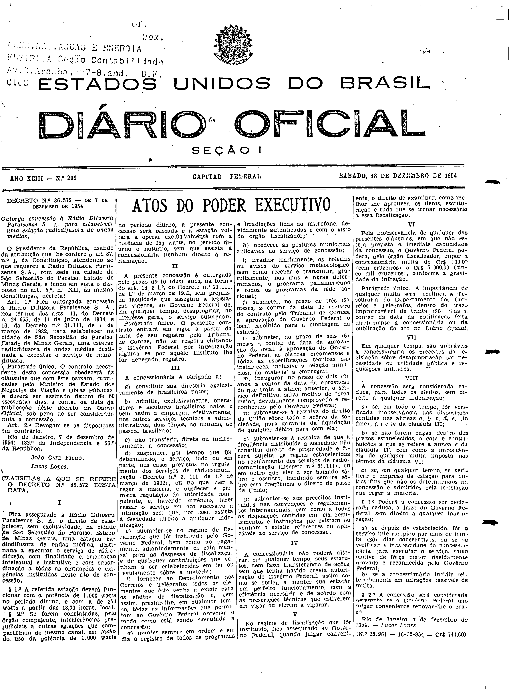

###DEC-036572-0-000-07-12-1954@@@

<strong>DECRETO Nº 36.572, DE 7 DE DEZEMBRO DE 1954.</strong>

<em><strong>Outorga concessão à Rádio Difusora Paraisense S.A. para estabelecer uma estação radiodifusora de ondas médias.</strong></em>

<strong>O PRESIDENTE DA REPÚBLICA</strong>, usando da atribuição que lhe confere o art. 87, nº I, da Constituição, atendendo ao que requereu a Rádio Difusora Paraisense S.A., com sede na cidade de São Sebastião do Paraíso, Estado de Minas Gerais, e tendo em vista o disposto no art. 5º,nº XII, da mesma Constituição,

<strong>DECRETA:</strong>

<strong>Art</strong>. 1º Fica outorgada concessão à Rádio Difusora Paraisense S.A., nos têrmos dos arts. 11, do Decreto nº 24.655, de 11 de julho de 1934, e 16 do Decreto nº 21.111, de 7 de março de 1932, para estabelecer na cidade de São Sebastião do Paraíso, Estado de Minas Gerais, uma estação radiodifusora de ondas médias destinada a executar o serviço de radiodifusão.

Parágrafo único. O contrato decorrente desta concessão obedecerá as cláusulas que com êste baixam, rubricadas pelo Ministro de Estado dos Negócios da Viação e Obras Públicas, e deverá ser assinado dentro de 60 (sessenta) dias, a contar da data da publicação dêste decreto no <em>Diário</em> <em>Oficial</em>, sob pena de ser considerada nula a concessão.

<strong>Art</strong>. 2º Revogam-se as disposições em contrário.

Rio de Janeiro, 7 de dezembro de 1954; 133º da Independência e 66º da República.

<strong>JOÃO CAFÉ FILHO</strong>

Lucas Lopes

<!-- fac-simile-oficial:inicio -->

## Fac-símile oficial: cláusulas

O texto acima não inclui as cláusulas a que se refere este decreto. A publicação oficial do anexo está em imagem, nas páginas do _Diário Oficial da União_ (Seção I) de 18 de dezembro de 1954: página 1 do PDF (capa do caderno) (a partir de CLÁUSULAS A QUE SE REFERE O DECRETO N.º 36.572, até N. 28.961).

As imagens são as páginas inteiras, tal como digitalizadas pela Imprensa Nacional, sem recorte, sem redesenho e sem transcrição. Cada página traz também outros atos do mesmo dia; a peça deste decreto está apenas no trecho indicado, e o texto do anexo só existe na imagem. Não há OCR validado.

Fonte: Imprensa Nacional, Biblioteca Machado de Assis, arquivo `DO_1_19541218_290.PDF` (SHA-256 `8840b006f23d0137165a102ba0e903a8e970650c0ddee87b8d8488ed32f870ba`), páginas 1 do PDF. SHA-256 das imagens, na ordem: `a703e04d9b16f2d8f99816be40d0ba18faa221d63c9bb08a85092da3965b9a21`.

<!-- fac-simile-oficial:fim -->
