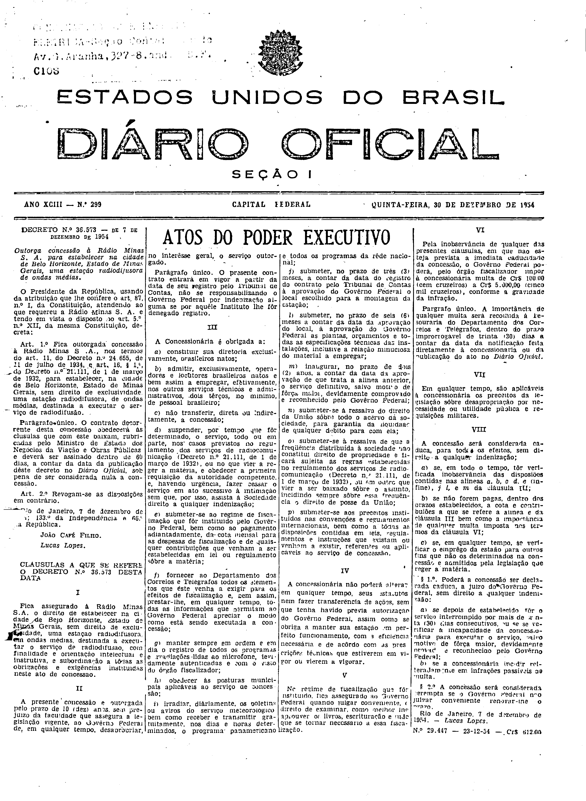

###DEC-036573-0-000-07-12-1954@@@

<strong>DECRETO Nº 36.573, DE 7 DE DEZEMBRO DE 1954.</strong>

<em><strong>Outorga concessão à Rádio Minas S. A. para estabelecer na cidade de Belo Horizonte, Estado de Minas Gerais, uma estação radiodifusora de ondas médias.</strong></em>

<strong>O PRESIDENTE DA REPÚBLICA</strong>, usando da atribuição que lhe confere o art. 87, nº I, da Constituição, atendendo ao que requereu a Rádio Minas S. A e tendo em vista o disposto no art. 5º, nº XII, da mesma Constituição,

<strong>DECRETA:</strong>

<strong>Art</strong>. 1º Fica outorgada concessão à Rádio Minas S. A, no têrmos do art. 11, do Decreto nº 24.655, de 11 de julho de1934, e art. 16, § 1º, do Decreto nº 21.111, de 1 de março de 1932, para estabelecer, na cidade de Belo Horizonte, Estado de Minas, sem direito de exclusividade, uma estação radiodifusora, de ondas médias, destinada a executar o serviço de radiodifusão.

Parágrafo único. O contrato decorrente desta concessão, obedecerá às cláusulas que com êste baixam, rubricadas pelo Ministro de Estado dos Negócios da Viação e Obras Públicas, e deverá ser assinado dentro de 60 dias, a contar da data da publicação dêste decreto no <em>Diário</em> <em>Oficial</em>, sob pena de ser considerada nula a concessão.

<strong>Art</strong>. 2º Revogam-se as disposições em contrário.

Rio de Janeiro, 7 de dezembro de 1954; 133º da Independência e 66º da República.

<strong>JOÃO CAFÉ FILHO</strong>

Lucas Lopes

<!-- fac-simile-oficial:inicio -->

## Fac-símile oficial: cláusulas

O texto acima não inclui as cláusulas a que se refere este decreto. A publicação oficial do anexo está em imagem, nas páginas do _Diário Oficial da União_ (Seção I) de 30 de dezembro de 1954: capa (1ª página do caderno, sem numeração impressa; página 1 do PDF) (a partir de CLÁUSULAS A QUE SE REFERE O DECRETO N.º 36.573, até N.º 29.447).

As imagens são as páginas inteiras, tal como digitalizadas pela Imprensa Nacional, sem recorte, sem redesenho e sem transcrição. Cada página traz também outros atos do mesmo dia; a peça deste decreto está apenas nas colunas indicadas, e o texto do anexo só existe na imagem. Não há OCR validado.

Fonte: Imprensa Nacional, Biblioteca Machado de Assis, arquivo `DO_1_19541230_299.PDF` (SHA-256 `6ac20cad77380849909a7b2381cb43b99477eec2780203db161b057589d9b03b`), páginas 1 do PDF. SHA-256 das imagens, na ordem: `a4a380c66b2a9458f2f7f426267bff99d67a3bacc77df743ca6b8383cc580d5f`.

<!-- fac-simile-oficial:fim -->
