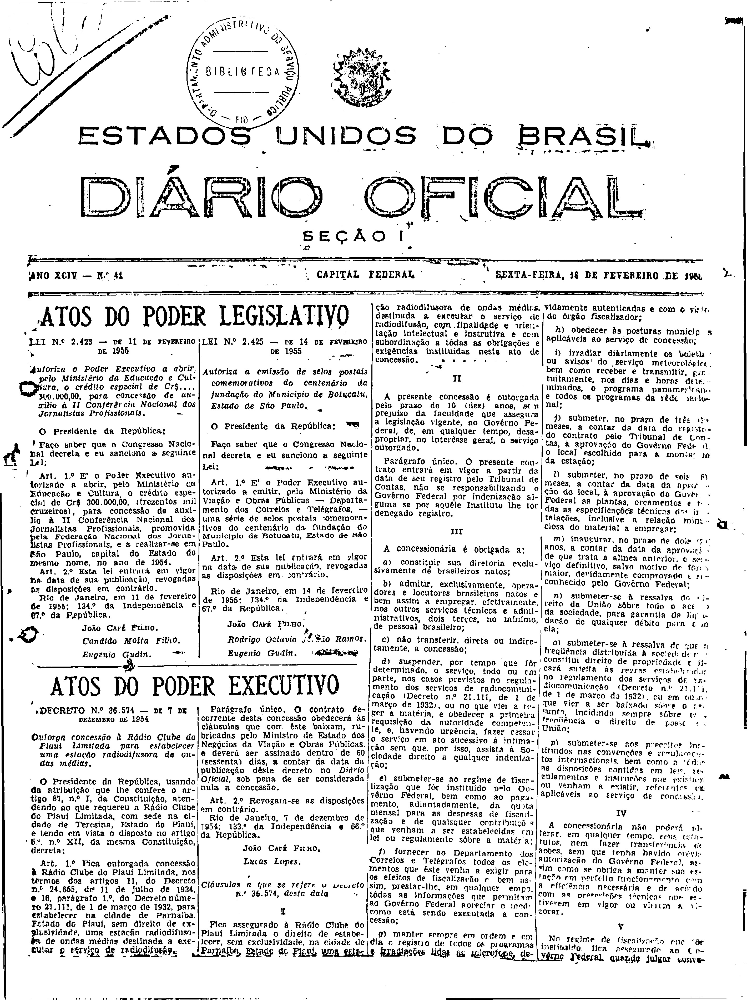
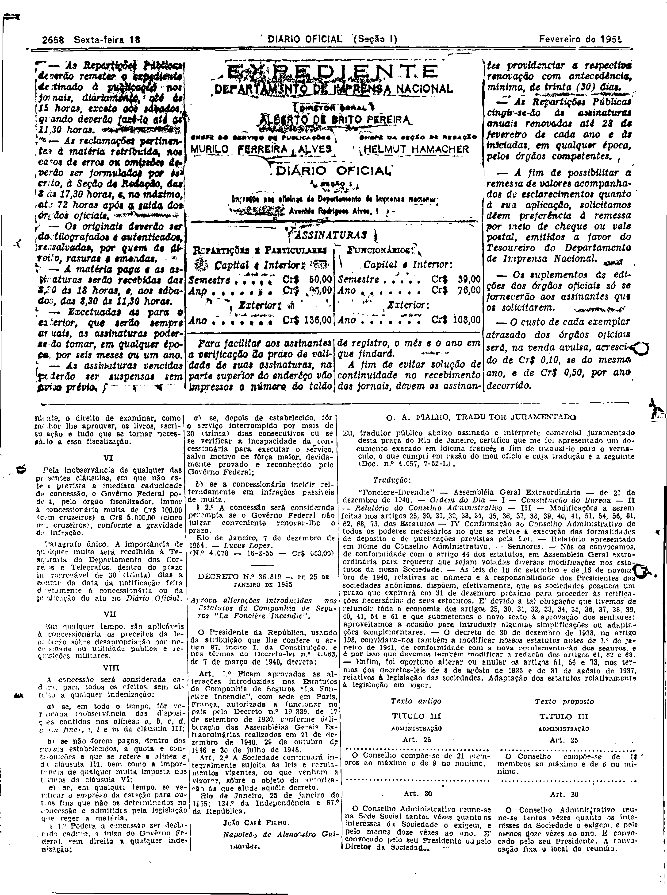

###DEC-036574-0-000-07-12-1954@@@

<strong>DECRETO N. 36.574 – DE 7 DE DEZEMBRO DE 1954</strong>

<em><strong>Outorga concessão à Radio Clube do Piauí Limitada para estabelecer uma estação radiodifusora de ondas médias.</strong></em>

O Presidente da República, usando da atribuição que lhe confere o artigo 87, nº I, da Constituição, atendendo ao que requereu a Rádio Clube do Piauí Limitada, com sede na cidade de Teresina, Estado do Piauí, e tendo em vista o disposto no artigo 5º, nº XII, da mesma Constituição,

<strong>DECRETA:</strong>

<strong>Art.</strong> 1º Fica outorgada concessão à Rádio Clube do Piauí Limitada, nos têrmos dos artigos 11, do Decreto nº 24.655, de 11 de Julho de 1934, e 16, parágrafo 1º, do Decreto número 21.111, de 1 de março de 1982, para estabelecer na cidade de Parnaíba, Estado do Piauí, sem direito de exclusividade, uma estação radiodifusora de ondas médias destinada a executar o serviço de radiodifusão.

Parágrafo único. O contrato decorrente desta concessão obedecerá às cláusulas que com êste baixam, rubricadas pelo Ministro de Estado dos Negócios da Viação e Obras Públicas, e deverá ser assinado dentro de 60 (sessenta) dias, a contar da data da publicação dêste decreto no Diário Oficial, sob pena de ser considerada nula a concessão.

<strong>Art.</strong> 2º Revogam-se as disposições em contrário.

Rio de Janeiro, 7 de dezembro de 1954; 133º da Independência e 66º da República.

<strong>JOÃO CAFÉ FILHO.</strong>

 Lucas Lopes.

<!-- fac-simile-oficial:inicio -->

## Fac-símile oficial: cláusulas

O texto acima não inclui as cláusulas a que se refere este decreto. A publicação oficial do anexo está em imagem, nas páginas do _Diário Oficial da União_ (Seção I) de 18 de fevereiro de 1955: página 1 do PDF (capa do caderno) (a partir de «Cláusulas a que se refere o decreto n.º 36.574, desta data»); página 2 do PDF (até «N.º 4.078 — 16-2-55 — Cr$ 663,00»).

As imagens são as páginas inteiras, tal como digitalizadas pela Imprensa Nacional, sem recorte, sem redesenho e sem transcrição. Cada página traz também outros atos do mesmo dia; a peça deste decreto está apenas no trecho indicado, e o texto do anexo só existe na imagem. Não há OCR validado.

Fonte: Imprensa Nacional, Biblioteca Machado de Assis, arquivo `DO_1_19550218_041.PDF` (SHA-256 `45e82debaf98a1bbe3b600ace18b5bb98933796f44e9f1849f3db1e4546511be`), páginas 1, 2 do PDF. SHA-256 das imagens, na ordem: `273e0f13ae9d4af8925c8f000c6a842b641e4fd348bd41122a9d31f4dba20f75`, `85ebc6cd67a70776e5ee4364c30f0411538b93cc812a855b891675f11215a7ed`.

<!-- fac-simile-oficial:fim -->
