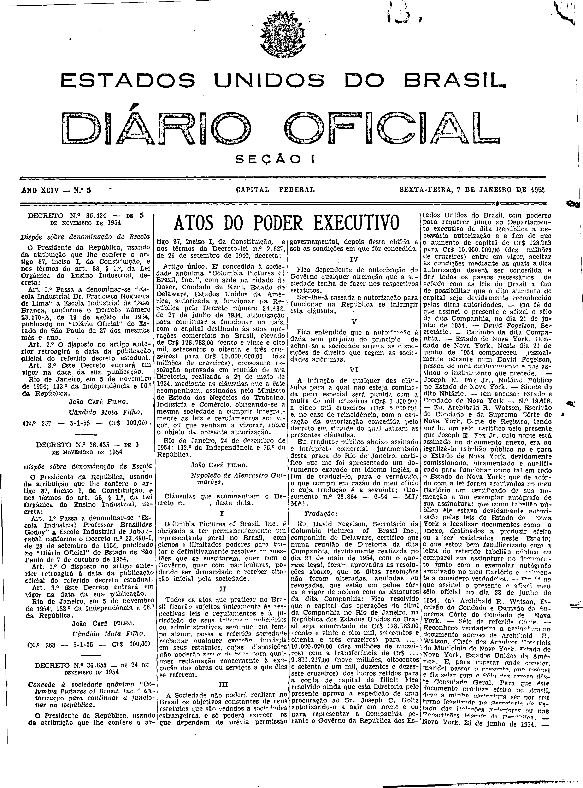
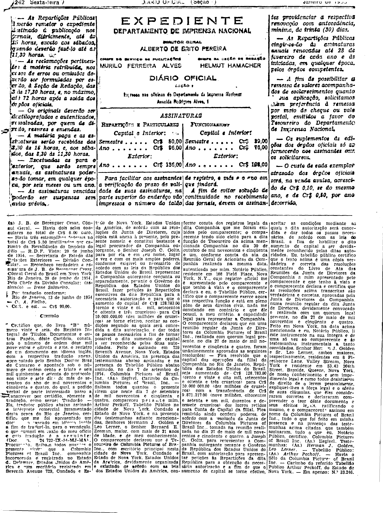
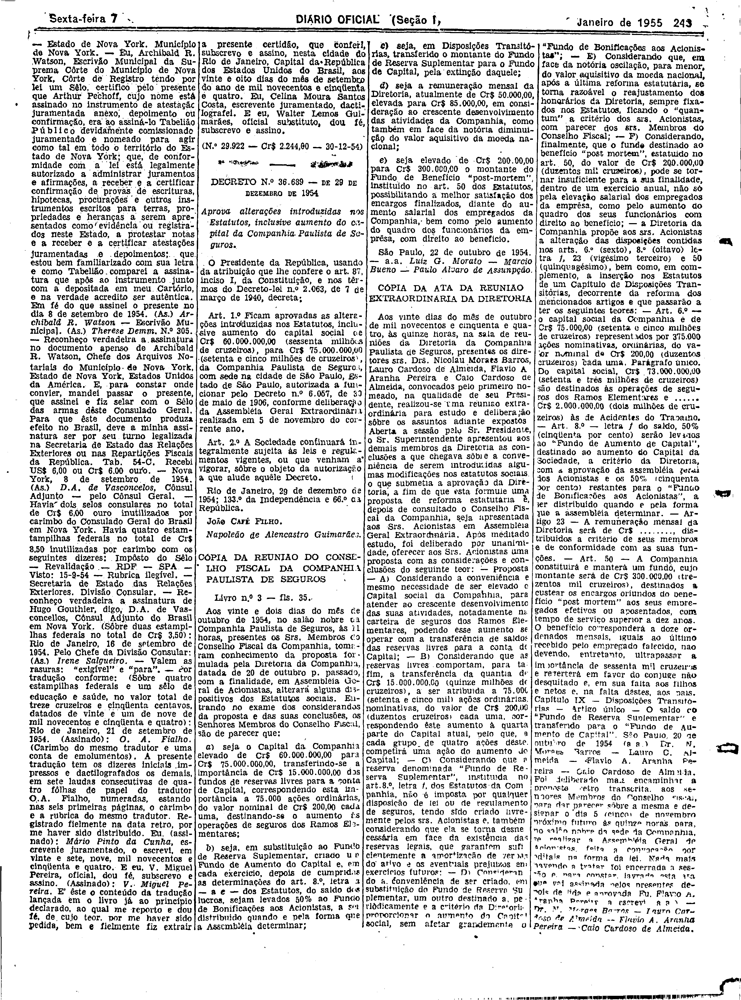

###DEC-036655-0-000-24-12-1954@@@

<strong>DECRETO N. 36.655 – DE 24 DE DEZEMBRO DE 1954</strong>

<em><strong>Concede à sociedade anônima "Columbia Pictures of Brazil, Inc.” autorização para continuar a funcionar na República.</strong></em>

O Presidente da República, usando da atribuição que lhe confere o artigo 87, inciso I, da Constituição, e nos têrmos do Decreto-lei nº 2.627 de 26 de setembro de 1940,

<strong>DECRETA:</strong>

<strong>Artigo único.</strong> E concedida à sociedade anônima “Columbia Pictures of Brazil, Inc.", com sede na cidade de Dover, Condado de Kent, Estado de Delaware, Estados Unidos da América, autorizada a funcionar na República pelo Decreto número 24.482, de 27 de junho de 1934, autorização para continuar a funcionar no país, com o capital destinado às suas operações comerciais no Brasil, elevado de Cr$ 128.783,00 (cento e vinte e oito mil, setecentos e oitenta e três cruzeiros) para Cr$ 10.000.000.00 (dez milhões de cruzeiros), consoante resolução aprovada em reunião de sua Diretoria, realizada a 27 de maio de 1954, mediante as cláusulas que a êste acompanham, assinadas pelo Ministro de Estado dos Negócios do Trabalho, Indústria e Comércio, obrigando-se a mesma sociedade a cumprir integralmente as leis e regulamentos em vigor, ou que venham a vigorar, sôbre o objeto da presente autorização.

Rio de Janeiro, 24 de dezembro de 1954; 133º da Independência e 66º da República.

<strong>JOÃO CAFÉ FILHO.</strong>

Napoleão de Alencastro Guimarães.

<!-- fac-simile-oficial:inicio -->

## Fac-símile oficial: cláusulas

O texto acima não inclui as cláusulas a que se refere este decreto. A publicação oficial do anexo está em imagem, nas páginas do _Diário Oficial da União_ (Seção I) de 7 de janeiro de 1955: página 1 do PDF (capa do caderno) (a partir de «Cláusulas que acompanham o Decreto n.º , desta data»); página 2 do PDF (continuação); página 3 do PDF (até «(N.º 29.922 — Cr$ 2.244,80 — 30-12-54)»).

As imagens são as páginas inteiras, tal como digitalizadas pela Imprensa Nacional, sem recorte, sem redesenho e sem transcrição. Cada página traz também outros atos do mesmo dia; a peça deste decreto está apenas no trecho indicado, e o texto do anexo só existe na imagem. Não há OCR validado.

Fonte: Imprensa Nacional, Biblioteca Machado de Assis, arquivo `DO_1_19550107_005.PDF` (SHA-256 `0dcb09192a196f407cfa9f760e82e300e0c6440bee9ca633da40a5d10cc66c25`), páginas 1, 2, 3 do PDF. SHA-256 das imagens, na ordem: `4db76e3033a1b04d8088a94bf6614a83cd35c48a00470fd1663b5e2603ea6288`, `ee2ea8f1b9fc273513f1017d50af6d39d1d13cce026543ee74d5ed54be43fc6f`, `44053fea49e9ada5613615ebb06614703cd7e3bf167b133e0e6edf51ca1640c0`.

<!-- fac-simile-oficial:fim -->
