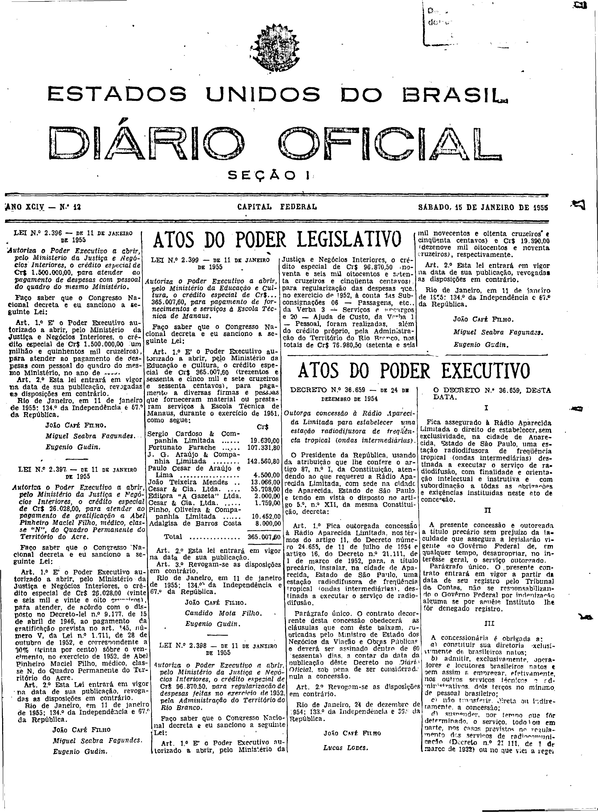
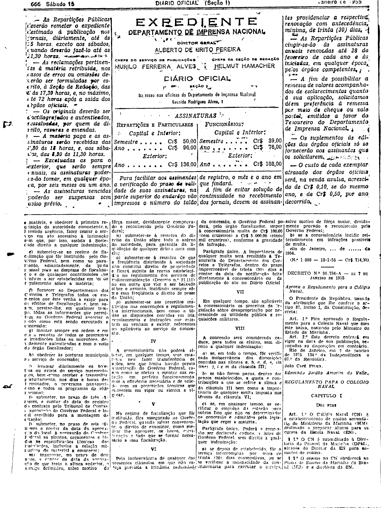

###DEC-036659-0-000-24-12-1954@@@

<strong>DECRETO N. 36.659 – DE 24 DE DEZEMBRO DE 1954</strong>

<em><strong>Outorga concessão à Rádio Aparecida da Limitada para estabelecer uma estação radiodifuzora de freqüência tropical (ondas intermediárias).</strong></em>

O Presidente da República, usando da atribuição que lhe confere o artigo 87, nº I, da Constituição, atendendo ao que requereu a Rádio Aparecida Limitada, com sede na cidade de Aparecida, Estado de São Paulo, e tendo em vista o disposto no artigo 5º, nº XII, da mesma Constituição,

<strong>DECRETA:</strong>

<strong>Art.</strong> 1º Fica outorgada concessão à Rádio Aparecida Limitada, nos têrmos do artigo 11, do Decreto número 24.655, de 11 de julho de 1954 e artigo 18, do Decreto nº 21.111, de 1 de março de 1952, para, a título precário, instalar, na cidade de Aparecida, Estado de São Paulo, uma estação radiodifusora de freqüência tropical (ondas intermediárias), destinada a executar o serviço de radiodifusão.

Parágrafo único. O contrato decorrente desta concessão  obedecerá às Cláusulas que com êste baixam, rubricadas pelo Ministro de Estado dos Negócios da Viação e Obras Públicas, e deverá ser assinado dentro de 60 (sessenta) dias, a contar da data da publicação dêste Decreto no Diário Oficial, sob pena de ser considerada nula a concessão.

<strong>Art.</strong> 2º Revogam-se as disposições em contrário.

Rio de Janeiro, 24 de dezembro de 1954; 133º da Independência e 66º da República.

<strong>JOÃO CAFÉ FILHO.</strong>

Lucas Lopes.

<!-- fac-simile-oficial:inicio -->

## Fac-símile oficial: cláusulas

O texto acima não inclui as cláusulas a que se refere este decreto. A publicação oficial do anexo está em imagem, nas páginas do _Diário Oficial da União_ (Seção I) de 15 de janeiro de 1955: página 1 do PDF (capa do caderno) (a partir de «O DECRETO N.º 36.659, DESTA DATA», início da cláusula I); página 2 do PDF (até «N.º 1.059 — 13-1-55 — Cr$ 714,00»).

As imagens são as páginas inteiras, tal como digitalizadas pela Imprensa Nacional, sem recorte, sem redesenho e sem transcrição. Cada página traz também outros atos do mesmo dia; a peça deste decreto está apenas no trecho indicado, e o texto do anexo só existe na imagem. Não há OCR validado.

Fonte: Imprensa Nacional, Biblioteca Machado de Assis, arquivo `DO_1_19550115_012.PDF` (SHA-256 `8228b54ad757b1f80465bdec6ad19a987ab349f0e81ec0a164119f36e58736b8`), páginas 1, 2 do PDF. SHA-256 das imagens, na ordem: `4ba429ef6f2f4c3304cfa6a7fcfc5eeda88443a511e3cee5b20a4762291ee8f7`, `4d30ee85c8b7ecf73a28e9462d6b5e87a502b8ed34e20f8648a978f072b41ba5`.

<!-- fac-simile-oficial:fim -->
