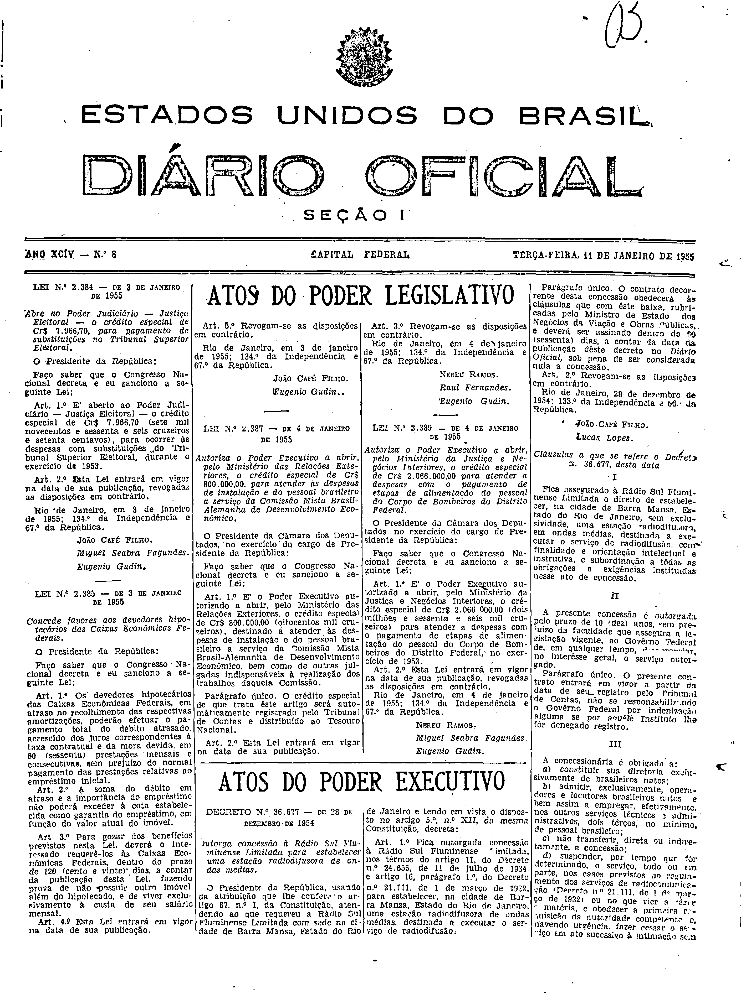
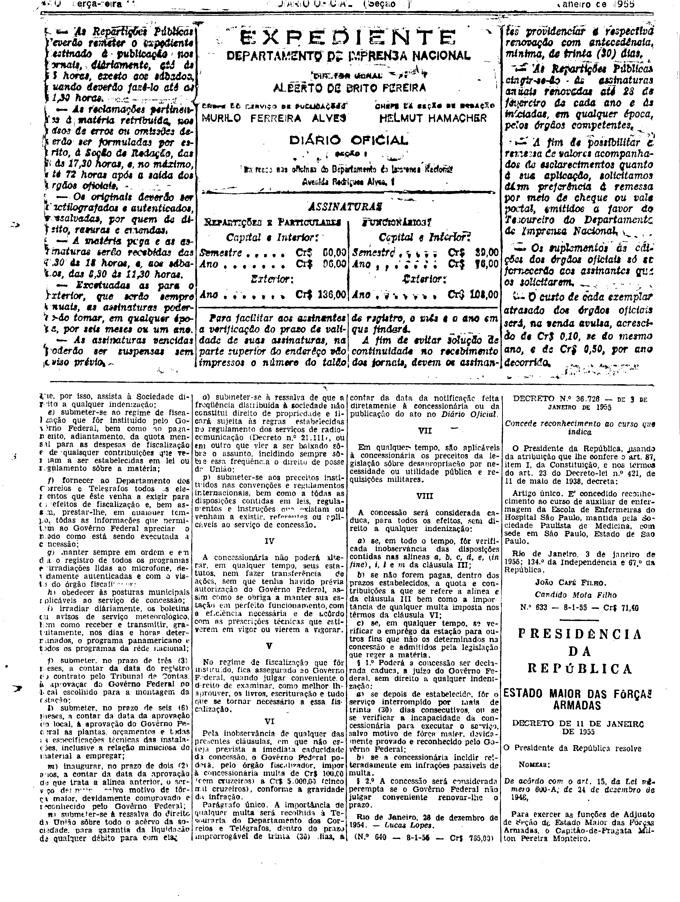

###DEC-036677-0-000-28-12-1954@@@

<strong>DECRETO N. 36.677 – DE 28 DE DEZEMBRO DE 1954</strong>

<em><strong>Outorga concessão à Rádio Sul Fluminense Limitada para estabelecer uma estação radiodifusora de ondas médias.</strong></em>

O Presidente da República, usando da atribuição que lhe confere o artigo 87, nº I, da Constituição, atendendo ao que requereu a Rádio Sul Fluminense Limitada com sede na cidade de Barra Mansa, Estado do Rio de Janeiro e tendo em vista o disposto no artigo 5º, nº XII, da mesma Constituição,

<strong>DECRETA:</strong>

<strong>Art.</strong> 1º Fica outorgada concessão à Rádio Sul Fluminense Limitada, nos têrmos do artigo 11, do Decreto nº 24.655, de 11 de julho de 1984. e artigo 16, parágrafo 1º, do Decreto nº 21.111, de 1 de março de 1932, para estabelecer, na cidade de Barra Mansa, Estado do Rio de Janeiro, uma estação radiodifusora de ondas médias, destinada a executar o serviço de radiodifusão.

Parágrafo único. O contrato decorrente desta concessão obedecerá às cláusulas que com êste baixa, rubricadas pelo Ministro de Estado dos Negócios da Viação e Obras Públicas, e deverá ser assinado dentro de 60 (sessenta) dias, a contar da data da publicação dêste decreto no Diário Oficial, sob pena de ser considerada nula a concessão.

<strong>Art.</strong> 2º Revogam-se as disposições em contrário.

Rio de Janeiro, 20 de dezembro de 1954; 133º da Independência e 66º da República.

<strong>JOÃO CAFÉ FILHO.</strong>

Lucas Lopes.

<!-- fac-simile-oficial:inicio -->

## Fac-símile oficial: cláusulas

O texto acima não inclui as cláusulas a que se refere este decreto. A publicação oficial do anexo está em imagem, nas páginas do _Diário Oficial da União_ (Seção I) de 11 de janeiro de 1955: capa (1ª página do caderno, sem numeração impressa; página 1 do PDF) (a partir de «Cláusulas a que se refere o Decreto n.º 36.677, desta data»); página 2 do PDF (numeração impressa ilegível na imagem) (até «N.º 640 — 8-1-55 — Cr$ 765,00»).

As imagens são as páginas inteiras, tal como digitalizadas pela Imprensa Nacional, sem recorte, sem redesenho e sem transcrição. Cada página traz também outros atos do mesmo dia; a peça deste decreto está apenas nas colunas indicadas, e o texto do anexo só existe na imagem. Não há OCR validado.

Fonte: Imprensa Nacional, Biblioteca Machado de Assis, arquivo `DO_1_19550111_008.PDF` (SHA-256 `52c960cb4ae1fda1e36bf856e3791b82f3db171ec2b86a00920df957d3251823`), páginas 1, 2 do PDF. SHA-256 das imagens, na ordem: `35bc897140fed75c17259fb00498afbdae6a7827a666f0110eae3ee6ac375871`, `4f9cdcc0c62c42069ae780c117df26f283b52e51b6b236c86238858c91ea8d89`.

<!-- fac-simile-oficial:fim -->
