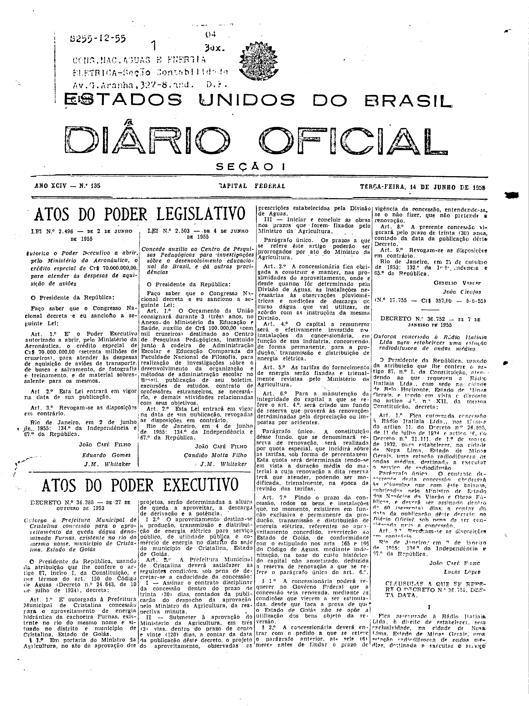
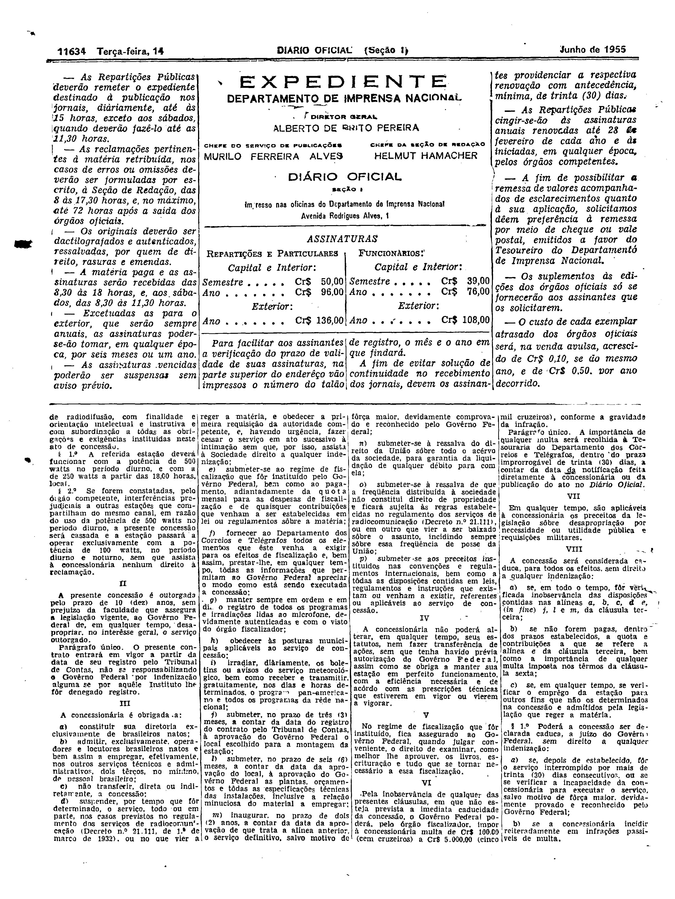

###DEC-036752-0-000-07-01-1955@@@

<strong>DECRETO Nº 36.752, DE 7 DE JANEIRO DE 1955.</strong>

<em><strong>Outorga concessão à Rádio Itatiaia Ltda para estabelecer uma estação ridiodifusora de ondas médias</strong></em>

<strong>O PRESIDENTE DA REPÚBLICA</strong>, usando da atribuição que lhe confere o artigo 87, nº I, da Constituição, atendendo ao que requereu a Rádio Itatiaia Ltda., com sede na cidade de Belo Horizonte, Estado de Minas Gerais, e tendo em vista o disposto no artigo 5º, nº XII, da mesma Constituição,

<strong>DECRETA:</strong>

<strong>Art</strong>. 1º Fica outorgada concessão à Rádio Itatiaia Ltda. nos têrmos do artigo 11 do Decreto nº 24.655 11 de julho de 1934 e artigo 16, do Decreto nº 21.111, de 1º de março de 1932, para estabelecer, na cidade de Nova Lima, Estado de Minas Gerais, uma estação radiodifusora de ondas médias, destinada a executar o serviço de radiodifusão

Parágrafo único. O contrato decorrente desta concessão obedecera às cláusulas que com êste baixam, rubricadas pelo Ministro de Estado dos Negócios da Viação e Obras Públicas, e deverá ser assinado dentro de 60 (sessenta) dias, a contar da data da publicação dêste Decreto no <em>Diário Oficial,</em> sob pena de ser considerada nula a concessão.

<strong>Art</strong>. 2º Revogam-se as disposições em contrário.

Rio de Janeiro, em 7 de janeiro de 1955; 134º da Independência e 67º da República.

<strong>JOÃO CAFÉ FILHO</strong>

Lucas Lopes

<!-- fac-simile-oficial:inicio -->

## Fac-símile oficial: cláusulas

O texto acima não inclui as cláusulas a que se refere este decreto. A publicação oficial do anexo está em imagem, nas páginas do _Diário Oficial da União_ (Seção I) de 14 de junho de 1955: página 1 do PDF (capa do caderno) (a partir de «CLÁUSULAS A QUE SE REFERE O DECRETO N.º 36.752, DESTA DATA»); página 2 do PDF (cláusulas II a VIII); página 3 do PDF (até «N.º 17.771 — Cr$ 765,00 — 8-6-55»).

As imagens são as páginas inteiras, tal como digitalizadas pela Imprensa Nacional, sem recorte, sem redesenho e sem transcrição. Cada página traz também outros atos do mesmo dia; a peça deste decreto está apenas no trecho indicado, e o texto do anexo só existe na imagem. Não há OCR validado.

Fonte: Imprensa Nacional, Biblioteca Machado de Assis, arquivo `DO_1_19550614_135.PDF` (SHA-256 `69dfffc9df246c3cf27264ea15114803265aa1e91610363f12951c6d565f0705`), páginas 1, 2, 3 do PDF. SHA-256 das imagens, na ordem: `3ae2ddb30a051d31ccc73831eaaedbc0bf49571750829707cda87f4c690f8f19`, `cb7226985a10abf4f9ef937983b5183c479ddbcdb38df1f573268da02a7c1418`, `44dee6e3f8dd9974e103bc61a1430806b6d80b6d38a9f0002b0b76f3c5cdaca7`.

<!-- fac-simile-oficial:fim -->
