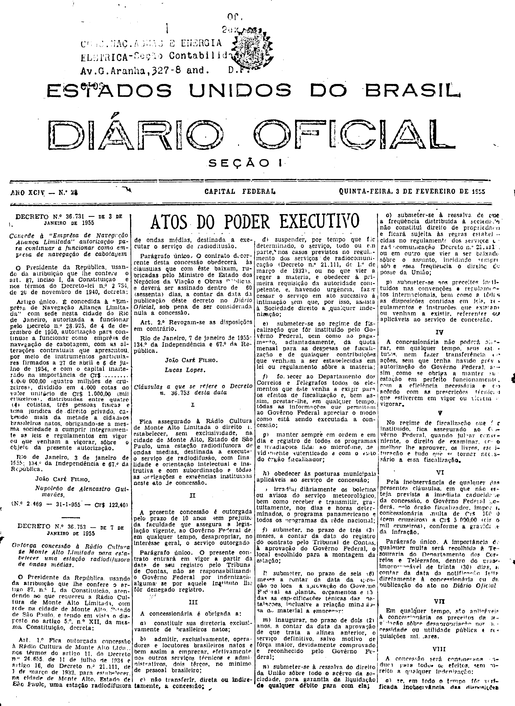
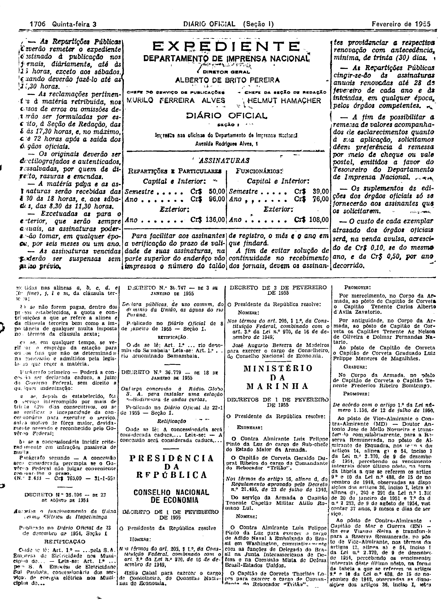

###DEC-036753-0-000-07-01-1955@@@

<strong>DECRETO Nº 36.753, DE 7 DE JANEIRO DE 1955.</strong>

<em><strong>Outorga concessão à Rádio Cultura de Monte Alto Limitada para estabelecer uma estação radiodifusora de ondas médias.</strong></em>

<strong>O PRESIDENTE DA REPÚBLICA</strong>, usando da atribuição que lhe confere o artigo 87, nº I, da Constituição atendendo ao que requereu a Rádio Cultura de Monte Alto Limitada com sede na cidade de Monte Alto, Estado de São Paulo, e tendo em vista o disposto no artigo 5º, nº XII, da mesma Constituição,

<strong>DECRETA:</strong>

<strong>Art</strong>. 1º Fica outorgada concessão à Rádio Cultura de Monte Alto Ltda nos têrmos do artigo 11, do Decreto nº 24.655, de 11 de julho de 1934 e artigo 16, do Decreto nº 21.111, de 1 de março de 1932, para estabelecer, na cidade de Monte Alto, Estado de São Paulo, uma estação radiodifusora de ondas médias, destinada a executar o serviço de radiodifusão.

Parágrafo único. O contrato decorrente desta concessão obedecerá às cláusulas que com êste baixam, rubricadas pelo Ministro de Estado dos Negócios da Viação e Obras Públicas, e deverá ser assinado dentro de 60 (sessenta) dias, a contar da data da publicação dêste decreto no <em>Diário Oficial</em>, sob pena de ser considerada nula a concessão.

<strong>Art</strong>. 2º Revogam-se as disposições em Contrário.

Rio de Janeiro, 7 de janeiro de 1955; 134º da Independência e 67º da República.

<strong>JOÃO CAFÉ FILHO</strong>

Lucas Lopes

<!-- fac-simile-oficial:inicio -->

## Fac-símile oficial: cláusulas

O texto acima não inclui as cláusulas a que se refere este decreto. A publicação oficial do anexo está em imagem, nas páginas do _Diário Oficial da União_ (Seção I) de 3 de fevereiro de 1955: capa (1ª página do caderno, sem numeração impressa; página 1 do PDF) (a partir de «Cláusulas a que se refere o Decreto n. 36.753 desta data»); p. 1706 (até «N.º 2.433 — Cr$ 765,00 — 31-1-55»).

As imagens são as páginas inteiras, tal como digitalizadas pela Imprensa Nacional, sem recorte, sem redesenho e sem transcrição. Cada página traz também outros atos do mesmo dia; a peça deste decreto está apenas nas colunas indicadas, e o texto do anexo só existe na imagem. Não há OCR validado.

Fonte: Imprensa Nacional, Biblioteca Machado de Assis, arquivo `DO_1_19550203_028.PDF` (SHA-256 `d45a7010523fa8b4f9adb3ed26521d80038522deb47f192e030e9a67dc2662e0`), páginas 1, 2 do PDF. SHA-256 das imagens, na ordem: `a125144e087067e1c2de7812d12e7c4d386cc0844a8302c8df9f031d6ef48285`, `5a1ef9fbc1d2937ea683d4e59be08c8dcb00ffbdc20b55239f14b2132e1dc243`.

<!-- fac-simile-oficial:fim -->
