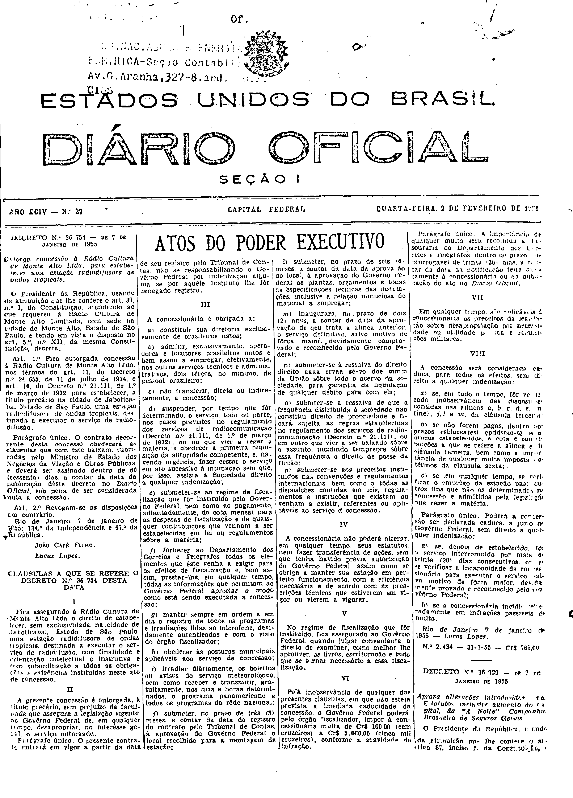

###DEC-036754-0-000-07-01-1955@@@

<strong>DECRETO Nº 36.754, DE 7 DE JANEIRO DE 1955.</strong>

<em><strong>Outorga concessão à Rádio Cultura de Monte Alto Ltda. para estabelecer uma estação radiodifusora de ondas tropicais.</strong></em>

<strong>O PRESIDENTE DA REPÚBLICA</strong>, usando da atribuição que lhe confere o art. 87, nº I, da Constituição, atendendo ao que requereu à Rádio Cultura de Monte Alto Limitada, com sede na cidade de São Paulo, e tendo em vista o disposto no art. 5º, nº XII da mesma Constituição,

<strong>DECRETA:</strong>

<strong>Art</strong>. 1º Fica outorgada a concessão à Rádio Cultura de Monte Alto Ltda. nos têrmos do art. 11, do Decreto nº 24.655, de 11 de julho de 1934, e do art. 16 do Decreto nº 21.111, de 1º de março de 1932, para estabelecer, a título precário da cidade de Jaboticabal, Estado de São Paulo, uma estação radiodifusora de ondas tropicais, destinada a executar o serviço de radiodifusão.

Parágrafo único. O contrato decorrente desta concessão obedecerá às clausulas que com êste baixam, rubricadas pelo Ministro de Estado dos Negócios e da Viação e Obras Públicas, e deverá ser assinado dentro de 60 (sessenta) dias a contar da data de publicação dêste decreto no <em>Diário Oficial</em>, sob pena de ser considerada nula a concessão.

<strong>Art</strong>. 2º Revogam-se as disposições em contrário.

Rio de Janeiro, 7 de janeiro de 1955; 134º da Independência e 67º da República.

<strong>JOÃO CAFÉ FILHO</strong>

Lucas Lopes

<!-- fac-simile-oficial:inicio -->

## Fac-símile oficial: cláusulas

O texto acima não inclui as cláusulas a que se refere este decreto. A publicação oficial do anexo está em imagem, nas páginas do _Diário Oficial da União_ (Seção I) de 2 de fevereiro de 1955: capa (1ª página do caderno, sem numeração impressa; página 1 do PDF) (de «CLÁUSULAS A QUE SE REFERE O DECRETO N.º 36.754 DESTA DATA» até «N.º 2.434 — 31-1-55 — Cr$ 765,00»).

As imagens são as páginas inteiras, tal como digitalizadas pela Imprensa Nacional, sem recorte, sem redesenho e sem transcrição. Cada página traz também outros atos do mesmo dia; a peça deste decreto está apenas nas colunas indicadas, e o texto do anexo só existe na imagem. Não há OCR validado.

Fonte: Imprensa Nacional, Biblioteca Machado de Assis, arquivo `DO_1_19550202_027.PDF` (SHA-256 `5727577dd3fb9f1b0aa4e8e4c0ef11a7ac0cf9a0f655c5da6c9d41b8017e7624`), páginas 1 do PDF. SHA-256 das imagens, na ordem: `db5497a290a4dbab6b3a7849a8b076f89439c2f83e46adcde7d917b94b35c264`.

<!-- fac-simile-oficial:fim -->
