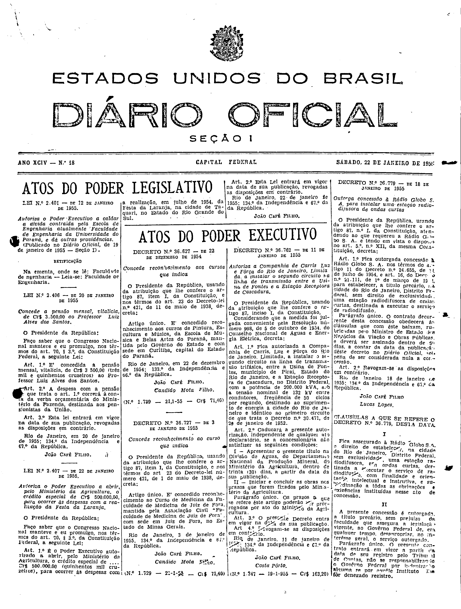
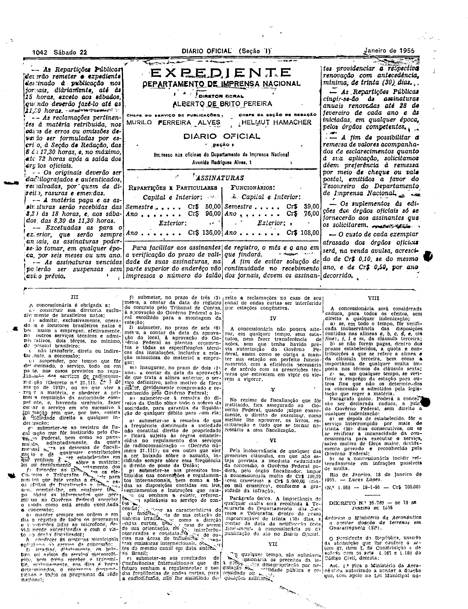

###DEC-036779-0-000-18-01-1955@@@

<strong>DECRETO Nº 36.779, DE 18 DE JANEIRO DE 1955.</strong>

<em><strong>Outorga concessão à Rádio Globo S.A. para estabelecer uma estação radiodifusora de ondas curtas.</strong></em>

<strong>O PRESIDENTE DA REPÚBLICA</strong>, usando da atribuição que lhe confere o art. 87, nº I, da Constituição, atendendo ao que requereu à Rádio Globo S.A., e tendo em vista o disposto no art. 5º, nº XII da mesma Constituição,

<strong>DECRETA:</strong>

<strong>Art</strong>. 1º Fica outorgada a concessão à Rádio Globo S.A. nos têrmos do art. 11, do Decreto nº 24.655, de 11 de julho de 1934, e do art. 16 do Decreto nº 21.111, de 1º de março de 1932, para estabelecer, a título precário da cidade de Rio de Janeiro, Distrito Federal, sem direito de exclusividade, uma estação radiodifusora de ondas curtas, destinada a executar o serviço de radiodifusão.

Parágrafo único. O contrato decorrente desta concessão obedecerá às clausulas que com êste baixam, rubricadas pelo Ministro de Estado dos Negócios e da Viação e Obras Públicas, e deverá ser assinado dentro de 60 dias, a contar da data de publicação dêste decreto no <em>Diário Oficial</em>, sob pena de ser considerada nula a concessão.

<strong>Art</strong>. 2º Revogam-se as disposições em contrário.

Rio de Janeiro, 18 de janeiro de 1955; 134º da Independência e 67º da República.

<strong>JOÃO CAFÉ FILHO</strong>

Lucas Lopes

<!-- fac-simile-oficial:inicio -->

## Fac-símile oficial: cláusulas

O texto acima não inclui as cláusulas a que se refere este decreto. A publicação oficial do anexo está em imagem, nas páginas do _Diário Oficial da União_ (Seção I) de 22 de janeiro de 1955: capa (1ª página do caderno, sem numeração impressa; página 1 do PDF) (a partir de «CLÁUSULAS A QUE SE REFERE O DECRETO N.º 36.779, DESTA DATA»); p. 1042 (até «N.º 1.668 — 19-1-55 — Cr$ 765,00»).

As imagens são as páginas inteiras, tal como digitalizadas pela Imprensa Nacional, sem recorte, sem redesenho e sem transcrição. Cada página traz também outros atos do mesmo dia; a peça deste decreto está apenas nas colunas indicadas, e o texto do anexo só existe na imagem. Não há OCR validado.

Fonte: Imprensa Nacional, Biblioteca Machado de Assis, arquivo `DO_1_19550122_018.PDF` (SHA-256 `0464708c81473c26ab65b396a774f716639667923175799ae3cb2a8347166b3c`), páginas 1, 2 do PDF. SHA-256 das imagens, na ordem: `08f857529947d82262d871136cc068d9e2c7a366fa50ede12f3738baa7fdacb4`, `80ecb5fd79a13d1bc07b4d89f77a8875bef98a6e7ee514b49b772dc6b9bcc07a`.

<!-- fac-simile-oficial:fim -->
