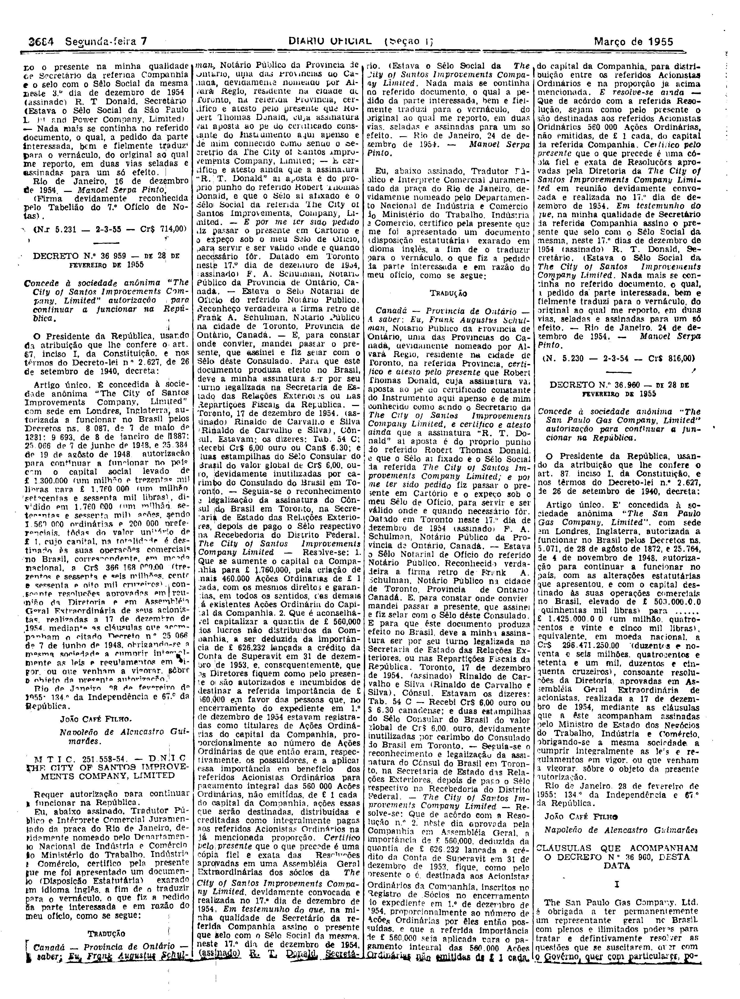
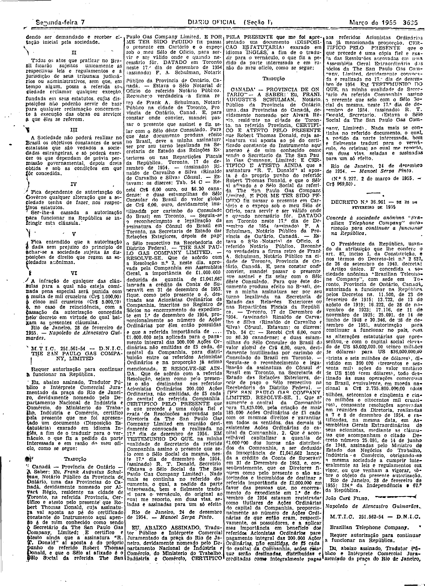

###DEC-036960-0-000-28-02-1955@@@

<strong>DECRETO Nº 36.960, DE 28 DE FEVEREIRO DE 1955.</strong>

<em><strong>Concede à sociedade anônima “The San Paulo Gas Company, Limited” autorização para continuar a funcionar na República.</strong></em>

<strong>O PRESIDENTE DA REPÚBLICA</strong>, usando da atribuição que lhe confere o art. 87, inciso I, da Constituição, e nos têrmos do Decreto-lei nº 2.627, de 26 de setembro de 1940,

<strong>DECRETA:</strong>

Artigo único. É concedida à sociedade anônima “<em>The San Paulo Gas Company, Limited</em>”, com sede em Londres, Inglaterra, autorizada a funcionar no Brasil pelos Decretos ns. 5.071, de 28 de agôsto de 1872, e 25.764, de 4 de novembro de 1948, autorização para continuar a funcionar no país, com as alterações estatutárias que apresentou, e com o capital destinado às suas operações comerciais no Brasil, elevado de £ 500.000.00 (quinhentas mil libras) para £ 1.425.000.00 (um milhão, quatrocentos e vinte e cinco mil libras), equivalente, em moeda nacional, a Cr$296.471.250,00 (duzentos e noventa e seis milhões, quatrocentos e setenta e um mil, duzentos e cinquenta cruzeiros), consoante resoluções da Diretoria, aprovadas em Assembléia Geral Extraordinária de acionistas, realizada a 17 de dezembro de 1954, mediante as cláusulas que a êste acompanham assinadas pelo Ministro de Estado dos Negócios do Trabalho, Indústria e Comércio, obrigando-se a mesma sociedade a cumprir integralmente as leis e regulamentos em vigor, ou que venham a vigorar, sôbre o objeto da presente autorização.

Rio de Janeiro, 28 de fevereiro de 1955; 134º da Independência e 67º da República.

<strong>JOAO CAFÉ FILHO</strong>

Napoleão de Alencastro Guimarães

<!-- fac-simile-oficial:inicio -->

## Fac-símile oficial: cláusulas

O texto acima não inclui as cláusulas a que se refere este decreto. A publicação oficial do anexo está em imagem, nas páginas do _Diário Oficial da União_ (Seção I) de 7 de março de 1955: página 4 do PDF (a partir de «CLÁUSULAS QUE ACOMPANHAM O DECRETO N.º 36.960, DESTA DATA»); página 5 do PDF (continuação, até «(N.º 5.227. 2 de março de 1955. — Cr$ 969,00)»).

As imagens são as páginas inteiras, tal como digitalizadas pela Imprensa Nacional, sem recorte, sem redesenho e sem transcrição. Cada página traz também outros atos do mesmo dia; a peça deste decreto está apenas no trecho indicado, e o texto do anexo só existe na imagem. Não há OCR validado.

Fonte: Imprensa Nacional, Biblioteca Machado de Assis, arquivo `DO_1_19550307_054.PDF` (SHA-256 `b5142c5c6c75b90c25be6d07af3307f114cef77fa6a50268cf01f725359abc65`), páginas 4, 5 do PDF. SHA-256 das imagens, na ordem: `cebeb980254dddf9d064a1614ccc490f766781cdd5a0744db6d5c2321eeea4d4`, `fe9ef5e8130546fbc41cef50f8e362c25e38c092427f2c8e2ee5786bd18e6303`.

<!-- fac-simile-oficial:fim -->
