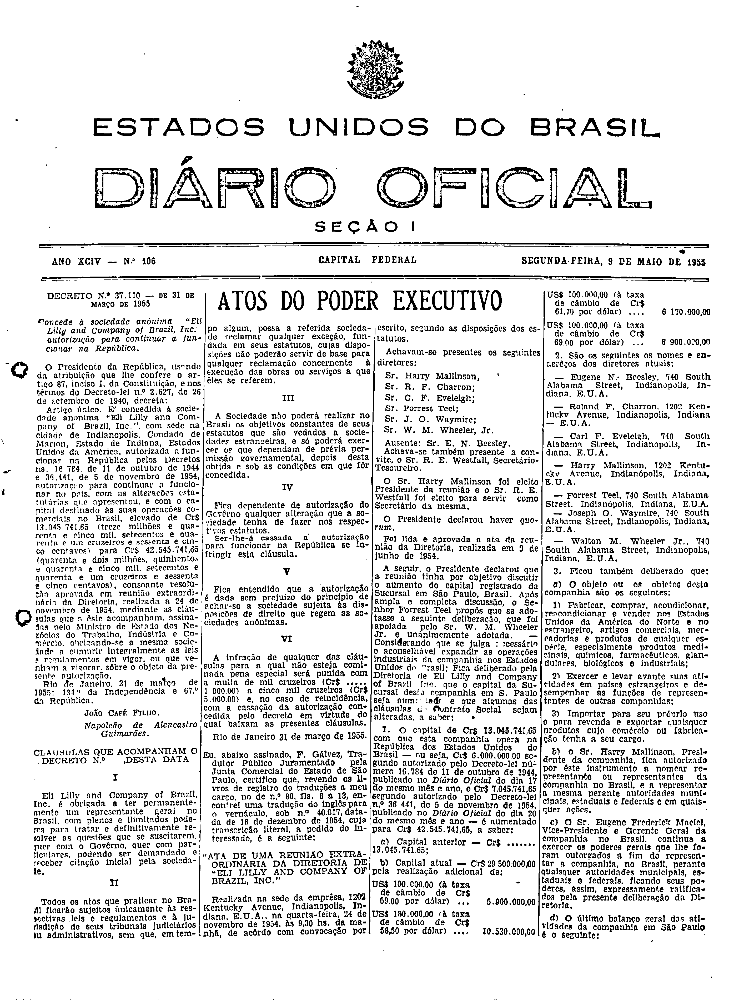
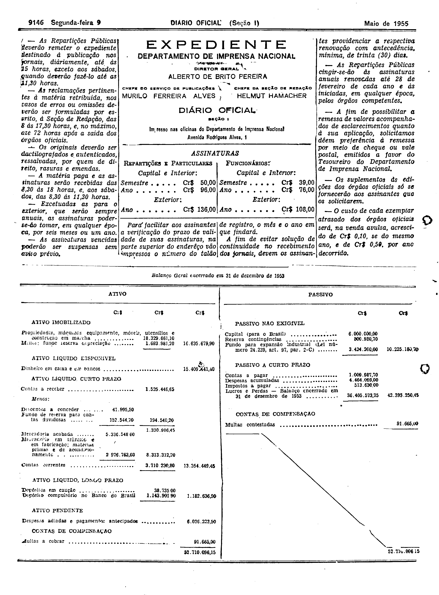
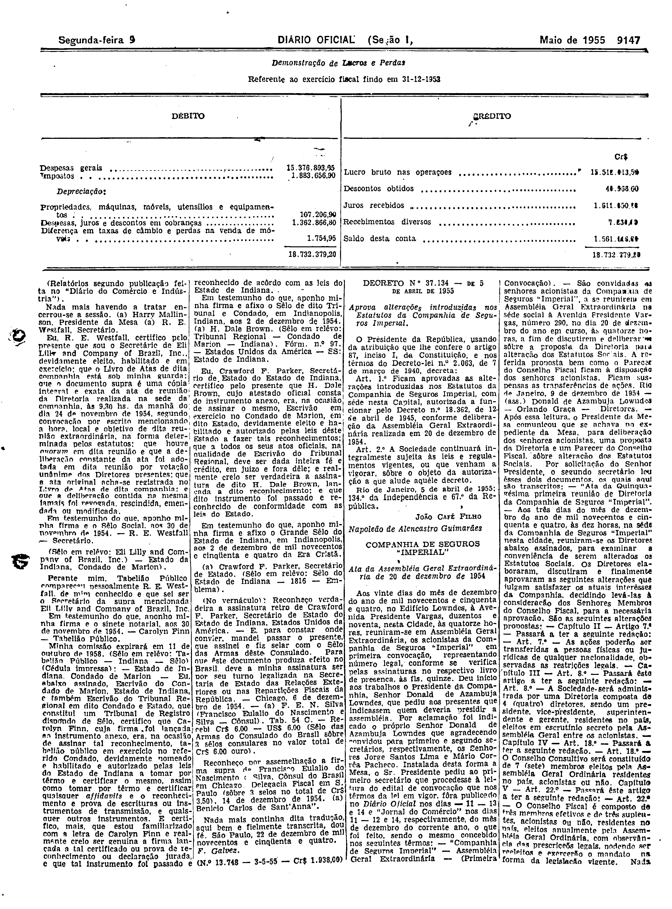

###DEC-037110-0-000-31-03-1955@@@

<strong>DECRETO Nº 37.110, DE 31 DE MARÇO DE 1955.</strong>

<em><strong>Concede à sociedade anônima “Eli Lilly and Company of Brasil, Inc." autorização para continuar a funcionar na República.</strong></em>

<strong>O PRESIDENTE DA REPÚBLICA</strong>, usando da atribuição que lhe confere o artigo 87, inciso I, da Constituição, e nos têrmos do Decreto-lei nº 2.627, de 26 de setembro de 1940,

<strong>DECRETA:</strong>

Artigo único. É concedida à sociedade anônima “<em>Eli LillY and Company of Brasil, Inc</em>”. com sede na cidade de Indianópolis, <em>Condado de Marion</em>, Estado de Indiana, Estados Unidos da América, autorizada a funcionar na República pelos Decretos ns. 16.784, de 11 de outubro de 1944 e 36.441, de 5 de novembro de 1954, autorização para continuar a funcionar no País, com as alterações estatuárias que apresentou, e com o capital destinado às suas operações comerciais no Brasil, elevado de Cr$13.045.741,65 (treze milhões e quarenta e cinco mil, setecentos e quarenta e um cruzeiros e sessenta e cinco centavos) para Cr$42.545.741,65 (quarenta e dois milhões, quinhentos e quarenta e cinco mil, setecentos e quarenta e um cruzeiros e sessenta e cinco centavos), consoante resolução aprovada em reunião extraordinária da Diretoria, realizada a 24 de novembro de 1954, mediante as cláusulas que a êste acompanham, assinadas pelo Ministro de Estado dos Negócios do Trabalho, Indústria e Comércio, obrigando-se a mesma sociedade a cumprir integramente as leis e regulamentos em vigor sôbre o objeto da presente autorização.

Rio de Janeiro, 31 de março de 1955; 134º da Independência e 67º da República.

<strong>JOÃO CAFÉ FILHO</strong>

Napoleão de Alencastro Guimarães

<!-- fac-simile-oficial:inicio -->

## Fac-símile oficial: cláusulas

O texto acima não inclui as cláusulas a que se refere este decreto. A publicação oficial do anexo está em imagem, nas páginas do _Diário Oficial da União_ (Seção I) de 9 de maio de 1955: página 1 do PDF (capa do caderno) (a partir de «CLÁUSULAS QUE ACOMPANHAM O DECRETO N.º , DESTA DATA»); página 2 do PDF (continuação); página 3 do PDF (até «(N.º 13.748 — 3-5-55 — Cr$ 1.938,00)»).

As imagens são as páginas inteiras, tal como digitalizadas pela Imprensa Nacional, sem recorte, sem redesenho e sem transcrição. Cada página traz também outros atos do mesmo dia; a peça deste decreto está apenas no trecho indicado, e o texto do anexo só existe na imagem. Não há OCR validado.

Fonte: Imprensa Nacional, Biblioteca Machado de Assis, arquivo `DO_1_19550509_106.PDF` (SHA-256 `628409c66f36936557198c37d7841b53cea1e78b6fc7e07fadddbd5bf4aab9e1`), páginas 1, 2, 3 do PDF. SHA-256 das imagens, na ordem: `9d46ea55190158fa075a119c9e17a91625cc3f06c9ef18353a39cb9a9bf39051`, `59781589e2ce830562b4b3731c77730779fe6cc5472a8fd73f91ea1b4b6de76a`, `2627139737ee8b2deedc7a102379e317738ae2297ec801108003b558d911162e`.

<!-- fac-simile-oficial:fim -->
