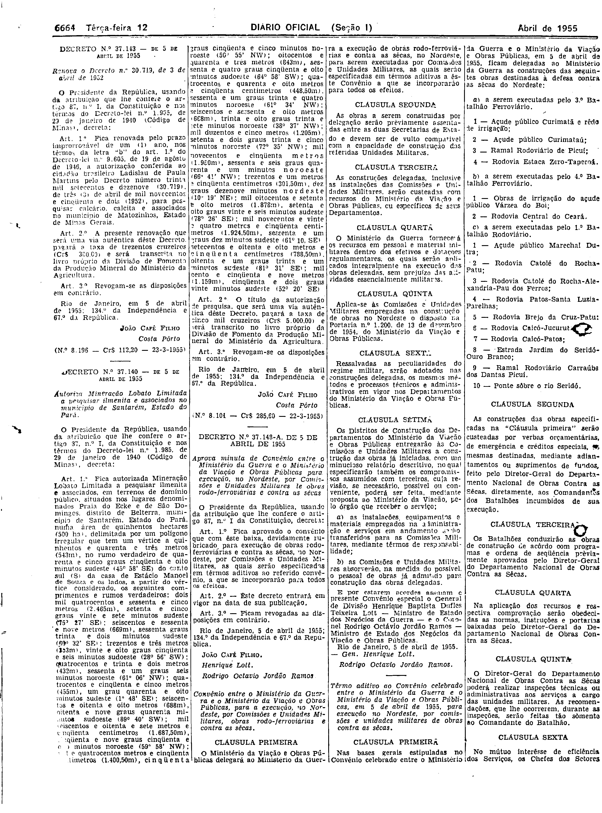
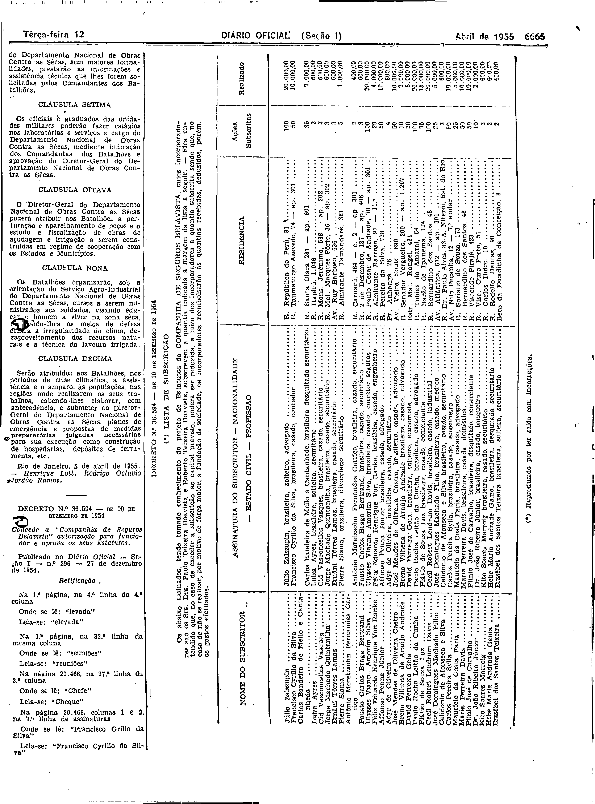

###DEC-037148-A-000-05-04-1955@@@

<strong>DECRETO Nº 37.148, DE 5 DE ABRIL DE 1955.</strong>

<em><strong>Aprova minuta de Convênio entre o Ministério da Guerra e o Ministério da Viação e Obras Públicas para execução, no Nordeste, por Comissões e Unidades Militares de obras rodo-ferroviárias e contra as secas.</strong></em>

<strong>O PRESIDENTE DA REPÚBLICA</strong>, usando da atribuição que lhe confere o artigo 87, nº I, da Constituição,

<strong>DECRETA:</strong>

<strong>Art</strong>. 1º Fica aprovado o convênio que com êste baixa, devidamente rubricado para execução de obras rodo-ferroviárias e contra as sêcas, no Nordeste, por Comissões e Unidades Militares, as quais serão especificadas em têrmos aditivos ao referido convênio, a que se incorporarão para todos os efeitos.

<strong>Art</strong>. 2º Êste decreto entra e vigor da data de sua publicação.

<strong>Art</strong>. 3º Revogam-se as disposições em contrário.

Rio de Janeiro, 5 de abril de 1955; 134º da Independência e 67º da República.

<strong>JOÃO CAFÉ FILHO</strong>

Henrique Lott

Rodrigo Octávio Jordão Ramos

<!-- fac-simile-oficial:inicio -->

## Fac-símile oficial: instrumento

O texto acima não inclui o instrumento a que se refere este decreto. A publicação oficial do anexo está em imagem, nas páginas do _Diário Oficial da União_ (Seção I) de 12 de abril de 1955: página 8 do PDF (a partir de «Convênio entre o Ministério da Guerra e o Ministério da Viação e Obras Públicas, para a execução, no Nordeste, por Comissões e Unidades Militares, obras rodo-ferroviárias e contra as sêcas», no pé da coluna 3, com as cláusulas primeira a sexta, e a mesma página traz, na coluna 4, a assinatura do convênio e, logo a seguir, um «Termo aditivo ao Convênio» de 5 de abril de 1955 com a relação das obras); página 9 do PDF (continuação do termo aditivo, até «Rio de Janeiro, 5 de abril de 1955. — Henrique Lott. Rodrigo Octávio Jordão Ramos»).

As imagens são as páginas inteiras, tal como digitalizadas pela Imprensa Nacional, sem recorte, sem redesenho e sem transcrição. Cada página traz também outros atos do mesmo dia; a peça deste decreto está apenas no trecho indicado, e o texto do anexo só existe na imagem. Não há OCR validado.

Fonte: Imprensa Nacional, Biblioteca Machado de Assis, arquivo `DO_1_19550412_084.PDF` (SHA-256 `5983002f81d31623b9db7147840655710204d13ee8d0cfc34e741111aa40e192`), páginas 8, 9 do PDF. SHA-256 das imagens, na ordem: `666fd97cad439ba28aae4f8b420a30bf4466814c22bd5814195a4c801b008ee6`, `19d480d2e3ab41d6b5388de24733159500b0d78599f501b1d9ca5048a9072048`.

<!-- fac-simile-oficial:fim -->
