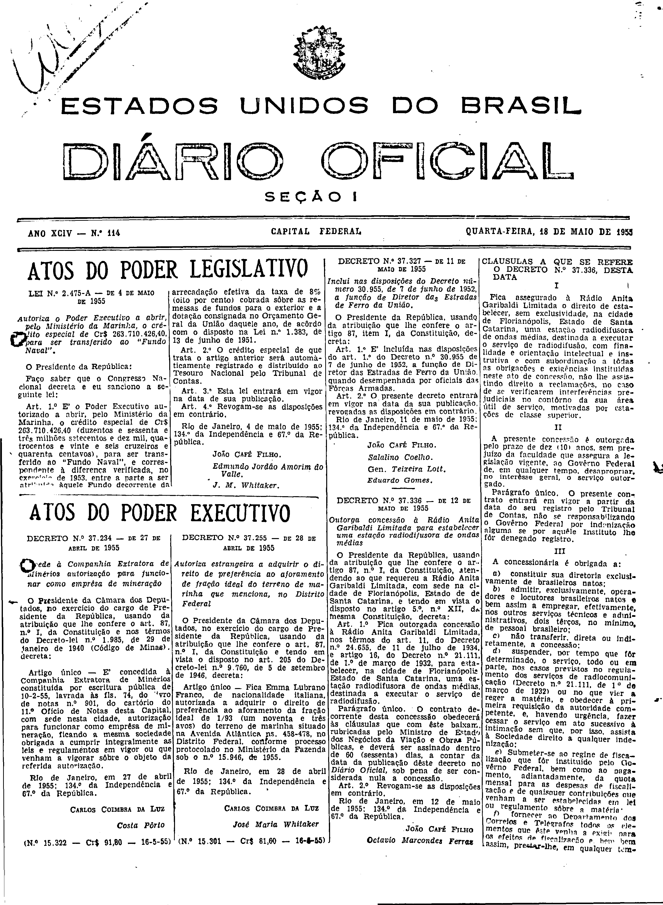
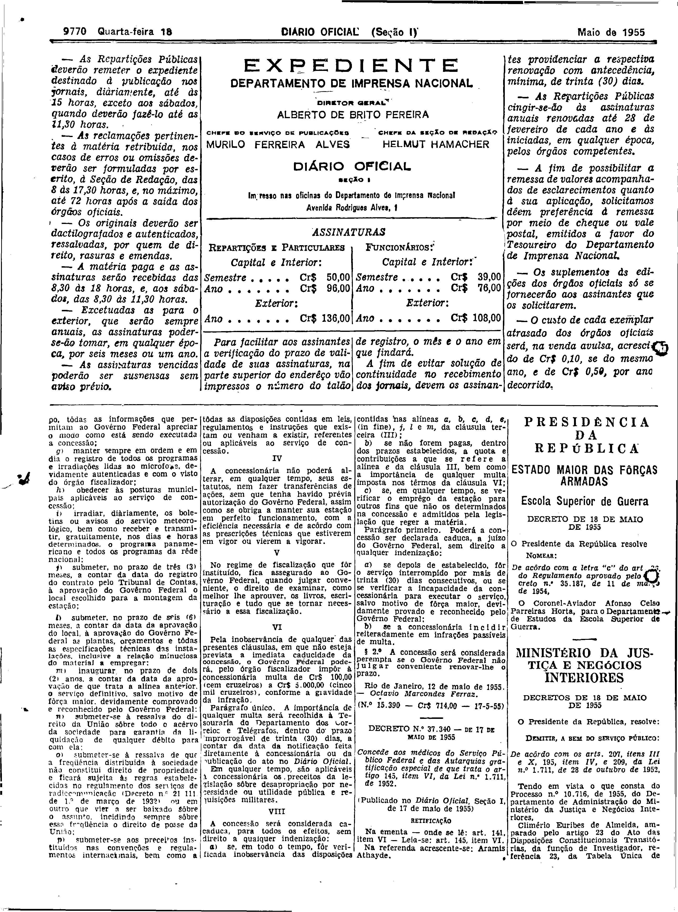

###DEC-037336-0-000-12-05-1955@@@

<strong>DECRETO Nº 37.336, DE 12 DE MAIO DE 1955.</strong>

<em><strong>Outorga concessão à Rádio Anita Garibaldi Limitada para estabelecer uma estação radiodifusora de ondas médias.</strong></em>

<strong>O PRESIDENTE DA REPÚBLICA</strong>, usando da atribuição que lhe confere o artigo 87, nº I, da Constituição, atendendo ao que requereu a Rádio Anita Garibaldi Limitada, com sede na cidade de Florianópolis, Estado de Santa Catarina, e tendo em vista o disposto no artigo 5º, nº XII, da mesma Constituição,

<strong>DECRETA:</strong>

<strong>Art</strong>. 1º Fica outorgada concessão a Rádio Anita Garibaldi Limitada, nos têrmos do art. 11, do Decreto nº 24.655, de 11 de julho de 1934, e artigo 16, do Decreto nº 21.111, de 1º de março de 1932, para estabelecer, na cidade de Florianópolis, Estado de Santa Catarina, uma estação radiodifusora de ondas médias, destinada a executar o serviço de radiodifusão.

Parágrafo único. O contrato decorrente desta concessão obedecerá às cláusulas que com êste baixam, rubricadas pelo Ministro de Estado dos Negócios da Viação e Obras Públicas, e deverá ser assinado dentro de 60 (sessenta) dias, a contar da data da publicação dêste decreto no <em>Diário Oficial</em>, sob pena de ser considerada nula a concessão.

<strong>Art</strong>. 2º Revogam-se as disposições em contrário.

Rio de Janeiro, em 12 de maio de 1955; 134º da Independência e 67º da República.

<strong>JOÃO CAFÉ FILHO</strong>

Octavio Marcondes Ferraz

<!-- fac-simile-oficial:inicio -->

## Fac-símile oficial: cláusulas

O texto acima não inclui as cláusulas a que se refere este decreto. A publicação oficial do anexo está em imagem, nas páginas do _Diário Oficial da União_ (Seção I) de 18 de maio de 1955: capa (1ª página do caderno, sem numeração impressa; página 1 do PDF) (a partir de «CLAUSULAS A QUE SE REFERE O DECRETO N.º 37.336, DESTA DATA»); p. 9770 (até «N.º 15.390 — Cr$ 714,00 — 17-5-55»).

As imagens são as páginas inteiras, tal como digitalizadas pela Imprensa Nacional, sem recorte, sem redesenho e sem transcrição. Cada página traz também outros atos do mesmo dia; a peça deste decreto está apenas nas colunas indicadas, e o texto do anexo só existe na imagem. Não há OCR validado.

Fonte: Imprensa Nacional, Biblioteca Machado de Assis, arquivo `DO_1_19550518_114.PDF` (SHA-256 `3611bccd9b32e33b87c6ec2791a39e5fcbdbf6d607b509a64e7cebefb82acc98`), páginas 1, 2 do PDF. SHA-256 das imagens, na ordem: `9878b6cadc8a90fbdce947a261f56923f84cda3b914185bebc09bb728e992927`, `3a7f902729a718ed49e05f9688125294e85e1ee44e987ab65067fff671d79210`.

<!-- fac-simile-oficial:fim -->
