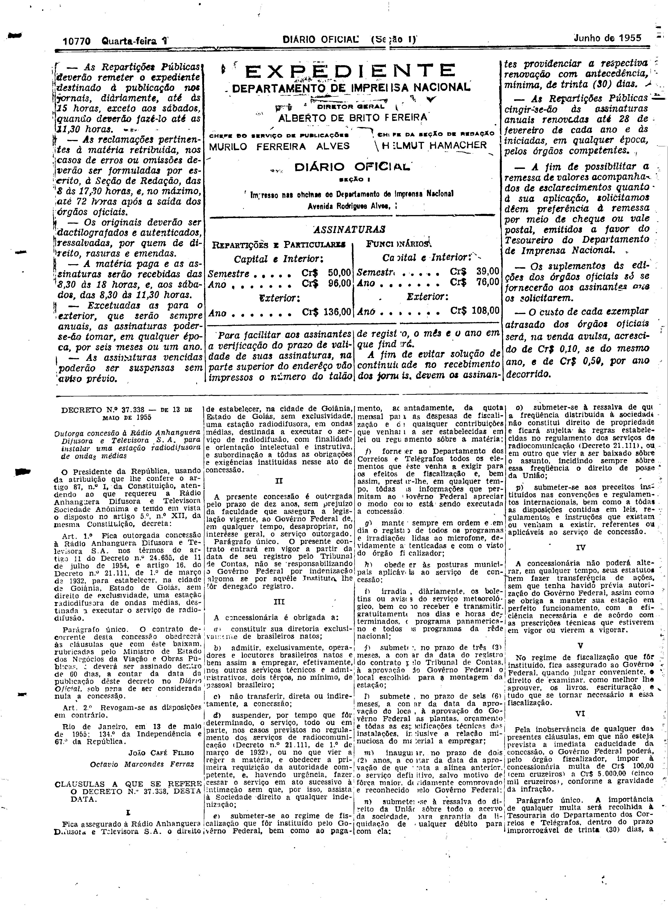
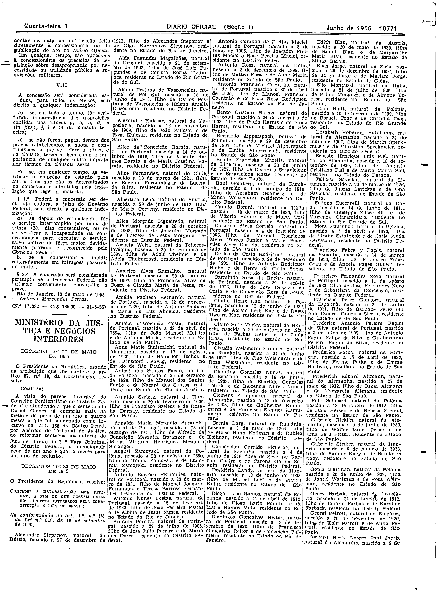

###DEC-037338-0-000-13-05-1955@@@

<strong>DECRETO Nº 37.338, DE 13 DE MAIO DE 1955.</strong>

<em><strong>Outorga Concessão à Rádio Anhanguera Difusora e Televisora S.A. para instalar uma estação radiodifusora de ondas médias</strong></em>

<strong>O PRESIDENTE DE REPÚBLICA</strong>, usando da atribuição que lhe confere o artigo 87, nº I, da Constituição, atendendo ao que requereu a Rádio Anhanguera Difusora e Televisora Sociedade Anônima e tendo em vista o disposto no artigo 5º, nº XII, da mesma Constituição,

<strong>DECRETA:</strong>

<strong>Art</strong>. 1º Fica outorgada concessão á Rádio Anhanguera Difusora e Televison S.A. nos têrmos do artigo 11 do Decreto nº 24.655, de 11 de julho de 1954, e artigo 16, do Decreto nº 21.111, de 1º de março de 1932, para estabelecer, na cidade de Goiânia, Estado de Goiás, sem direito de exclusividade, uma estação radiodifusora de ondas médias, destinada a executar o serviço de radiodifusão.

Parágrafo único. O contrato decorrente desta concessão obedecerá ás cláusulas que com êste baixam, rubricadas pelo Ministro de Estado dos Negócios de Viação e Obras públicas, e deverá ser assinado dentro de 60 dias, a contar da data da publicação dêste decreto no <em>Diário Oficial,</em> sob pena de ser considerada nula a concessão.

<strong>Art</strong>. 2º Revogam-se as disposições em contrário.

Rio de Janeiro, em 13 de maio de 1955; 134º da Independência e 67º da República.

<strong>JOÃO CAFÉ FILHO</strong>

Octavio Marcondes Ferraz

<!-- fac-simile-oficial:inicio -->

## Fac-símile oficial: cláusulas

O texto acima não inclui as cláusulas a que se refere este decreto. A publicação oficial do anexo está em imagem, nas páginas do _Diário Oficial da União_ (Seção I) de 1 de junho de 1955: página 2 do PDF (a partir de «CLÁUSULAS A QUE SE REFERE O DECRETO N.º 37.338, DESTA DATA», início da cláusula I); página 3 do PDF (até «N.º 17.082 — Cr$ 765,00 — 31-5-55»).

As imagens são as páginas inteiras, tal como digitalizadas pela Imprensa Nacional, sem recorte, sem redesenho e sem transcrição. Cada página traz também outros atos do mesmo dia; a peça deste decreto está apenas no trecho indicado, e o texto do anexo só existe na imagem. Não há OCR validado.

Fonte: Imprensa Nacional, Biblioteca Machado de Assis, arquivo `DO_1_19550601_125.PDF` (SHA-256 `0940f65902c4acab396d9e648884fd1ed38e1d198ffad8074ddba3d6c9879a18`), páginas 2, 3 do PDF. SHA-256 das imagens, na ordem: `7a08397bbc3afccf20b140b252c092980a520620a492a85e03eaabf8918e410d`, `f44788bee1f10c4ff94c2d996a00bb6a1b19545b76a20bbc23f4e5c2ac9d1c75`.

<!-- fac-simile-oficial:fim -->
