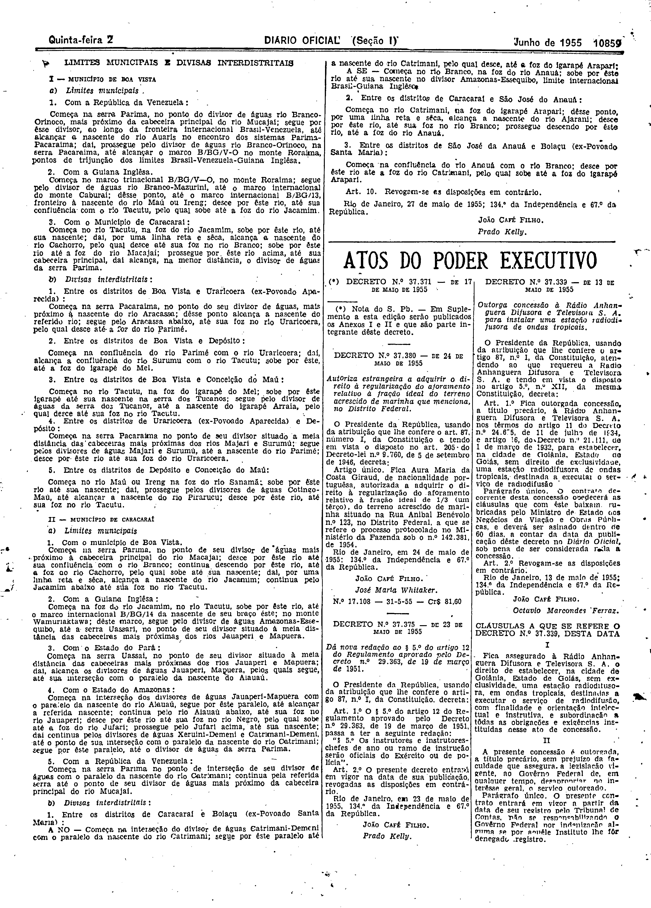
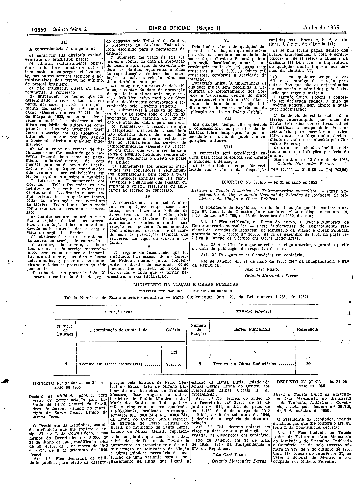

###DEC-037339-0-000-13-05-1955@@@

<strong>DECRETO N. 37.339 – DE 13 DE MAIO DE 1955</strong>

<em><strong>Outorga concessão à Rádio Anhanguera Difusora e Televisora S. A. para instalar uma estação radiodifusora de ondas tropicais.</strong></em>

O Presidente da República, usando da atribuição que lhe confere o artigo 87, nº I, da Constituição, atendendo ao que requereu a Rádio Anhanguera Difusora e Televisora S. A. e tendo em vista o disposto no artigo 5º, nº XII, da mesma Constituição,

<strong>DECRETA:</strong>

<strong>Art.</strong> 1º Fica outorgada concessão, a título precário, à Rádio Anhanguera Difusora e Televisora S. A. nos têrmos do artigo 11 do Decreto nº 24.655, de 11 de julho de 1934, e artigo 16, do Decreto nº 21.111, de 1 de março de 1932, para estabelecer, na cidade de Goiânia Estado de Goiás, sem direito de exclusividade uma estação radiodifusora de ondas tropicais, destinada a executar o serviço de radiodifusão.

Parágrafo único. O contrato decorrente desta concessão obedecerá às cláusulas que com êste baixam, rubricadas pelo Ministro de Estado dos Negócios da Viação e Obras Públicas, e deverá ser assinado dentro de 60 dias, a contar da data da publicação dêste decreto no Diário Oficial, sob pena de ser considerada nula a concessão.

<strong>Art.</strong> 2º Revogam-se as disposições em contrário.

Rio de Janeiro, 13 de maio de 1955; 134º da Independência e 67º da República.

<strong>JOÃO CAFÉ FILHO.</strong>

Octavio Marcondes Ferraz.

<!-- fac-simile-oficial:inicio -->

## Fac-símile oficial: cláusulas

O texto acima não inclui as cláusulas a que se refere este decreto. A publicação oficial do anexo está em imagem, nas páginas do _Diário Oficial da União_ (Seção I) de 2 de junho de 1955: p. 10859 (a partir de «CLÁUSULAS A QUE SE REFERE O DECRETO N.º 37.339, DESTA DATA»); p. 10860 (até «N.º 17.083 — 31-5-55 — Cr$ 765,00»).

As imagens são as páginas inteiras, tal como digitalizadas pela Imprensa Nacional, sem recorte, sem redesenho e sem transcrição. Cada página traz também outros atos do mesmo dia; a peça deste decreto está apenas nas colunas indicadas, e o texto do anexo só existe na imagem. Não há OCR validado.

Fonte: Imprensa Nacional, Biblioteca Machado de Assis, arquivo `DO_1_19550602_126.PDF` (SHA-256 `888aa6a6dd83b764021a8e65f1fa07cc7f3e57402693cf8d9b38aa7edb96ac5b`), páginas 3, 4 do PDF. SHA-256 das imagens, na ordem: `f30444d6230f61b8be421b20ba84138d36ca3d99f6d4e4df68d1552998c32122`, `9e20032dab3401e176b8f9ed6e3dec3fa86ff9b4253a05429eac48a9ca242b4d`.

<!-- fac-simile-oficial:fim -->
