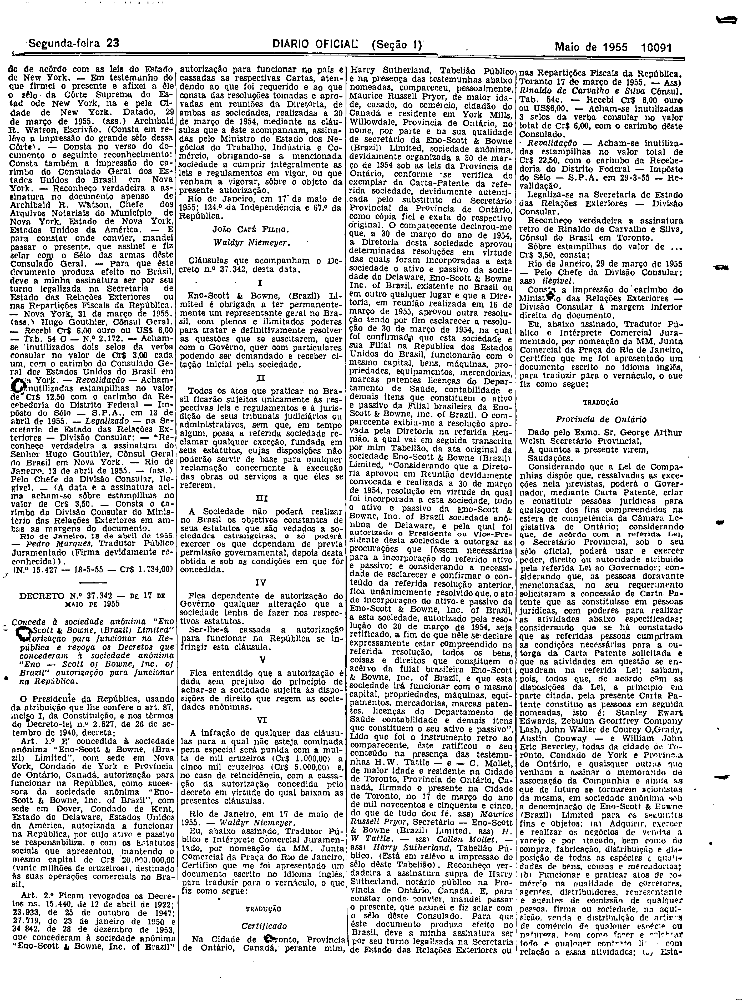

###DEC-037342-0-000-17-05-1955@@@

<strong>DECRETO N. 37.342 – DE 17 DE MAIO DE 1955</strong>

<em><strong>Conceda à sociedade anônima “Eno – Scott & Bowne, (Brazil) Limited" autorização para funcionar na República e revoga os Decretos que concederam à sociedade anônima “Eno – Scott & Bowne, Inc. of Brazil” autorização para funcionar na República.</strong></em>

O Presidente da República, usando da atribuição que lhe confere o art. 87, inciso I, da Constituição, e nos têrmos do Decreto-lei n. 2. 627, de 26 de setembro de 1940,

<strong>DECRETA:</strong>

<strong>Art.</strong> 1º E’ concedida à sociedade anônima “Eno-Scott & Bowne, (Brazil) Limited”, com sede em North York, Condado de York e Província de Ontário, Canadá, autorização para funcionar na República, como sucessora da sociedade anônima “Eno-Scott & Bowne, Inc. of Brazil”, com sede em Dover, Condado de Kent, Estado de Delaware, Estados Unidos da América, autorizada a funcionar na República, por cujo ativo e passivo se responsabiliza, e com os Estatutos sociais que apresentou, mantendo o mesmo capital de Cr$ 20.000.000,00 (vinte milhões de cruzeiros), destinado às suas operações comerciais no Brasil.

<strong>Art.</strong> 2º Ficam revogados os Decretos ns. 15.440, de 12 de abril de 1922; 23.933, de 25 de outubro de 1947; 27.719, de 23 de janeiro de 1950 e 34. 842, de 28 de dezembro de 1953, que concederam à sociedade anônima "Eno-Scott & Rowne, Inc. of Brazil” autorização para funcionar no país e cassadas as respectivas Cartas, atenderão ao que foi requerido e ao que consta das resoluções tomadas e aprovadas em reuniões da Diretoria, de ambas as sociedades, realizadas a 30 de março de 1954, mediante as cláusulas que a êste acompanham, assinadas pelo Ministro de Estado dos Negócios do Trabalho, Indústria e Comércio, obrigando-se a mencionada sociedade a cumprir integralmente as leis e regulamentos em vigor, ou que venham a vigorar, sôbre o objeto da presente autorização.

Rio de Janeiro, em 17 de maio de 1955; 134º da Independência e 67º da República.

<strong>JOÃO CAFÉ FILHO.</strong>

Waldir Niemeyer.

<!-- fac-simile-oficial:inicio -->

## Fac-símile oficial: clausulas

A peça vinculada ao Decreto nº 37.342 é reproduzida nas imagens abaixo, a partir da publicação oficial da Imprensa Nacional. A reprodução é em fac-símile, sem transcrição por OCR nem reconstrução do conteúdo.

As imagens mostram páginas inteiras do Diário Oficial da União e podem conter outras matérias. Essas matérias vizinhas não são atribuídas a este decreto. A peça é identificada pelo seu título e pela referência ao ato nas páginas indicadas.

SHA-256 desta imagem: `d01173b15b34740d36311b3bd051c248a0e0b7d66c071c295d331afb35a3bd2f`.

Fontes oficiais da publicação:

- [DO_1_19550523_117.PDF](https://biblioteca.in.gov.br/documents/271518/581356/DO_1_19550523_117.PDF/cf7f4504-be2c-2a9d-73d8-553711537d0f?t=1574962659280&download=true) — SHA-256 do PDF: `585a07471049691d5c32cf3e1a6198874995497e15114d7ce6a1a520561eccb9`.

<!-- fac-simile-oficial:fim -->
