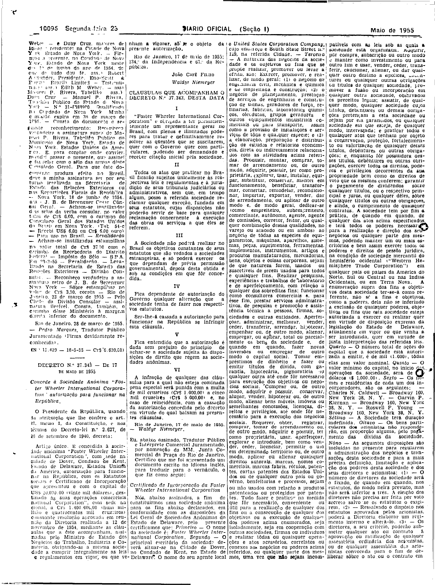

###DEC-037343-0-000-17-05-1955@@@

<strong>DECRETO Nº 37.343, DE 17 DE MAIO DE 1955.</strong>

<em><strong>Concede á Sociedade Anônima “Foster Wheeler International Corporation” autorização para funcionar na República.</strong></em>

<strong>O PRESIDENTE DA REPÚBLICA</strong>, usando da atribuição que lhe confere o art. 87, inciso I, da Constituição, e nos têrmos do Decreto-lei nº 2.627, de 26 de setembro de 1940,

<strong>DECRETA:</strong>

Artigo único. É concedida á sociedade anônima “<em>Foster Wheeler International Corporation</em>”, com sede na cidade de Dover, condado de Kent, Estado de Delaware, Estados Unidos da América, autorização para funcionar na República, com os Estatutos sociais e Certificado de Incorporação que apresentou e com o capital de US$20,000.00 ( vinte mil dólores), destinado às suas operações comerciais no Brasil, equivalendo, em moeda nacional, a Cr$1.400.000,00 (hum milhão e quatrocentos mil cruzeiros) consoante resolução aprovada em reunião da Diretoria realizada a 12 de novembro de 1954, mediante as cláusulas que a êste acompanham, assinadas pelo Ministro de Estado dos Negócios do Trabalho, Indústria e Comércio, obrigando-se a  mesma sociedade a cumprir integralmente as leis e regulamentos em vigor, ou que venham a vigorar, sôbre o objeto da presente autorização.

Rio de Janeiro, 17 de maio de 1955; 134º da Independência e 67º da República.

<strong>JOÃO CAFÉ FILHO</strong>

Waldyr Niemeyer

<!-- fac-simile-oficial:inicio -->

## Fac-símile oficial: clausulas

A peça vinculada ao Decreto nº 37.343 é reproduzida nas imagens abaixo, a partir da publicação oficial da Imprensa Nacional. A reprodução é em fac-símile, sem transcrição por OCR nem reconstrução do conteúdo.

As imagens mostram páginas inteiras do Diário Oficial da União e podem conter outras matérias. Essas matérias vizinhas não são atribuídas a este decreto. A peça é identificada pelo seu título e pela referência ao ato nas páginas indicadas.

SHA-256 desta imagem: `d87052ee6ea797fe3be522edfa832f600bf1f53385a2acba7bce78a8e7fa768b`.

Fontes oficiais da publicação:

- [DO_1_19550523_117.PDF](https://biblioteca.in.gov.br/documents/271518/581356/DO_1_19550523_117.PDF/cf7f4504-be2c-2a9d-73d8-553711537d0f?t=1574962659280&download=true) — SHA-256 do PDF: `585a07471049691d5c32cf3e1a6198874995497e15114d7ce6a1a520561eccb9`.

<!-- fac-simile-oficial:fim -->
