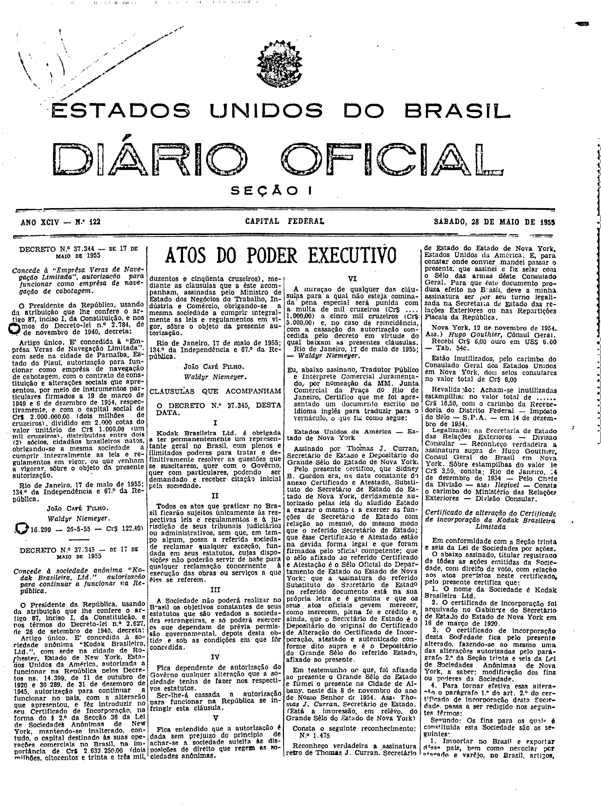

###DEC-037345-0-000-17-05-1955@@@

<strong>DECRETO Nº 37.345, DE 17 DE MAIO 1955.</strong>

<em><strong>Concede a sociedade anônima “Kodak Brasileira Ltda.”, autorização para continuar a funcionar na Republica .</strong></em>

<strong>O PRESIDENTE DA REPÚBLICA</strong>, usando da atribuição que lhe confere o artigo 87, inciso I, da Constituição, e nos têrmos do Decreto-lei nº 2.627, de 26 de setembro de 1940,

<strong>DECRETA:</strong>

Artigo único. É concedida a sociedade anônima “<em>Kodak Brasileira Ltda</em>.” com sede na cidade de <em>Rochester</em>, Estado de <em>New York</em>, Estados Unidos da América, autorizada a funcionar na República pelos Decretos ns. 14.399 de 11 de outubro de 1920 e 30.289, de 31 de dezembro de 1945, autorização para continuar a funcionar no país, com a alteração que apresentou, e fez introduzir no seu Certificado de Incorporação, na forma do § 2º da Secção 36 da Lei de Sociedades Anônimas de <em>New York</em>, mantendo-se inalterado, contudo, o capital destinado as suas operações comerciais no Brasil, na importância de Cr$2.633.250,00 (dois milhões, oitocentos e trinta e três mil duzentos e cinqüenta cruzeiros), mediante as cláusulas que a este acompanham, assinadas pelo Ministro de Estado dos Negócios do Trabalho, Indústria e Comércio, obrigando-se a mesma a sociedade a cumprir integralmente as leis e regulamentos em vigor, sôbre o objeto da presente autorização.

Rio de Janeiro, 17 de maio de 1955; 134 da Independência e 67 da República.

<strong>JOÃO CAFÉ FILHO</strong>

Waldyr Niemeyer

<!-- fac-simile-oficial:inicio -->

## Fac-símile oficial: clausulas

A peça vinculada ao Decreto nº 37.345 é reproduzida nas imagens abaixo, a partir da publicação oficial da Imprensa Nacional. A reprodução é em fac-símile, sem transcrição por OCR nem reconstrução do conteúdo.

As imagens mostram páginas inteiras do Diário Oficial da União e podem conter outras matérias. Essas matérias vizinhas não são atribuídas a este decreto. A peça é identificada pelo seu título e pela referência ao ato nas páginas indicadas.

SHA-256 desta imagem: `85ec7046027b2b7a4b6656caedf0d259f1704ed0be3e1dc7cbec5f11ff0126d2`.

Fontes oficiais da publicação:

- [DO_1_19550528_122.PDF](https://biblioteca.in.gov.br/documents/271518/581356/DO_1_19550528_122.PDF/deb59835-1fdf-6a57-34cc-3d169e88ade9?t=1574962827827&download=true) — SHA-256 do PDF: `90cb8d6553df8ea63914f4ef9ac8c3d334cc14e39597b2e1dca60ab35bd0d00a`.

<!-- fac-simile-oficial:fim -->
