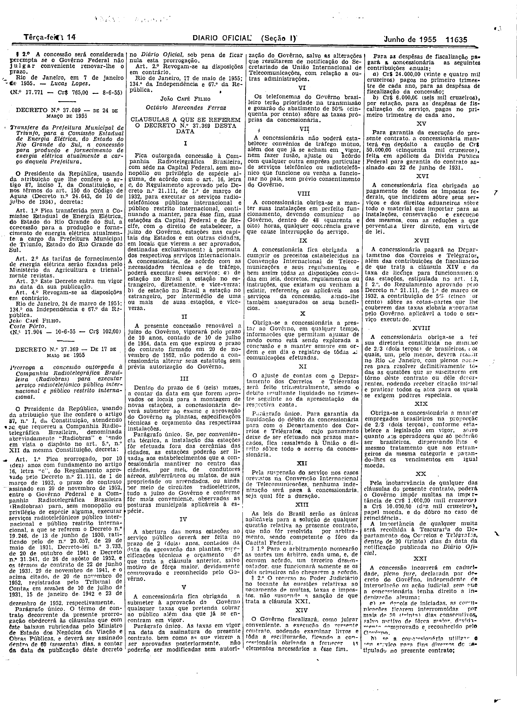
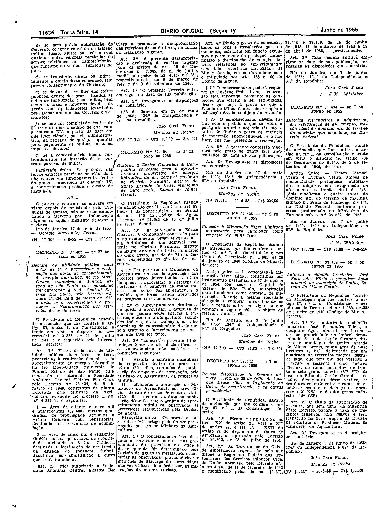

###DEC-037369-0-000-17-05-1955@@@

<strong>DECRETO Nº 37.369, DE 17 DE MAIO DE 1955.</strong>

<em><strong>Prorroga a concessão outorgada à Companhia Radiotelegráfica Brasileira (Radiobras) para executar serviço radiotelefônico público internacional e público restrito internacional.</strong></em>

<strong>O PRESIDENTE DA REPÚBLICA</strong>, usando da atribuição que lhe confere o artigo 87, inciso I, da Constituição, atendendo ao que requereu a Companhia Radiotelegráfica Brasileira denominada abreviadamente “Radiobrás“ e tendo em vista o disposto no art. 5º nº XII da mesma Constituição,

<strong>DECRETA:</strong>

<strong>Art</strong>. 1º Fica prorrogado, por 10 (dez) anos com fundamento no artigo 16, letra “c” do Regulamento aprovado pelo Decreto nº 21.111, de 1 de março de 1932, o prazo do contrato assinado em 20 de novembro de 1952, entre o Govêrno Federal e a Companhia Radiotelegráfica Brasileira (Radiobrás) para, sem monopólio ou privilégio de espécie alguma, executar serviços radiotelefônicos público internacional e público restrito, internacional a que se referem o Decreto nº 19.246, de 13 de junho de 1930, ratificado pelo de nº 20.057, de 29 de maio de 1931, Decreto-lei nº 3.733, de 20 de outubro de 1941 e Decreto nº 31.341, de 26 de agôsto de 1952, e têrmos de contrato de 22 de julho de 1931, 29 de novembro de 1941, e o acima citado, de 20 de novembro de 1952, registrados pelo Tribunal de Contas em sessões de 10 de julho de 1931, 15 de janeiro de 1942 e 23 de dezembro de 1952, respectivamente.

Parágrafo único. O têrmo de contrato decorrente da presente prorrogação obedecerá às cláusulas que com êste baixam rubricadas pelo Ministro de Estados dos Negócios da Aviação e Obras Públicas, e deverá ser assinado dentro de 60 (sessenta) dias, a contar da data da publicação dêste decreto no <em>Diário Oficial</em> sob pena de ficar nula esta prorrogação.

<strong>Art</strong>. 2º Revogam-se as disposições em contrário.

Rio de Janeiro, 17de maio de 1955; 134º da Independência e 67º da República

<strong>JOÃO CAFÉ FILHO</strong>

Octávio Marcondes Ferraz

<!-- fac-simile-oficial:inicio -->

## Fac-símile oficial: cláusulas

O texto acima não inclui as cláusulas a que se refere este decreto. A publicação oficial do anexo está em imagem, nas páginas do _Diário Oficial da União_ (Seção I) de 14 de junho de 1955: p. 11635 (a partir de «CLÁUSULAS A QUE SE REFEREM O DECRETO N.º 37.369 DESTA DATA»); p. 11636 (até «N.º 17.706 — 8-6-55 — Cr$ 1.122,00»).

As imagens são as páginas inteiras, tal como digitalizadas pela Imprensa Nacional, sem recorte, sem redesenho e sem transcrição. Cada página traz também outros atos do mesmo dia; a peça deste decreto está apenas nas colunas indicadas, e o texto do anexo só existe na imagem. Não há OCR validado.

Fonte: Imprensa Nacional, Biblioteca Machado de Assis, arquivo `DO_1_19550614_135.PDF` (SHA-256 `69dfffc9df246c3cf27264ea15114803265aa1e91610363f12951c6d565f0705`), páginas 3, 4 do PDF. SHA-256 das imagens, na ordem: `44dee6e3f8dd9974e103bc61a1430806b6d80b6d38a9f0002b0b76f3c5cdaca7`, `a4d58c92f753f4dd51f204b56c58b29963e4ea08d8d60da2b7fad5a31f1074ed`.

<!-- fac-simile-oficial:fim -->
