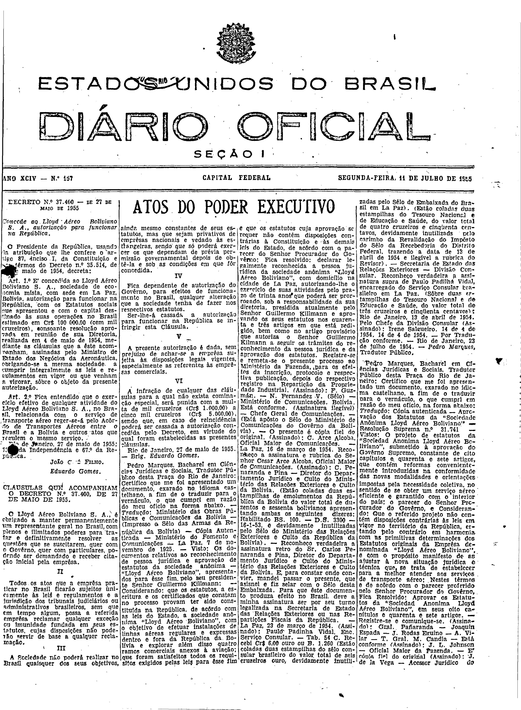

###DEC-037400-0-000-27-05-1955@@@

<strong>DECRETO Nº 37.400, DE 27 DE MAIO DE 1955.</strong>

<em><strong>Concede ao Lloyd Aéreo Boliviano S.A., autorização para funcionar na República.</strong></em>

<strong>O PRESIDENTE DA REPÚBLICA</strong>, usando da atribuição que lhe confere o artigo 87, Inciso I, da Constituição e nos têrmos do Decreto-lei nº 35.514, de 18 de maio de 1954,

<strong>DECRETA:</strong>

<strong>Art</strong>. 1º É concedida ao Lioyd Aéreo Boliviano S.A., Sociedade de Economia mista, com sede em La Paz, Bolivia, autorização para funcionar na República, com os Estatutos sociais que apresentou e com o capital destinado às suas operações no Brasil estimado em Cr$100.000,00 (cem mil cruzeiros),consoante resolução aprovada em reunião de sua Diretoria, realizada em 4 de maio de 1954, mediante as cláusulas que a êste acompanham, assinadas pelo Ministro de Estado dos Negócios da Aeronáutica, obrigando-se a mesma sociedade a cumprir integralmente as leis regulamentos em vigor ou que venham a vigorar, sôbre o objeto da presente autorização.

<strong>Art</strong>. 2º Fica entendido que o exercício efetivo de qualquer atividade do Lioyd Aéreo Boliviano S.A., no Brasil, relacionada com o serviço de transporte aéreo reger-se-á pelo Acôrdo de Transportes Aéreos entre o Brasil e a Bolívia e outros atos que regulem o mesmo serviço.

Rio de Janeiro, 27 de maio de 1955, 134º da Independência e 67º da República.

<strong>JOÃO CAFÉ FILHO</strong>

Eduardo Gomes

<!-- fac-simile-oficial:inicio -->

## Fac-símile oficial: clausulas

A peça vinculada ao Decreto nº 37.400 é reproduzida nas imagens abaixo, a partir da publicação oficial da Imprensa Nacional. A reprodução é em fac-símile, sem transcrição por OCR nem reconstrução do conteúdo.

As imagens mostram páginas inteiras do Diário Oficial da União e podem conter outras matérias. Essas matérias vizinhas não são atribuídas a este decreto. A peça é identificada pelo seu título e pela referência ao ato nas páginas indicadas.

SHA-256 desta imagem: `b579adc153313de8eae4a2a9bc231f8691b74e07fe9af280495675a19781d696`.

Fontes oficiais da publicação:

- [DO_1_19550711_157.PDF](https://biblioteca.in.gov.br/documents/271518/581356/DO_1_19550711_157.PDF/46817c20-02ce-69f2-b5a8-e52312c083ff?t=1574963204977&download=true) — SHA-256 do PDF: `dbf3e536d0816a1543c84750ae0bcb1a59f8550de984eb6a1de440cb603a9b5b`.

<!-- fac-simile-oficial:fim -->
