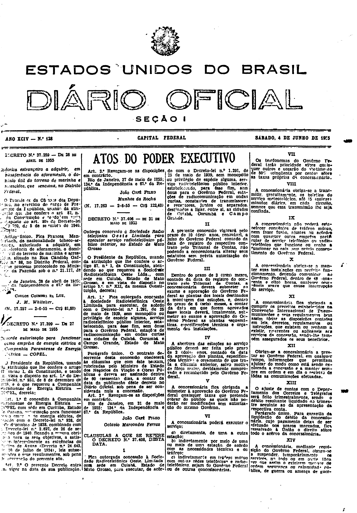
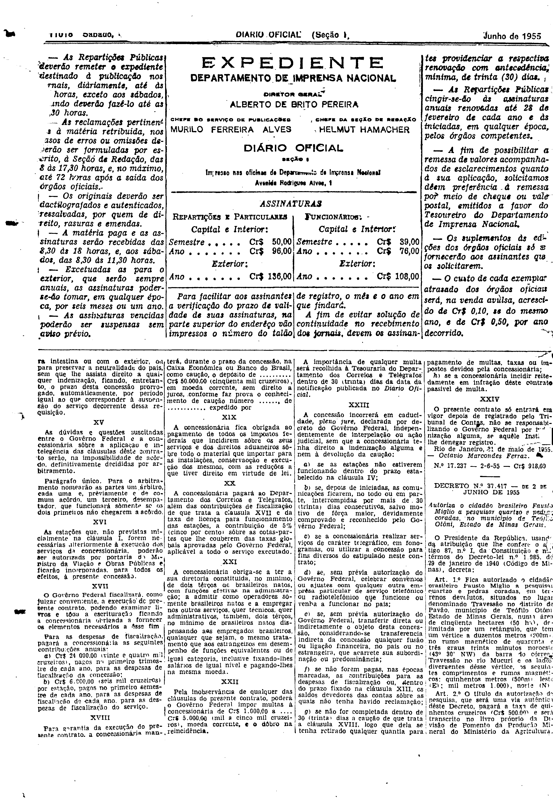

###DEC-037408-0-000-31-05-1955@@@

<strong>DECRETO Nº 37.408, DE 31 DE MAIO DE 1955.</strong>

<em><strong>Outorga concessão à Sociedade Radio telefônica Oeste Limitada para executar serviço radiotelefônico públicos interior, no Estado de Mato Grosso.</strong></em>

<strong>O PRESIDENTE DA REPÚBLICA</strong>, usando da atribuição que lhe confere o artigo 87,.nº I, Constituição, atendendo ao que requereu a Sociedade Radiotelefônica Oester Ltda., com sede em Cuiabá, Estado de Mato Grosso, e em vista do disposto no artigo 5º nº XII, da mesma Constituição,

<strong>DECRETA:</strong>

<strong>Art</strong>. 1º Fica outorgada concessão à Sociedade Radiotelefônica Oeste Limitada para executar de acôrdo com o Decreto-lei nº 1.291, de 25 de maio de 1939, sem monopólio ou radiotelefônico público interior, estabelecendo para êsse fim, sem ônus para o Govêrno Federal, estações de radiocomunicação em ondas curtas nas cidades de Cuiabá, Corumbá e Campo Grande, Estado de Mato Grosso.

Parágrafo único. O contrato decorrente desta concessão obedecerá às cláusulas que com êste baixam, rubricadas pelo Ministro de Estado dos Negócios da Viação e Obras Públicas e deverá ser assinado dentro de 60 (sessenta ) dias, a contar da data da publicação dêste decreto no <em>Diário oficial</em> sob pena de ser considerada nula a concessão.

<strong>Art</strong>. 2º Revogam-se as disposições em contrário.

Rio de Janeiro, em 31 de maio de 1955; 134º da Independência e 67º da República.

<strong>JOÃO CAFÉ FILHO</strong>

Octavio Marcondes Ferruz

<!-- fac-simile-oficial:inicio -->

## Fac-símile oficial: cláusulas

O texto acima não inclui as cláusulas a que se refere este decreto. A publicação oficial do anexo está em imagem, nas páginas do _Diário Oficial da União_ (Seção I) de 4 de junho de 1955: capa (1ª página do caderno, sem numeração impressa; página 1 do PDF) (a partir de «CLÁUSULAS A QUE SE REFERE O DECRETO N.º 37.408, DESTA DATA»); página 2 do PDF (numeração impressa ilegível na imagem) (até «N.º 17.237 — 2-6-55 — Cr$ 918,60»).

As imagens são as páginas inteiras, tal como digitalizadas pela Imprensa Nacional, sem recorte, sem redesenho e sem transcrição. Cada página traz também outros atos do mesmo dia; a peça deste decreto está apenas nas colunas indicadas, e o texto do anexo só existe na imagem. Não há OCR validado.

Fonte: Imprensa Nacional, Biblioteca Machado de Assis, arquivo `DO_1_19550604_128.PDF` (SHA-256 `aae74a61e4600f43753c5bd2c5fefb7ecc2ca0b300c4fd9cbe2a75f089084364`), páginas 1, 2 do PDF. SHA-256 das imagens, na ordem: `99397ceb4d57d0b0b72546a942555d27f251ca7cff28f271f28f092bacd149d1`, `196520dd7bf594ee4ce0c1c57b874e594a3e67b85a0a0f8f0834b68ca8413944`.

<!-- fac-simile-oficial:fim -->
