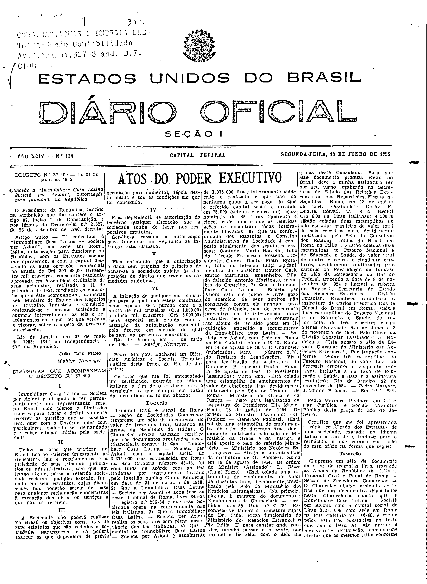

###DEC-037409-0-000-31-05-1955@@@

<strong>DECRETO Nº 37.409, DE 31 DE MAIO DE 1955.</strong>

<em><strong>Concede à “Immobiliare Casa Latina Società per Azioni”, autorização para funcionar na República.</strong></em>

<strong>O PRESIDENTE DA REPÚBLICA</strong>, usando da atribuição que lhe confere o artigo 87, inciso I, da Constituição, e nos têrmos do Decreto-lei nº 2.627, de 26 de setembro de 1940,

<strong>DECRETA:</strong>

Artigo único - É concedida à “<em>Immobiliare</em> Casa Latina - <em>Societá</em> <em>per</em> <em>Azioni</em>”, com sede em Roma, Itália, autorização para funcionar na República, com os Estatutos sociais que apresentou, e com o capital destinado às suas operações comerciais no Brasil, de Cr$300.000,00 (trezentos mil cruzeiros), consoante resolução aprovada em Assembléia Ordinária de seus acionistas, realizada a 11 de setembro de 1954, mediante as cláusulas que a êste acompanham, assinadas pelo Ministro de Estado dos Negócios do Trabalho, Indústria e Comércio, obrigado-se a mesma sociedade a cumpri integralmente as leis e regulamentos em vigor, ou que venham a vigora, sôbre o objeto da presente autorização.

Rio de Janeiro, em 31 de maio de 1955; 134º da Independência e 67º da República.

<strong>JOÃO CAFÉ FILHO</strong>

bWaldyr Niemeyer

<!-- fac-simile-oficial:inicio -->

## Fac-símile oficial: clausulas

A peça vinculada ao Decreto nº 37.409 é reproduzida nas imagens abaixo, a partir da publicação oficial da Imprensa Nacional. A reprodução é em fac-símile, sem transcrição por OCR nem reconstrução do conteúdo.

As imagens mostram páginas inteiras do Diário Oficial da União e podem conter outras matérias. Essas matérias vizinhas não são atribuídas a este decreto. A peça é identificada pelo seu título e pela referência ao ato nas páginas indicadas.

SHA-256 desta imagem: `5a032fd8453671b4257eab848d44c04cff40c2b6caea88c6260cd67459d2b3ca`.

Fontes oficiais da publicação:

- [DO_1_19550613_134.PDF](https://biblioteca.in.gov.br/documents/271518/581356/DO_1_19550613_134.PDF/bb523f35-68c1-00d5-746b-64633f0e63b0?t=1574962965310&download=true) — SHA-256 do PDF: `8d52516eb0b5e40c74697325e8ae6b6f74ddab3aacf5e9775653e04f6c8086c0`.

<!-- fac-simile-oficial:fim -->
