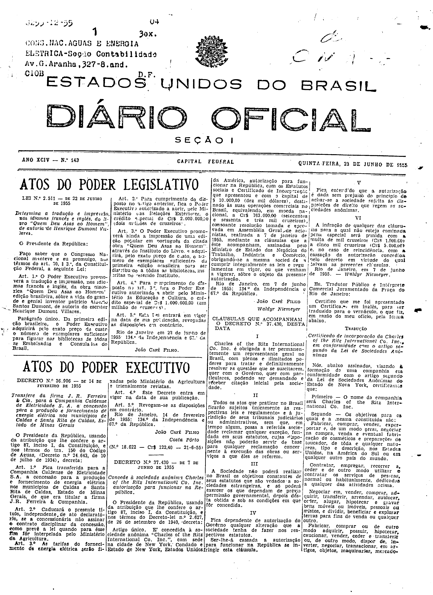

###DEC-037430-0-000-07-06-1955@@@

<strong>DECRETO Nº 37.430, DE 7 DE JUNHO DE 1955.</strong>

<em><strong>Concede à sociedade anômima Charles of the Ritz International Co. Inc. autorização para funcionar na República.</strong></em>

<strong>O PRESIDENTE DA REPÚBLICA</strong>, usando da atribuição que lhe confere o artigo 87, inciso I, da Constituição, e nos têrmos do Decreto-lei nº 2.627, de 26 de setembro de 1940,

<strong>DECRETA:</strong>

Artigo único. É concedida à sociedade anônima “<em>Charles</em> <em>of</em> <em>the</em> <em>Ritz</em> <em>International</em> <em>Co</em>. <em>Inc</em>.”, com sede na cidade de <em>New</em> <em>York</em>, condado e Estado de <em>New</em> <em>York</em>, Estados Unidos <em>da</em> América, autorização para funcionar na República, com os Estatutos sociais e Certificado de Incorporação que apresentou e com o capital de $10.000,00(dez mil dólares), destinado às suas operações comerciais no Brasil, equivalendo, em moeda nacional, a Cr$763.000,00 (setecentos e sessenta e três mil cruzeiros), consoante resolução tomada e aprovada em Assembléia Geral de acionistas, realizada a 7 de janeiro de 1955, mediante as cláusulas que a êste acompanham, assinadas pelo Ministro de Estado dos Negócios do Trabalho, Indústria e Comércio, obrigando-se a mesma sociedade a cumprir integralmente as leis e regulamentos em vigor, ou que venham a vigorar, sôbre o objeto da presente autorização.

Rio de Janeiro, em 7 de junho de 1955; 134º da Independência e 67º da República.

<strong>JOÃO CAFÉ FILHO</strong>

Waldyr Niemeyer

<!-- fac-simile-oficial:inicio -->

## Fac-símile oficial: clausulas

A peça vinculada ao Decreto nº 37.430 é reproduzida nas imagens abaixo, a partir da publicação oficial da Imprensa Nacional. A reprodução é em fac-símile, sem transcrição por OCR nem reconstrução do conteúdo.

As imagens mostram páginas inteiras do Diário Oficial da União e podem conter outras matérias. Essas matérias vizinhas não são atribuídas a este decreto. A peça é identificada pelo seu título e pela referência ao ato nas páginas indicadas.

SHA-256 desta imagem: `f5bb570df1590bbaeb54442bd6c1d56a6849d00180eb0448d1821fba055d8ad2`.

Fontes oficiais da publicação:

- [DO_1_19550623_143.PDF](https://biblioteca.in.gov.br/documents/271518/581356/DO_1_19550623_143.PDF/8889f81d-b5ac-0ee3-c5f4-c762602165ae?t=1574963064733&download=true) — SHA-256 do PDF: `a9279b487e09e3949540f76ad05a380d84bcf1d0a5d337b72f9628e0cfbebc40`.

<!-- fac-simile-oficial:fim -->
