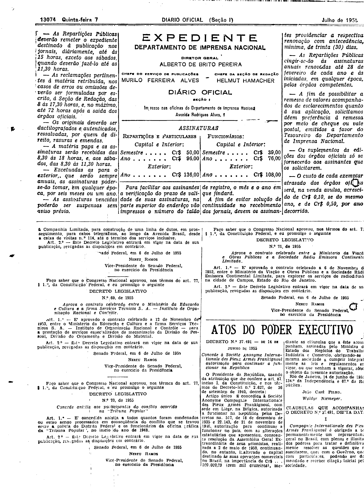
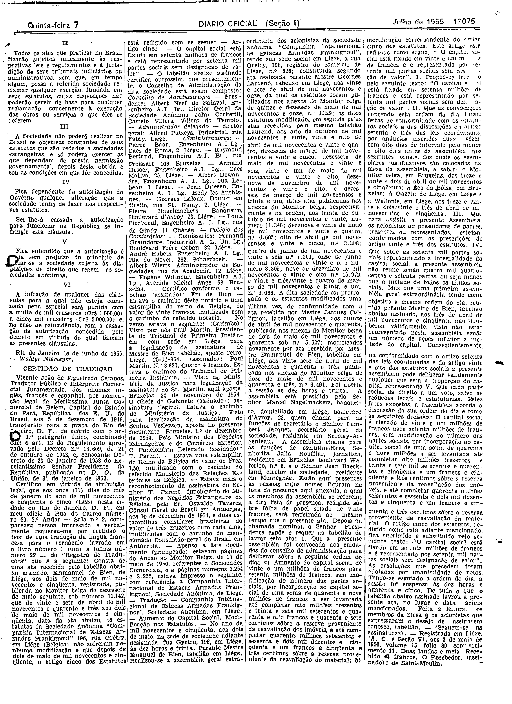
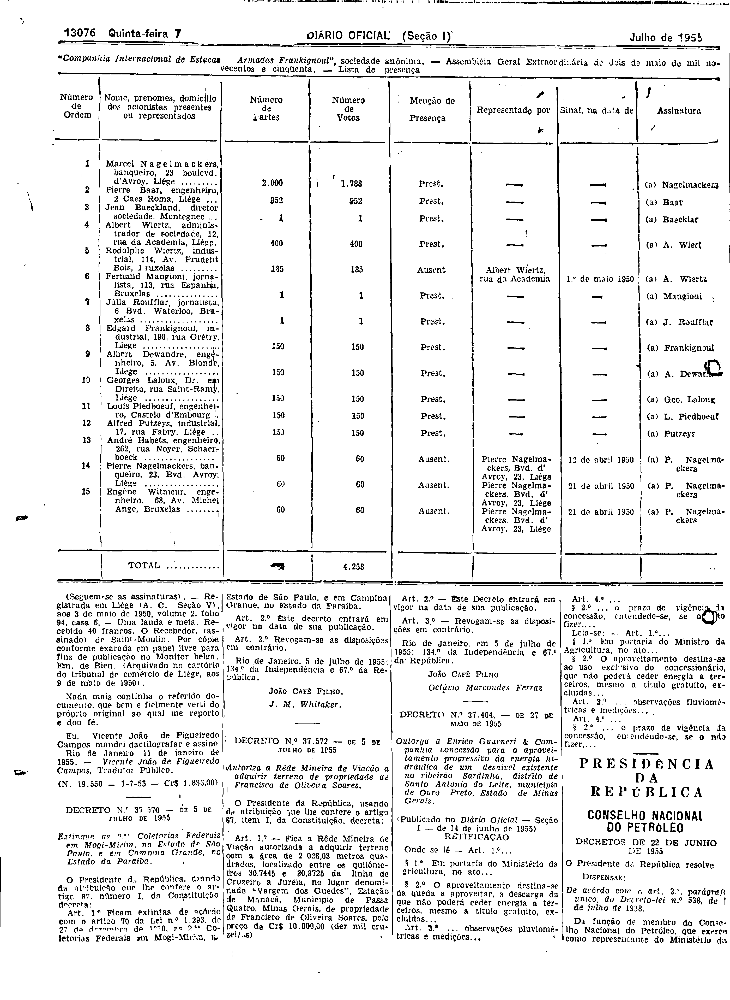

###DEC-037491-0-000-14-06-1955@@@

<strong>DECRETO Nº 37.491, DE 14 DE JUNHO DE 1955.</strong>

<!-- fac-simile-oficial:inicio -->

## Fac-símile oficial do ato inteiro: cláusulas + certidão de tradução e lista de presença

Esta norma é reproduzida apenas em imagem. As páginas inteiras do _Diário Oficial da União_ (Seção I) de 7 de julho de 1955 trazem o decreto e o instrumento que o acompanha: PDF `DO_1_19550707_154.PDF`, p.2 do PDF (impressa 13074), p.3 do PDF (impressa 13075), p.4 do PDF (impressa 13076).

O texto do Senado que antes constava aqui foi retirado para manter uma só versão do ato: não foi colacionado palavra a palavra com o impresso.

**Limites lidos nas imagens:** p.13074 (PDF 2): decreto na col.3 base–col.4; «CLÁUSULAS QUE ACOMPANHAM O DECRETO N.º 37.491» na base da col.4 (I). p.13075 (PDF 3): col.1 II–VI e «Rio de Janeiro, 14 de junho de 1955. — Waldyr Niemeyer.»; depois «CERTIDÃO DE TRADUÇÃO» (Vicente João de Figueiredo Campos, 11-1-1955) até o fim das cols.1–4. p.13076 (PDF 4): quadro «Lista de presença» (15 acionistas, total 4.258) em largura total e col.1 topo, fim da certidão até «(N. 19.550 — 1-7-55 — Cr$ 1.836,00)», antes do Decreto 37.570.

**Assinatura(s):** Waldyr Niemeyer (cláusulas); Vicente João de Figueiredo Campos, Tradutor Público (certidão)

As imagens são as páginas inteiras, extraídas do PDF com `pdfimages -png` (imagem JBIG2 embutida, uma por página, sem reduzir), sem recorte, sem redesenho e sem transcrição. Cada página traz também outros atos do mesmo dia; a peça está apenas no trecho indicado. O texto do ato só existe na imagem. Não há OCR validado.

Fonte: Imprensa Nacional, Biblioteca Machado de Assis, `DO_1_19550707_154.PDF` (SHA-256 `12403b1e947633c88c85db99c68f1e616391821ba335f8ed7a95ddf3cdf3d102`). SHA-256 das imagens, na ordem: `54a45a0699276060f9b2f9b00995e6cfc1d501f0c7997fff20f2f3d924430a3f`, `9d514780cb262a71c0aeb5870585b40ff5e06060344aeae4bd33b959cb6b0842`, `07263c1be833c290c6698132874e292ca12cc038e82a4434c45be9e61075e5b1`.

[PDF da edição oficial](https://biblioteca.in.gov.br/documents/271518/581356/DO_1_19550707_154.PDF/3b5ae50e-75fc-6892-8339-e86604876f9b?t=1574963176227&download=true).

<!-- fac-simile-oficial:fim -->
