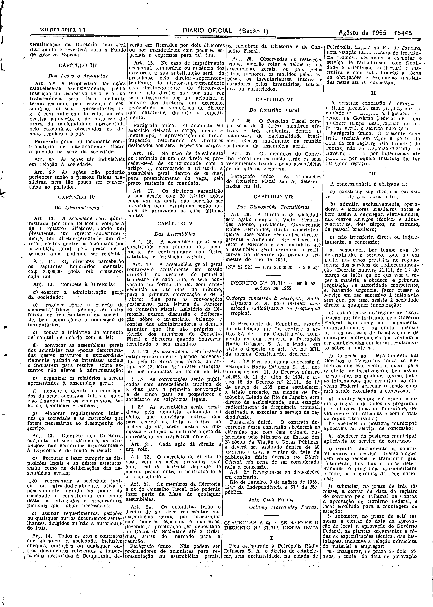
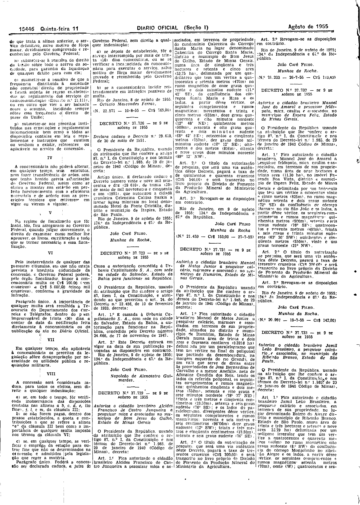

###DEC-037717-0-000-08-08-1955@@@

<strong>DECRETO Nº 37.717, DE 8 DE AGÔSTO DE 1955.</strong>

<em><strong>Outorga concessão à Petrópolis Rádio Difusora S.A. para instalar uma estação radiodifusora de frequência tropical.</strong></em>

<strong>O PRESIDENTE DA REPÚBLICA</strong>, usando da atribuição que lhe confere o artigo 87, nº I, da Constituição, atendendo ao que requereu a Petrópolis Rádio Difusora S.A. e tendo, em vista o disposto no art. 5º, nº XII, da mesma Constituição,

<strong>DECRETA:</strong>

<strong>Art</strong>. 1º Fica outorgada concessão à Petrópolis Rádio Difusora S.A. nos têrmos do art. 11, do Decreto número 24.655, de 11 de julho de 1934, e artigo 16, do Decreto nº 21.111, de 1º de março de 1932, para estabelecer, a título precário, na cidade de Petrópolis, Estado do Rio de Janeiro, sem direito de exclusividade, uma estação radiodifusora de frequência tropical, destinada a executar o serviço de radiodifusão.

Parágrafo único. O contrato decorrente desta concessão obedecerá às cláusulas que com êste baixam, rubricadas pelo Ministro de Estado, dos Negócios da Viação e Obras Públicas e deverá ser assinado dentro de 60 (sessenta) dias, a contar da data da publicação dêste decreto no <em>Diário</em> <em>Oficial</em>, sob pena de ser considerada nula a concessão.

<strong>Art</strong>. 2º Revogam-se as disposições em contrário.

Rio de Janeiro, em 8 de agôsto de 1955; 134º da Independência e 67º da República.

<strong>JOÃO CAFÉ FILHO</strong>

bMunhoz da Rocha

<!-- fac-simile-oficial:inicio -->

## Fac-símile oficial: cláusulas

O texto acima não inclui as cláusulas a que se refere este decreto. A publicação oficial do anexo está em imagem, nas páginas do _Diário Oficial da União_ (Seção I) de 11 de agosto de 1955: p. 15445 (a partir de «CLÁUSULAS A QUE SE REFERE O DECRETO N.º 37.717, DESTA DATA»); p. 15446 (até «N. 22.571 — 10-8-55 — Cr$ 765,00»).

As imagens são as páginas inteiras, tal como digitalizadas pela Imprensa Nacional, sem recorte, sem redesenho e sem transcrição. Cada página traz também outros atos do mesmo dia; a peça deste decreto está apenas nas colunas indicadas, e o texto do anexo só existe na imagem. Não há OCR validado.

Fonte: Imprensa Nacional, Biblioteca Machado de Assis, arquivo `DO_1_19550811_183.PDF` (SHA-256 `a82e13eaa5bbaaf86146b7da5bcc0f6359d37f2a1644a38d3c7b63392d9bfad2`), páginas 5, 6 do PDF. SHA-256 das imagens, na ordem: `fdcd824f777e048bd728ea9adf317fe0eac25cde96bbf443086058c0a2995cab`, `353e8b24568c0155d5e1780333bc83e3443763a9a78053e6550514b53f9b84f8`.

<!-- fac-simile-oficial:fim -->
