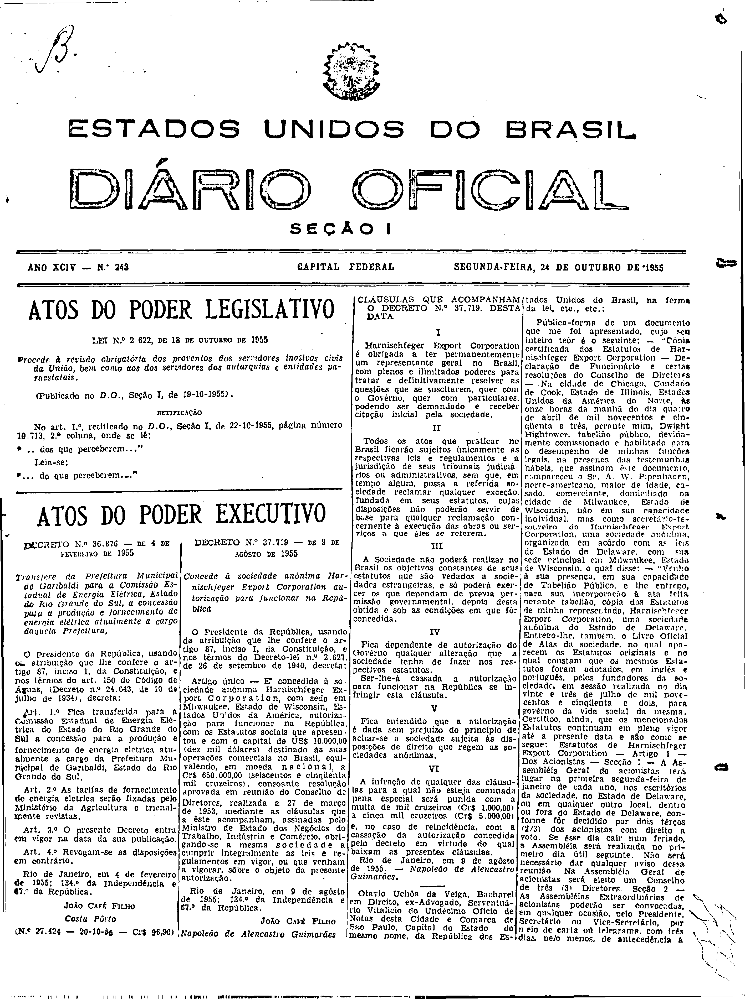

###DEC-037719-0-000-09-08-1955@@@

<strong>DECRETO Nº 37.719, DE 9 DE AGÔSTO DE 1955.</strong>

<em><strong>Concede à sociedade anônima Harnischfeger Export Corporation autorização para funcionar na República.</strong></em>

<strong>O PRESIDENTE DA REPÚBLICA</strong>, usando da atribuição que lhe confere o artigo 87, inciso I, da Constituição, e nos têrmos do Decreto-lei nº 2.627, de 26 setembro de 1940,

<strong>DECRETO:</strong>

Artigo único - É concedida à sociedade anônima <em>Harnischfeger Export Corporation</em>, com sede em <em>Whwukee</em>, Estado de <em>Wisconsin</em>, Estados Unidos da América, autorização para funcionar na República, com os Estatutos sociais que apresentou e com o capital de US$10.000,00 (dez mil dólares) destinado às suas operações comerciais no Brasil, eqüivalendo, em moeda nacional, a Cr$650.000,00 (seiscentos e cinqüenta cruzeiros), consoante resolução aprovada em reunião do Conselho de Diretores, realizada a 27 de março de 1953, mediante as cláusulas que a êste acompanham, assinadas pelo Ministro de Estado dos Negócios do Trabalho, Indústria e Comércio, obrigando-se a mesma sociedade a cumprir integralmente as leis e regulamentos em vigor, ou que venham a vigorar, sôbre o objeto da presente autorização.

Rio de Janeiro, em 9 de agôsto de 1955; 134º da Independência e 67º da República.

<strong>JOÃO CAFÉ FILHO</strong>

Napoleão de Alencastro Guimarães

<!-- fac-simile-oficial:inicio -->

## Fac-símile oficial: clausulas

A peça vinculada ao Decreto nº 37.719 é reproduzida nas imagens abaixo, a partir da publicação oficial da Imprensa Nacional. A reprodução é em fac-símile, sem transcrição por OCR nem reconstrução do conteúdo.

As imagens mostram páginas inteiras do Diário Oficial da União e podem conter outras matérias. Essas matérias vizinhas não são atribuídas a este decreto. A peça é identificada pelo seu título e pela referência ao ato nas páginas indicadas.

SHA-256 desta imagem: `e232ee9a66ef245925ab48b59718249d916f1ed5184c96b236c9ed2272f7a354`.

Fontes oficiais da publicação:

- [DO_1_19551024_243.PDF](https://biblioteca.in.gov.br/documents/271518/581356/DO_1_19551024_243.PDF/06ade93c-0d50-e146-9ccc-14b5e8cd7900?t=1574964010020&download=true) — SHA-256 do PDF: `589b6c9db9eca0b820901b7c235302f29d1ef013dad940b35185d6afdd034052`.

<!-- fac-simile-oficial:fim -->
