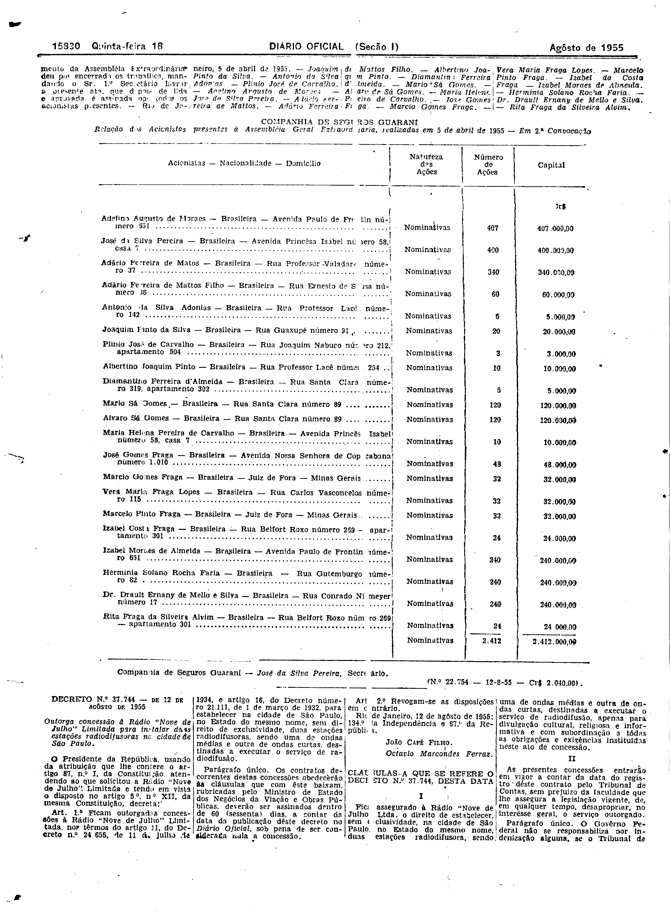
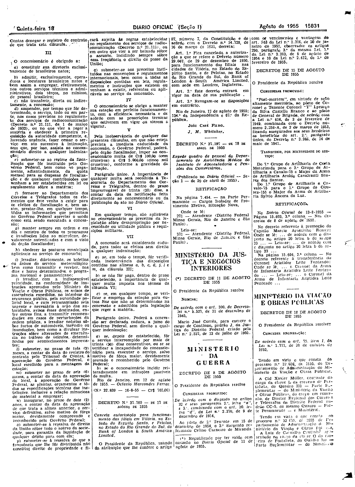

###DEC-037744-0-000-12-08-1955@@@

<strong>DECRETO Nº 37.744, DE 12 DE AGÔSTO DE 1955.</strong>

<em><strong>Outorga concessão à Rádio “Nove de Julho” Limitada para instalar duas estações radiodifusoras na cidade de São Paulo.</strong></em>

<strong>O PRESIDENTE DA REPÚBLICA</strong>, usando da atribuição que lhe confere o artigo 87, nº I, da Constituição atendendo ao que solicitou a Rádio “Nove de Julho” Limitada e tendo em vista o disposto no artigo 5º, nº XII, da mesma Constituição,

<strong>DECRETA:</strong>

<strong>Art</strong>. 1º Ficam outorgadas concessões à Rádio “Nove de Julho” Limitada, nos têrmos do artigo 11, do Decreto nº 24.655, de 11 de julho de 1934, e artigo 16, do Decreto número 21.111, de 1 de março de 1932, para estabelecer na cidade de São Paulo, no Estado do mesmo nome, sem direito de exclusividade, duas estações radiodifusoras, sendo uma de ondas médias e outra de ondas curtas, destinadas a executar o serviço de radiodifusão.

Parágrafo único. Os contratos decorrentes destas concessões obedecerão às cláusulas que com êste baixam, rubricadas pelo Ministro de Estado dos Negócios da Viação e Obras Públicas, deverão ser assinados dentro de 60 (sessenta) dias, a contar da data da publicação dêste decreto no <em>Diário</em> <em>Oficial</em>, sob pena de ser considerada nula a concessão.

<strong>Art</strong>. 2º Revogam-se as disposições em contrário.

Rio de Janeiro, 12 de agôsto de 1955; 134º da Independência e 57º da República.

<strong>JOÃO CAFÉ FILHO</strong>

Octavio Marcondes Ferraz

<!-- fac-simile-oficial:inicio -->

## Fac-símile oficial: cláusulas

O texto acima não inclui as cláusulas a que se refere este decreto. A publicação oficial do anexo está em imagem, nas páginas do _Diário Oficial da União_ (Seção I) de 18 de agosto de 1955: p. 15830 (a partir de «CLÁUSULAS A QUE SE REFERE O DECRETO N.º 37.744, DESTA DATA»); p. 15831 (até «N.º 22.839 — 16-8-55 — Cr$ 765,00»).

As imagens são as páginas inteiras, tal como digitalizadas pela Imprensa Nacional, sem recorte, sem redesenho e sem transcrição. Cada página traz também outros atos do mesmo dia; a peça deste decreto está apenas nas colunas indicadas, e o texto do anexo só existe na imagem. Não há OCR validado.

Fonte: Imprensa Nacional, Biblioteca Machado de Assis, arquivo `DO_1_19550818_188.PDF` (SHA-256 `865c6d10cd1463b51ed2d3c923cbca49c712fa5102d60888a967d2c7e5635433`), páginas 6, 7 do PDF. SHA-256 das imagens, na ordem: `ff5a5d5d69b5d8ba85859fc4bbde188a4ec0139ad8ceef3e8b03c896008d4c96`, `93238b6c0350029ead23e5eb0e920390a4e5387c514f141c6567d1fb01cb3eb7`.

<!-- fac-simile-oficial:fim -->
