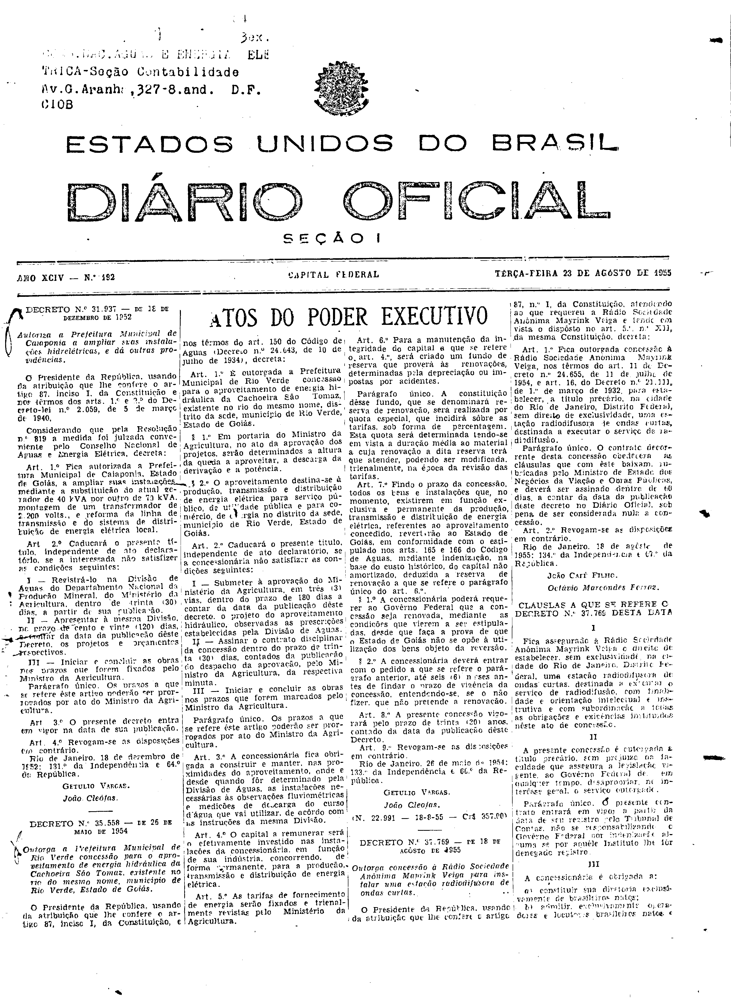
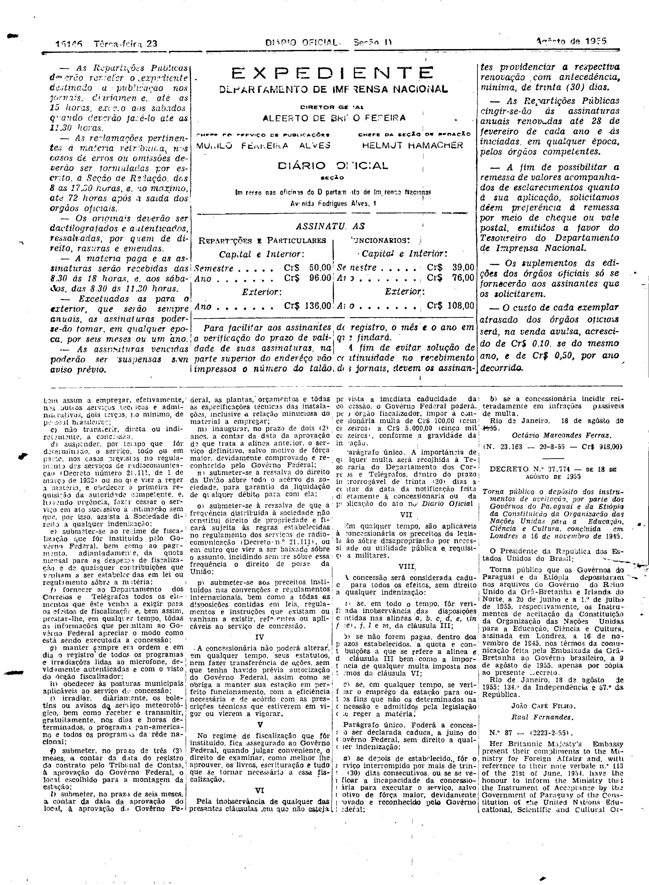

###DEC-037769-0-000-18-08-1955@@@

<strong>DECRETO Nº 37.769, DE 18 DE AGÔSTO DE 1955.</strong>

<em><strong>Outorga concessão à Rádio Sociedade Anônima Mayrink Veiga para instalar uma estação radiodifusora de ondas curtas.</strong></em>

<strong>O PRESIDENTE DA REPÚBLICA</strong>, usando da atribuição que lhe confere o artigo 87, nº I, da Constituição, atendendo ao que requereu a Rádio Sociedade Anônima Mayrink Veiga e tendo em vista o dispôsto no art. 5º, nº XII, da mesma Constituição,

<strong>DECRETA:</strong>

<strong>Art</strong>. 1º Fica outorgada concessão à Rádio Sociedade Anônima Mayrink Veiga, nos têrmos do art. 11 do Decreto nº 24.655, de 11 de julho de 1954, e art. 16, do Decreto nº 21.111, de 1º de março de 1932, para estabelecer, a título precário, na cidade do Rio de Janeiro, Distrito Federal, sem direito de exclusividade, uma estação radiodifusora de ondas curtas, destinada a executar o serviço de radiodifusão.

Parágrafo único. O contrato decorrente desta concessão obedecerá às cláusulas que com êste baixam, rubricadas pelo Ministro de Estado dos Negócios da Viação e Obras Públicas, e deverá ser assinado dentro de 60 dias, a contar da data da publicação dêste decreto no <em>Diário</em> <em>Oficial</em>, sob pena de ser considerada nula a concessão.

<strong>Art</strong>. 2º Revogam-se as disposições em contrário.

Rio de Janeiro, 18 de agôsto de 1955; 134º da Independência e 67º da República.

<strong>JOÃO CAFÉ FILHO</strong>

Octávio Marcondes Ferraz

<!-- fac-simile-oficial:inicio -->

## Fac-símile oficial: cláusulas

O texto acima não inclui as cláusulas a que se refere este decreto. A publicação oficial do anexo está em imagem, nas páginas do _Diário Oficial da União_ (Seção I) de 23 de agosto de 1955: página 1 do PDF (capa do caderno) (a partir de «CLÁUSULAS A QUE SE REFERE O DECRETO N.º 37.769 DESTA DATA», com a margem direita da página parcialmente apagada na própria digitalização); página 2 do PDF (até «N. 23.163 — 20-8-55 — Cr$ 918,00»).

As imagens são as páginas inteiras, tal como digitalizadas pela Imprensa Nacional, sem recorte, sem redesenho e sem transcrição. Cada página traz também outros atos do mesmo dia; a peça deste decreto está apenas no trecho indicado, e o texto do anexo só existe na imagem. Não há OCR validado.

Fonte: Imprensa Nacional, Biblioteca Machado de Assis, arquivo `DO_1_19550823_192.PDF` (SHA-256 `f983768b6c4e3f2aaf455898f30857810fd571a8c3438a4c4ec8635eb425e44a`), páginas 1, 2 do PDF. SHA-256 das imagens, na ordem: `493966f358e0a78ec1e2a9db9b79d75b08f1bd75cca7c81bc93e21116098c2e1`, `29d8db945fee39011bcd4377a172374854f882586104dda17f14e22c819deda2`.

<!-- fac-simile-oficial:fim -->
