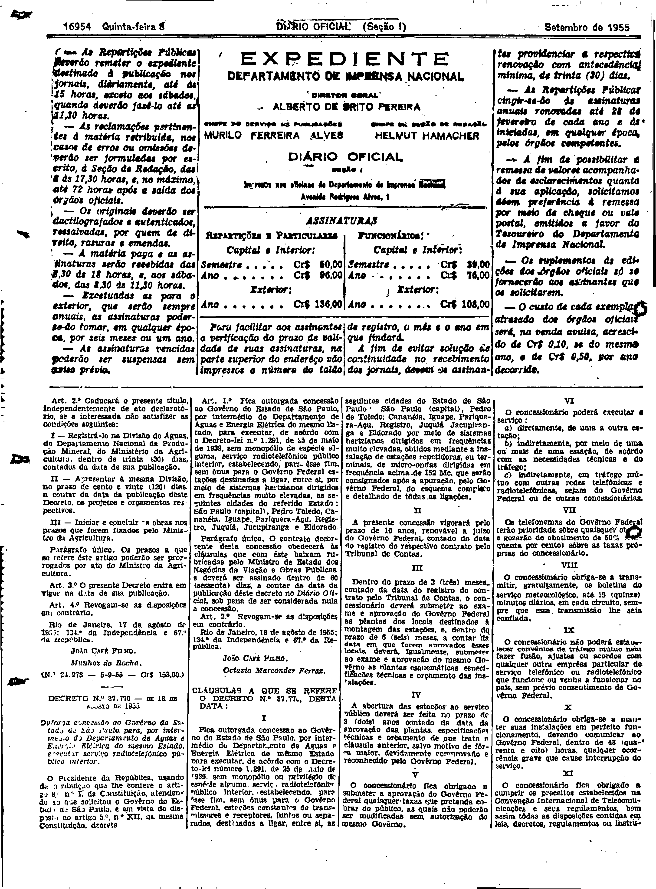
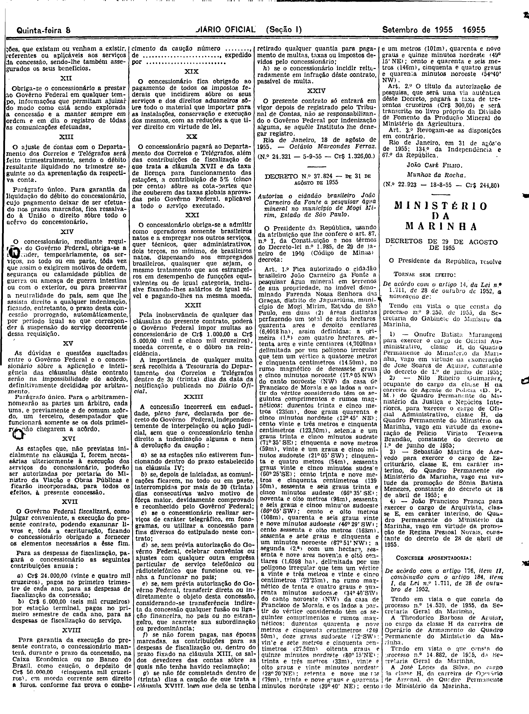

###DEC-037770-0-000-18-08-1955@@@

<strong>DECRETO Nº 37.770, DE 18 DE AGOSTO DE 1955.</strong>

<!-- fac-simile-oficial:inicio -->

## Fac-símile oficial do ato inteiro: cláusulas

Esta norma é reproduzida apenas em imagem. As páginas inteiras do _Diário Oficial da União_ (Seção I) de 8 de setembro de 1955 trazem o decreto e o instrumento que o acompanha: PDF `DO_1_19550908_205.PDF`, p.2 do PDF (impressa 16954), p.3 do PDF (impressa 16955).

O texto do Senado que antes constava aqui foi retirado para manter uma só versão do ato: não foi colacionado palavra a palavra com o impresso.

**Limites lidos nas imagens:** p.16954 (PDF 2): decreto col.1 base–col.2 (JOÃO CAFÉ FILHO / Octavio Marcondes Ferraz); «CLÁUSULAS A QUE SE REFERE O DECRETO N.º 37.77?» começa na base da col.2 e segue pelas cols.3–4 (I–XI). p.16955 (PDF 3): cols.1–3 XII–XXIV, terminando «Rio de Janeiro, 18 de agôsto de 1955. — Octávio Marcondes Ferraz. (N.º 24.321 — 5-9-55 — Cr$ 1.326,00.)», antes do Decreto 37.824.

**Assinatura(s):** Octávio Marcondes Ferraz (Ministro da Viação e Obras Públicas)

As imagens são as páginas inteiras, extraídas do PDF com `pdfimages -png` (imagem JBIG2 embutida, uma por página, sem reduzir), sem recorte, sem redesenho e sem transcrição. Cada página traz também outros atos do mesmo dia; a peça está apenas no trecho indicado. O texto do ato só existe na imagem. Não há OCR validado.

Fonte: Imprensa Nacional, Biblioteca Machado de Assis, `DO_1_19550908_205.PDF` (SHA-256 `4af7dbf70066b3be116032afaa9a1bcf1bfb35dc660860ebe5a498c7e08f1087`). SHA-256 das imagens, na ordem: `0d77960c990a06d367a99e65cee077747fc0d5325a3b22c755044fc7b61b8fdc`, `b07bc46d0fe018f20479226988097f932397552b6689d5687034b86163e47c53`.

[PDF da edição oficial](https://biblioteca.in.gov.br/documents/271518/581356/DO_1_19550908_205.PDF/353aace3-e029-fca6-c994-ad84c86af668?t=1574963642050&download=true).

<!-- fac-simile-oficial:fim -->
