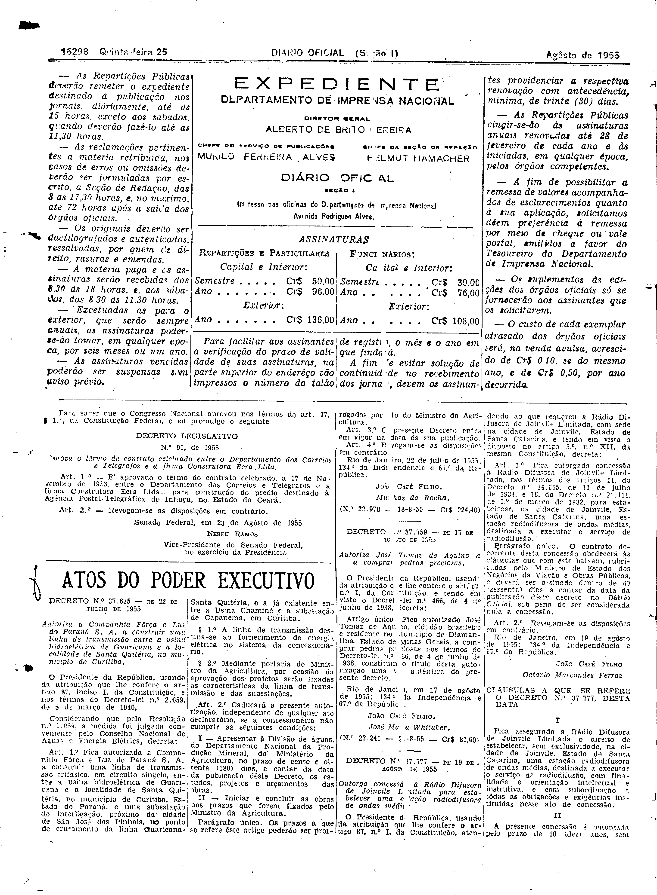
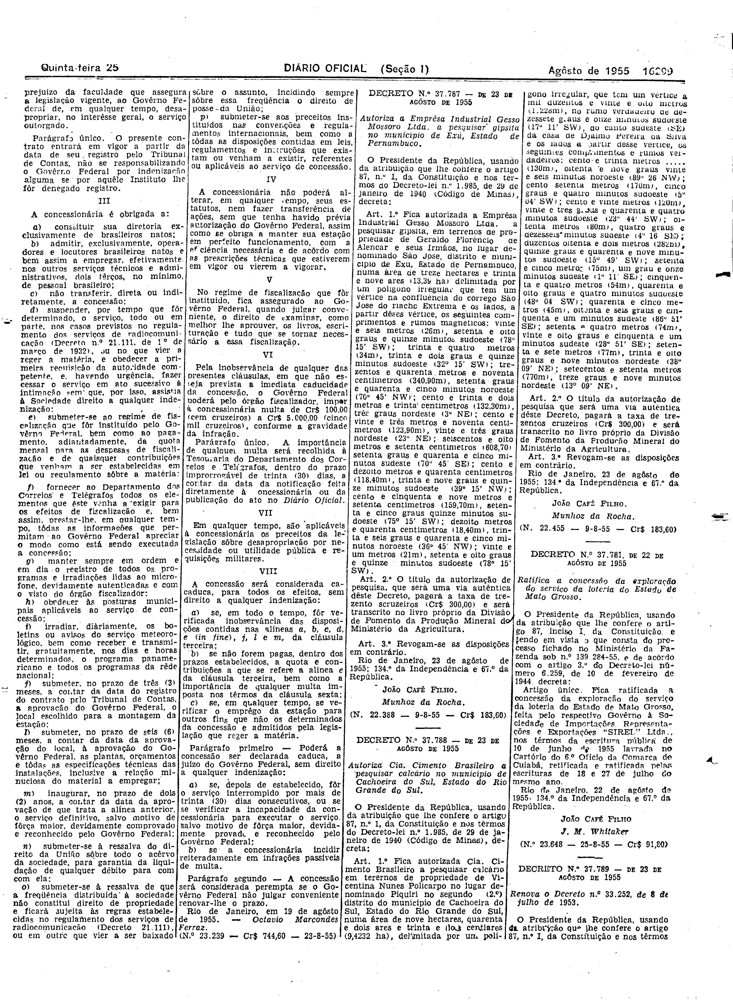

###DEC-037777-0-000-19-08-1955@@@

<strong>DECRETO Nº 37.777, DE 19 DE AGÔSTO DE 1955.</strong>

<em><strong>Outorga concessão à Rádio Difusora de Joinvile Limitada para estabelecer uma estação radiodifusora de ondas médias.</strong></em>

<strong>O PRESIDENTE DA REPÚBLICA</strong>, usando da atribuição que lhe confere o artigo 87, nº I, da Constituição, atendendo ao que requereu a Rádio Difusora de Joinvile Limitada, Estado de Santa Catarina, e tendo em vista o disposto no artigo 5º, nº XII, da mesma Constituição,

<strong>DECRETA:</strong>

<strong>Art</strong>. 1º Fica outorgada concessão à Rádio Difusora de Joinvile Limitada, nos têrmos dos artigos 11, do Decreto nº 24.655, de 11 de julho de 1934, e 16, do Decreto nº 21.111, de 1º de março de 1932, para estabelecer, na cidade de Joinvile, Estado de Santa Catarina, uma estação radiodifusora a executar o serviço de radiodifusão.

Parágrafo único. O contrato decorrente desta concessão obedecerá às cláusulas que com êste baixam, rubricadas pelo Ministro de Estado dos Negócios da Viação e Obras Públicas, e deverá ser assinado dentro de 60 (sessenta) dias, a contar da data da publicação dêste decreto no <em>Diário</em> <em>Oficial</em>, sob pena de ser considerada nula a concessão.

<strong>Art</strong>. 2º Revogam-se as disposições em contrário.

Rio de Janeiro, em 19 de agôsto de 1955; 134º da Independência e 67º da República.

<strong>JOÃO CAFÉ FILHO</strong>

Octávio Marcondes Ferraz

<!-- fac-simile-oficial:inicio -->

## Fac-símile oficial: cláusulas

O texto acima não inclui as cláusulas a que se refere este decreto. A publicação oficial do anexo está em imagem, nas páginas do _Diário Oficial da União_ (Seção I) de 25 de agosto de 1955: página 2 do PDF (a partir de «CLÁUSULAS A QUE SE REFERE O DECRETO N.º 37.777, DESTA DATA»); página 3 do PDF (até «N.º 23.239 — 18-8-55 — Cr$ 744,60»).

As imagens são as páginas inteiras, tal como digitalizadas pela Imprensa Nacional, sem recorte, sem redesenho e sem transcrição. Cada página traz também outros atos do mesmo dia; a peça deste decreto está apenas no trecho indicado, e o texto do anexo só existe na imagem. Não há OCR validado.

Fonte: Imprensa Nacional, Biblioteca Machado de Assis, arquivo `DO_1_19550825_194.PDF` (SHA-256 `83f164aabaac1920d8c419dc7b860757174a9a05657d5c161b8f6dbda9461abb`), páginas 2, 3 do PDF. SHA-256 das imagens, na ordem: `4aa19c9350a7c5bb012c1492e0af58ed244224b4c1adc0acfcc0417f685c22ef`, `ce9984d14b296515cc1dad3506af2100e8c260040ff23695d55607d6688b7060`.

<!-- fac-simile-oficial:fim -->
