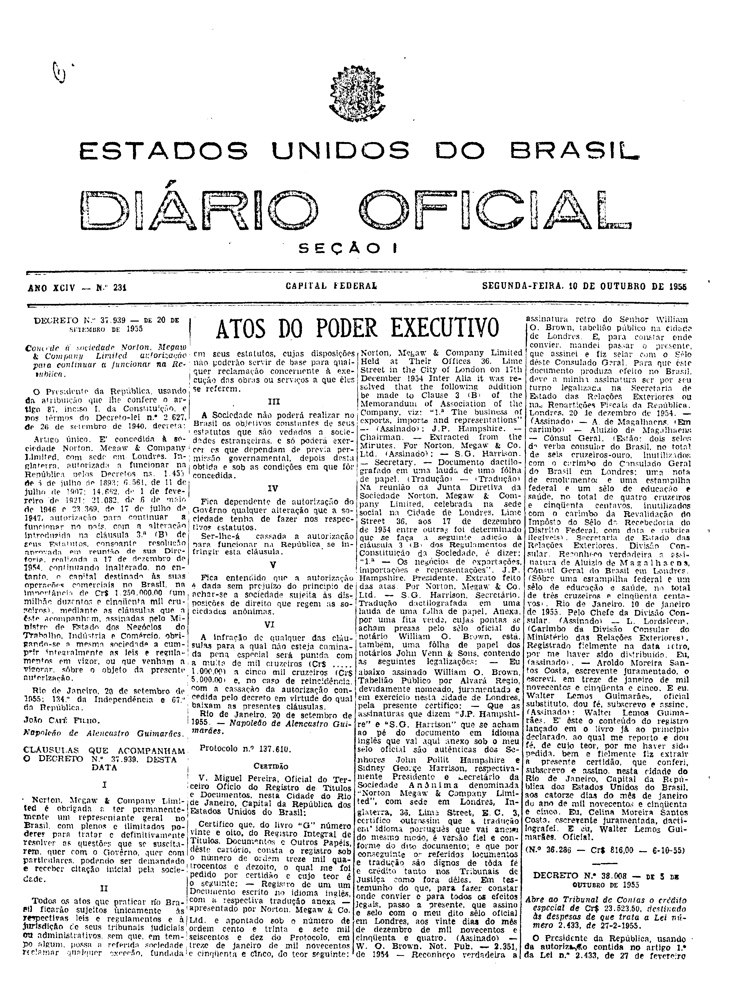

###DEC-037939-0-000-20-09-1955@@@

<strong>DECRETO Nº 37.939, DE 20 DE SETEMBRO DE 1955.</strong>

<em><strong>Concede à sociedade Norton, Megaw & Company Limited autorização para continuar a funcionar na República.</strong></em>

<strong>O PRESIDENTE DA REPÚBLICA</strong>, usando da atribuição que lhe confere o artigo 87, inciso I, da Constituição, e nos têrmos do Decreto-lei nº 2.627, de 26 de setembro de 1940,

<strong>DECRETA:</strong>

Artigo único. É concedida à sociedade Norton, <em>Megaw & Company Limited</em>, com sede em Londres, Inglaterra, autorizada a funcionar na República pelos Decretos ns. 1.455, de 5 de julho de 1893; 6.561, de 11 de julho de 1907; 14.662, de 1 de fevereiro de 1921; 21.082, de 6 de maio de 1946 e 23.369, de 17 de julho de 1947, autorização para continuar a funcionar no país, com a alteração introduzida na cláusula 3ª (B) de seus Estatutos, consoante resolução aprovada em reunião de sua Diretoria, realizada a 17 de dezembro de 1954, continuando inalterado no entanto, o capital destinado às suas operações comerciais no Brasil, na importância de Cr$1.250.000,00 (um milhão duzentos e cinqüenta mil cruzeiros), mediante as cláusulas que a êste acompanham, assinadas pelo Ministro de Estado dos Negócios do Trabalho, Indústria e Comércio, obrigando-se a mesma sociedade a cumprir integralmente as leis e regulamentos em vigor, ou que venham a vigorar, sôbre o objeto da presente autorização.

Rio de Janeiro, 20 de setembro de 1955; 134º da Independência e 67º da República.

<strong>JOÃO CAFÉ FILHO</strong>

Napoleão de Alencastro Guimarães

<!-- fac-simile-oficial:inicio -->

## Fac-símile oficial: clausulas

A peça vinculada ao Decreto nº 37.939 é reproduzida nas imagens abaixo, a partir da publicação oficial da Imprensa Nacional. A reprodução é em fac-símile, sem transcrição por OCR nem reconstrução do conteúdo.

As imagens mostram páginas inteiras do Diário Oficial da União e podem conter outras matérias. Essas matérias vizinhas não são atribuídas a este decreto. A peça é identificada pelo seu título e pela referência ao ato nas páginas indicadas.

SHA-256 desta imagem: `9c5ee8fcac365f0e986d1231257d73713420da0e296021a463923d807a5cc7e1`.

Fontes oficiais da publicação:

- [DO_1_19551010_231.PDF](https://biblioteca.in.gov.br/documents/271518/581356/DO_1_19551010_231.PDF/64a894c9-6a93-7e5c-d002-6c761b77d43e?t=1574963895083&download=true) — SHA-256 do PDF: `3cf072e23c7278fc3b5285706945572698e772ded8a818a444a865cb0f70a3dc`.

<!-- fac-simile-oficial:fim -->
