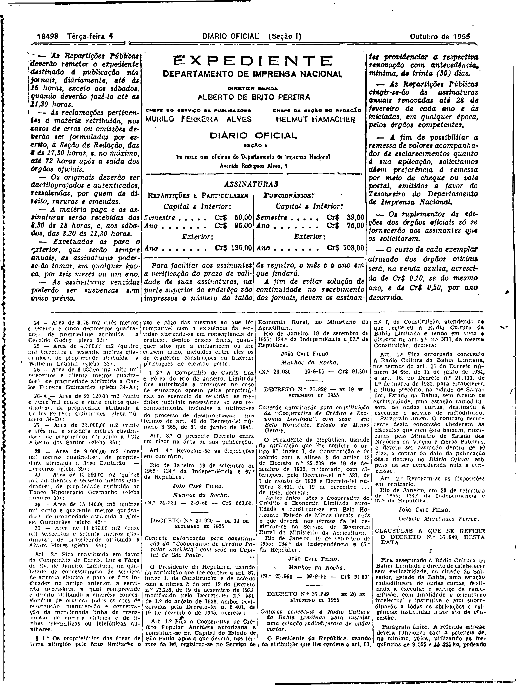
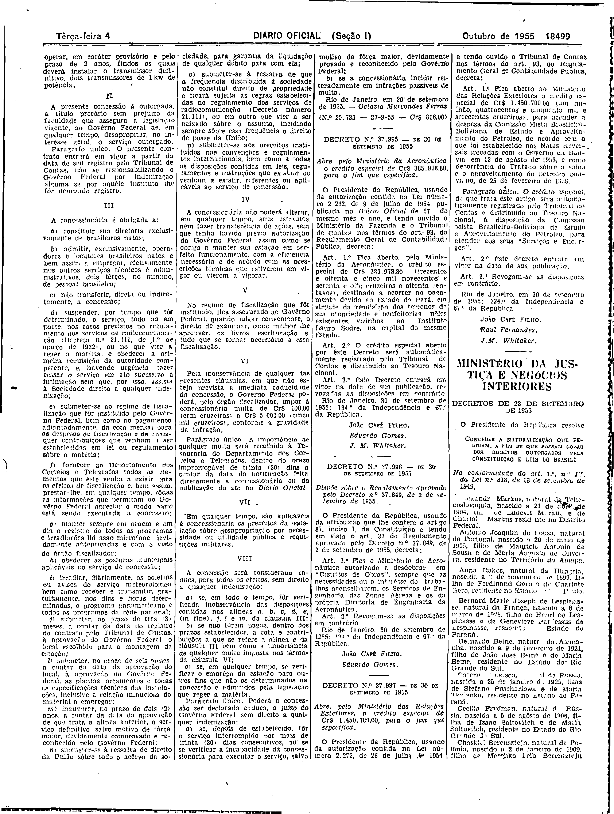

###DEC-037949-0-000-20-09-1955@@@

<strong>DECRETO Nº 37.949, DE 20 DE SETEMBRO DE 1955.</strong>

<em><strong>Outorga concessão à Rádio Cultura da Bahia limitada para instalar uma estação radiodifusora de ondas curtas.</strong></em>

<strong>O PRESIDENTE DA REPÚBLICA</strong>, usando da atribuição que lhe confere o art. 87 nº1, da Constituição, atendendo ao que requereu a Rádio Cultura da Bahia Limitada e tendo em vista o disposto no art. 5º, nº XII, da mesma Constituição,

<strong>DECRETA:</strong>

<strong>Art</strong>. 1º Fica outorgada concessão nos têrmos do art. 11 do Decreto número 24.655, de 11 de Julho de 1934, e art. 16, do Decreto nº21.111, de 1° de março de 1932, para estabelecer, a título precário, na cidade de Salvador, no estado da Bahia, sem direito de exclusividade, uma estação radiodifusora de ondas curtas, destinada a executar o serviço de radiodifusão.

Parágrafo único. O contrato decorrente desta concessão obedecerá às cláusulas que com êste baixam, rubricadas pelo Ministro de Estado dos Negócios da Viação e Obras Públicas, e deverá ser assinado dentro de 60 dias, a contar da data da publicação dêste decreto no Diário Oficial, sob pena de ser considerada nula a concessão.

<strong>Art</strong>. 2° Revogam se as disposições em contrário.

Rio de Janeiro, em 20 de setembro de 1955; 134° da independência e 67° da República.

<strong>JOÃO CÁFE FILHO</strong>

Octavio Marcondes Ferraz

<!-- fac-simile-oficial:inicio -->

## Fac-símile oficial: cláusulas

O texto acima não inclui as cláusulas a que se refere este decreto. A publicação oficial do anexo está em imagem, nas páginas do _Diário Oficial da União_ (Seção I) de 4 de outubro de 1955: página 2 do PDF (a partir de «CLÁUSULAS A QUE SE REFERE O DECRETO N.º 37.949, DESTA DATA»); página 3 do PDF (até «N.º 25.733 — 27-9-55 — Cr$ 816,00»).

As imagens são as páginas inteiras, tal como digitalizadas pela Imprensa Nacional, sem recorte, sem redesenho e sem transcrição. Cada página traz também outros atos do mesmo dia; a peça deste decreto está apenas no trecho indicado, e o texto do anexo só existe na imagem. Não há OCR validado.

Fonte: Imprensa Nacional, Biblioteca Machado de Assis, arquivo `DO_1_19551004_226.PDF` (SHA-256 `d24f89ef081c8065c7dc880374c89ec103b4ad7d4093ab2d8cdfb52642a58793`), páginas 2, 3 do PDF. SHA-256 das imagens, na ordem: `01d789fde9931cac7a1e35ad6c79c2f2c028273ebe63ddad511a1e35bd13002f`, `dc9c90da96a5291b94db248e5c6df2460a20c7fb33245d41c5b495a6911e027c`.

<!-- fac-simile-oficial:fim -->
