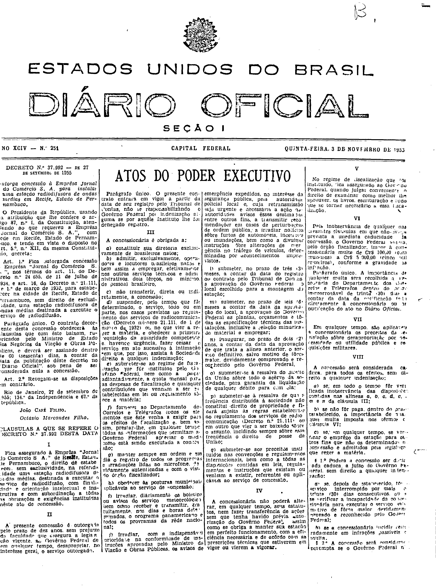
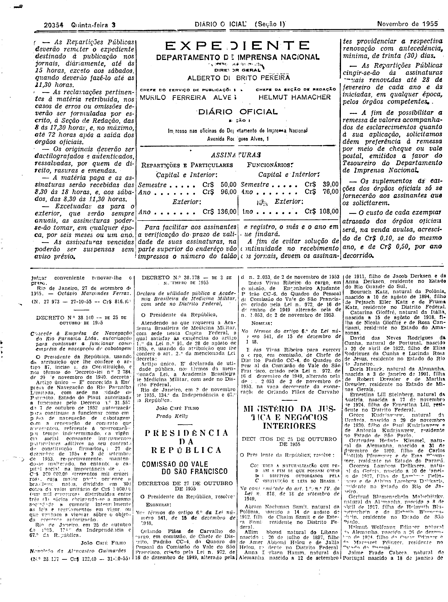

###DEC-037992-0-000-27-09-1955@@@

<strong>DECRETO Nº 37.992, DE 27 DE SETEMBRO DE 1955.</strong>

<em><strong>Outorga concessão à Emprêsa Jornal do Comércio S. A. para instalar uma estação radiodifusora de ondas médias em Recife, Estado de Pernambuco.</strong></em>

<strong>O PRESIDENTE DA REPÚBLICA</strong>, usando da atribuição que lhe confere o artigo 87, nº I, da Constituição, atendendo ao que requereu a Emprêsa “Jornal do Comércio S.A.”, com sede em Recife, Estado de Pernambuco, tendo em vista o disposto no art. 5º, nº XII, da mesma Constituição,

<strong>DECRETA:</strong>

<strong>Art</strong>. 1º Fica outorgada concessão a Emprêsa “Jornal do Comércio S.A.”, nos têrmos do art. 11, do Decreto nº 24.655, de 11 de julho de 1934, e art. 16, do Decreto nº 21.111, de 1º de março de 1952, para estabelecer na cidade de Recife, Estado de Pernambuco, sem direito de exclusividade, uma estação radiodifusora de ondas médias destinadas a executar o serviço da radiodifusão.

Parágrafo único. O contrato decorrente desta concessão obedecerá às cláusulas que com êste baixam, rubricados pelo Ministro de Estado do Negócios da Viação e Obras Públicas, e deverá ser assinado dentro de 60 (sessenta) dias, a contar da data da publicação dêste decreto no “<em>Diário Oficial</em>” sob pena de ser considerada nula a concessão.

<strong>Art</strong>. 2º Revogam-se as disposições em contrário.

Rio de Janeiro, 27 de setembro de 1955;134º da Independência e 67º da República.

<strong>JOÃO CAFÉ FILHO</strong>

Octávio Marcondes Filho

<!-- fac-simile-oficial:inicio -->

## Fac-símile oficial: cláusulas

O texto acima não inclui as cláusulas a que se refere este decreto. A publicação oficial do anexo está em imagem, nas páginas do _Diário Oficial da União_ (Seção I) de 3 de novembro de 1955: página 1 do PDF (capa do caderno) (a partir de «CLÁUSULAS A QUE SE REFERE O DECRETO N.º 37.992 DESTA DATA»); página 2 do PDF (até «N. 27.973 — 27-10-55 — Cr$ 816,00»).

As imagens são as páginas inteiras, tal como digitalizadas pela Imprensa Nacional, sem recorte, sem redesenho e sem transcrição. Cada página traz também outros atos do mesmo dia; a peça deste decreto está apenas no trecho indicado, e o texto do anexo só existe na imagem. Não há OCR validado.

Fonte: Imprensa Nacional, Biblioteca Machado de Assis, arquivo `DO_1_19551103_251.PDF` (SHA-256 `ee8603263d5b9553af05d107cdbe3a0f593cf60a6e8fd8bc1a0fccb8d81d3405`), páginas 1, 2 do PDF. SHA-256 das imagens, na ordem: `4d44b0f32499176f5c464247a193390b8642f52637ee15dc11da0e2dcbc0c542`, `b049aa58fe3b19c0b5991a2c71c4b4284c7f94f5afa4c8ea4d9c77dcbe8c3a9a`.

<!-- fac-simile-oficial:fim -->
