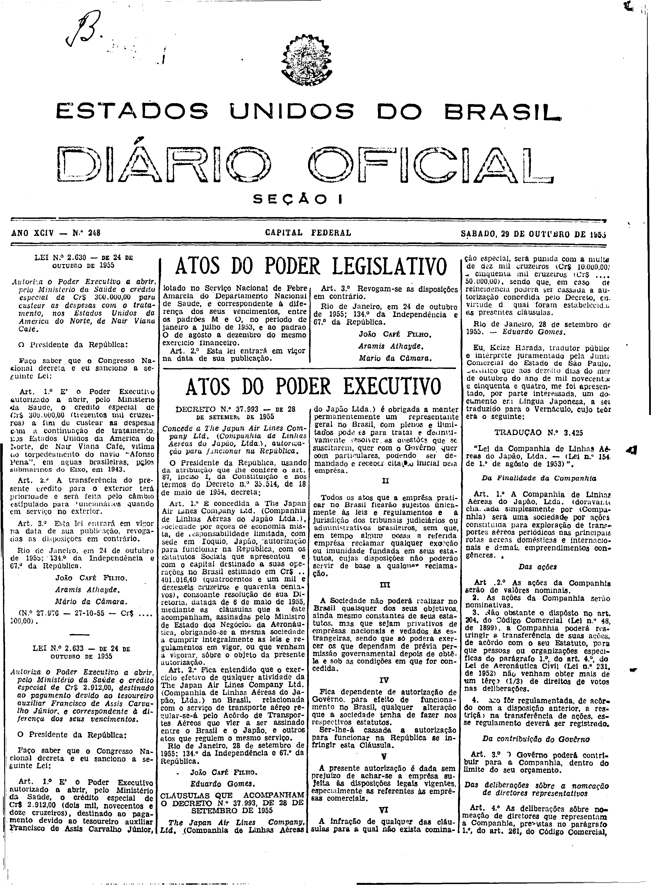

###DEC-037993-0-000-28-09-1955@@@

<strong>DECRETO N. 37.993 – DE 28 DE SETEMBRO DE 1955</strong>

<em><strong>Concede à The Japan Air Lines Company Ltd. (Companhia de Linhas Aéreas do Japão, Ltda.), autorização para funcionar na República.</strong></em>

O Presidente da República, usando da atribuição que lhe confere o art. 87, inciso I, da Constituição e nos termos do Decreto nº 35.514, de 18 de maio de 1954,

<strong>DECRETA:</strong>

<strong>Art.</strong> 1º É concedida À The Japan Air Lines Company Ltd. (Companhia de Linhas Aéreas do Japão Ltda. ), sociedade por ações de economia mista, de responsabilidade limitada, com séde em Tóquio, Japão, autorização para funcionar na República, com os Estatutos Sociais que apresentou e com o capital destinado a suas operações no Brasil estimado em Cr$ .. 401.016,40 (quatrocentos e um mil e dezesseis cruzeiros e quarenta centavos), consoante resolução de sua Diretoria, datada de 6 de maio de 1955, mediante as cláusulas que a êste acompanham, assinadas pelo Ministro de Estado dos Negócios da Aeronáutica, obrigando-se a mesma sociedade a cumprir integralmente as leis e regulamentos em vigor, ou que venham a vigorar sôbre o objeto da presente autorização.

<strong>Art.</strong> 2º Fica entendido que o exercício efetivo de qualquer atividade da The Japan Air Lines Company Ltd. (Companhia de Linhas Aéreas do Japão, Ltda.) no Brasil, relacionada com o serviço de transporte aéreo regular-se-á pelo Acôrdo de Transportes Aéreos que vier a ser assinada entre o Brasil e o Japão, e outros atos que regulem o mesmo serviço.

Rio de Janeiro, 28 de setembro de 1955; 134º da Independência e 67º da República.

<strong>JOÃO CAFÉ FILHO.</strong>

Eduardo Gomes.

<!-- fac-simile-oficial:inicio -->

## Fac-símile oficial: clausulas

A peça vinculada ao Decreto nº 37.993 é reproduzida nas imagens abaixo, a partir da publicação oficial da Imprensa Nacional. A reprodução é em fac-símile, sem transcrição por OCR nem reconstrução do conteúdo.

As imagens mostram páginas inteiras do Diário Oficial da União e podem conter outras matérias. Essas matérias vizinhas não são atribuídas a este decreto. A peça é identificada pelo seu título e pela referência ao ato nas páginas indicadas.

SHA-256 desta imagem: `211ee0002115860c4a461f51af197a1cd05859afc647d6a82f8fc32e84817e75`.

Fontes oficiais da publicação:

- [DO_1_19551029_248.PDF](https://biblioteca.in.gov.br/documents/271518/581356/DO_1_19551029_248.PDF/de25fb6a-5f36-1113-5ff7-3c0d1acc6037?t=1574964057077&download=true) — SHA-256 do PDF: `f0120ac3946a4194e05e5c73e3322fc5ca358fa1ca5a96e0457712480e8670e4`.

<!-- fac-simile-oficial:fim -->
