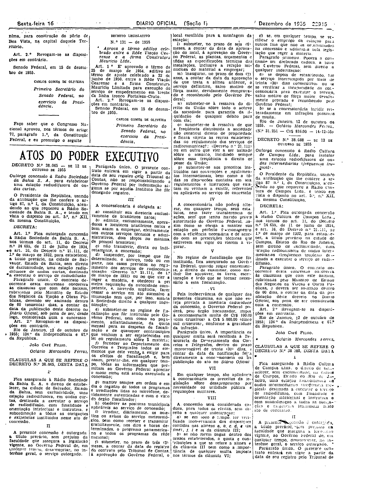

###DEC-038065-0-000-12-10-1955@@@

<strong>DECRETO Nº 38.065, DE 12 DE OUTUBRO DE 1955.</strong>

<em><strong>Outorga concessão à Rádio Sociedade da Bahia S.A. para estabelecer uma estação radiodifusora de ondas curtas.</strong></em>

<strong>O PRESIDENTE DA REPÚBLICA</strong>, usando da atribuição que lhe confere o artigo 87, n° I, da Constituição, atendendo ao que requereu a Rádio Sociedade da Bahia S.A., e tendo em vista o disposto no art. 5º, nº XII, da mesma Constituição,

<strong>DECRETA:</strong>

<strong>Art</strong>. 1º Fica outorgada concessão à Rádio Sociedade da Bahia S.A., nos têrmos do art. 11, do Decreto nº 24.655, de 11 de julho de 1934, e art. 16, do Decreto nº 21.111, de 1º de março de 1932, para estabelecer, a título precário, na cidade de Salvador, Estado da Bahia, sem direto de exclusividade, uma estação radiodifusora de ondas curtas, destinada a executar o serviço de radiodifusão.

Parágrafo único. O contrato decorrente desta concessão obedecerá às cláusulas que com êste baixam, rubricadas pelo Ministro de Estado dos Negócio da Viação e Obras Públicas, devendo ser assinado dentro de 60 (sessenta) dias, a contar da data da publicação dêste decreto no <em>Diário</em> <em>Oficial</em>, sob pena de ser, desde logo, considerada nula a concessão.

<strong>Art</strong>. 2º Revogam-se as disposições em contrário.

Rio de Janeiro, 12 de outubro de 1955; 134º da Independência e 67º República.

<strong>JOÃO CAFÉ FILHO</strong>

Octávio Marcondes Ferraz

<!-- fac-simile-oficial:inicio -->

## Fac-símile oficial: cláusulas

O texto acima não inclui as cláusulas a que se refere este decreto. A publicação oficial do anexo está em imagem, nas páginas do _Diário Oficial da União_ (Seção I) de 16 de dezembro de 1955: p. 22915 (de «CLÁUSULAS A QUE SE REFERE O DECRETO N.º 38.065, DESTA DATA», até «N.º 31.251 — Cr$ 816,00 — 14-12-55»).

As imagens são as páginas inteiras, tal como digitalizadas pela Imprensa Nacional, sem recorte, sem redesenho e sem transcrição. Cada página traz também outros atos do mesmo dia; a peça deste decreto está apenas nas colunas indicadas, e o texto do anexo só existe na imagem. Não há OCR validado.

Fonte: Imprensa Nacional, Biblioteca Machado de Assis, arquivo `DO_1_19551216_286.PDF` (SHA-256 `dc0f4a9cccce4d2e98caa07cd842e16cd5a26cc6ca8b29da5587261ebdc344e1`), páginas 3 do PDF. SHA-256 das imagens, na ordem: `5487c993749c7ce418174b475a4db2ae9e7fd2e8ec9dedaa2a64d68897d5c1f9`.

<!-- fac-simile-oficial:fim -->
