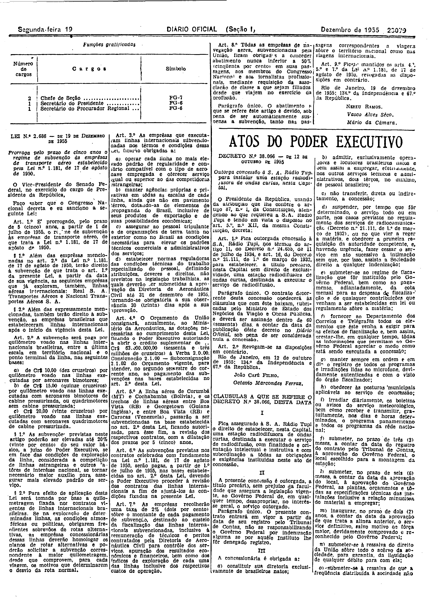
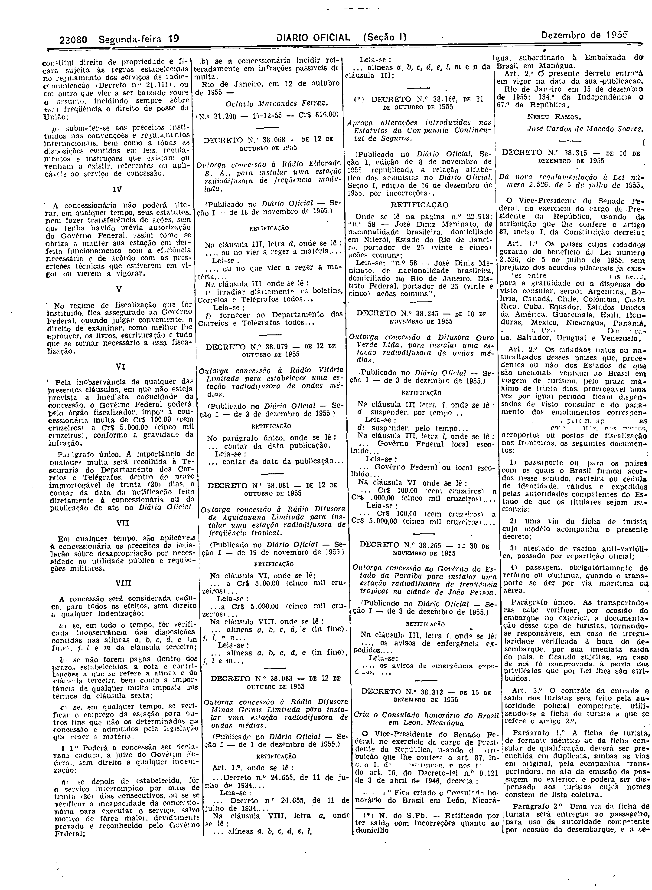

###DEC-038066-0-000-12-10-1955@@@

<strong>DECRETO Nº 38.066, DE 12 DE OUTUBRO DE 1955.</strong>

<em><strong>Outorga concessão à S</strong></em>.<em><strong>A. Rádio Tupi para instalar uma estação radiodifusora de ondas curtas, nesta Capital.</strong></em>

<strong>O PRESIDENTE DA REPÚBLICA</strong>, usando da atribuição que lhe confere, o artigo 87, n° I, da constituição, atendendo ao que requereu a S.A. Rádio Tupi e tendo em vista o disposto no art. 5º n° XII, da mesma Constituição,

<strong>DECRETA:</strong>

<strong>Art</strong>. 1º Fica outorgada concessão à S.A. Rádio Tupi, nos têrmos do artigo 11, do Decreto n° 24.655, de 11 de julho de 1934, e art. 16, do Decreto n° 21.111, de 1º de março de 1932, para estabelecer, a título precário, nesta Capital sem direito de exclusividade, uma estação radiodifusora de ondas curtas, destinada a executar o serviço de radiodifusão.

Parágrafo único. O contrato decorrente desta concessão obedecerá às cláusulas que com êste baixam, rubricadas pelo Ministro de Estdo dos Negócios da Viação e Obras Públicas, e deverá ser assinado dentro de 60 (sessenta) dias, a contar da data da publicação dêste decreto no <em>Diário</em> <em>Oficial</em>, sob pena de ser considerada nula a concessão.

<strong>Art</strong>. 2º Revogam-se as disposições em contrário.

Rio de Janeiro, 12 de outubro de 1955; 134º da Independência e 67º República.

<strong>JOÃO CAFÉ FILHO</strong>

Octávio Marcondes Ferraz

<!-- fac-simile-oficial:inicio -->

## Fac-símile oficial: cláusulas

O texto acima não inclui as cláusulas a que se refere este decreto. A publicação oficial do anexo está em imagem, nas páginas do _Diário Oficial da União_ (Seção I) de 19 de dezembro de 1955: página 15 do PDF (a partir de «CLÁUSULAS A QUE SE REFERE O DECRETO N.º 38.066, DESTA DATA»); página 16 do PDF (até «N.º 31.290 — 15-12-55 — Cr$ 816,00»).

As imagens são as páginas inteiras, tal como digitalizadas pela Imprensa Nacional, sem recorte, sem redesenho e sem transcrição. Cada página traz também outros atos do mesmo dia; a peça deste decreto está apenas no trecho indicado, e o texto do anexo só existe na imagem. Não há OCR validado.

Fonte: Imprensa Nacional, Biblioteca Machado de Assis, arquivo `DO_1_19551219_288.PDF` (SHA-256 `875d5b1b9c8df8572fd6ff6125d0ab16a4618ee84c6fc77fbbe4c8f8328fe37e`), páginas 15, 16 do PDF. SHA-256 das imagens, na ordem: `9925df489c054b3831e006771077c26b5a21b1a44feef01e0462a78b8468e096`, `30895e394826d52815c9f5142658e6fb7a271bcbbf9b4304404f34d1f1f3e188`.

<!-- fac-simile-oficial:fim -->
