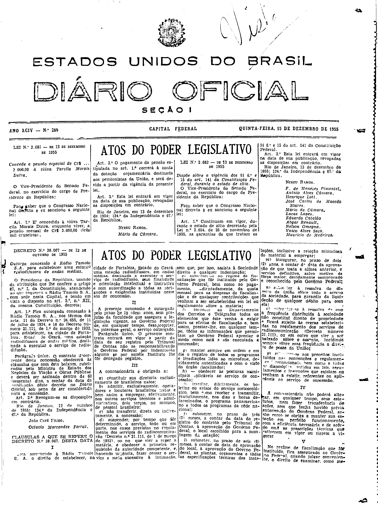
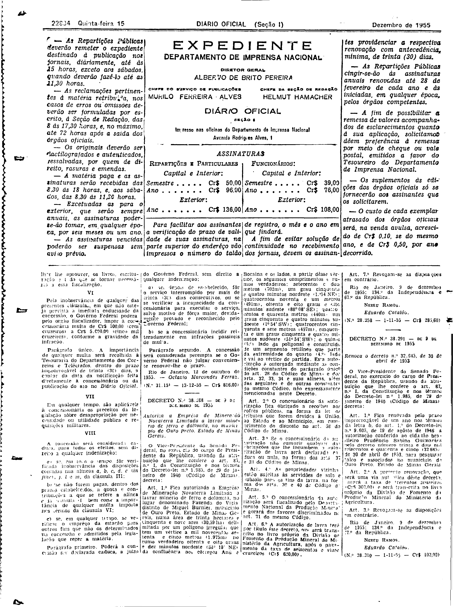

###DEC-038067-0-000-12-10-1955@@@

<strong>DECRETO N° 38.067, DE 12 DE OUTUBRO DE 1955.</strong>

<em><strong>Outorga concessão à Rádio Tamoio S.A. para estabelecer uma estação radiodifusora de ondas médias.</strong></em>

<strong>O PRESIDENTE DA REPÚBLICA</strong>, usando da atribuição que lhe confere o artigo 87, nº I, da Constituição, atendendo ao que requereu a Rádio Tamoio S.A., com sede nesta Capital, tendo em vista o disposto no art. 5º, nº XII, da mesma Constituição,

<strong>DECRETA:</strong>

<strong>Art</strong>. 1º Fica outorgada a concessão à Rádio Tamoio S.A., nos têrmos dos arts. 11 do Decreto nº 24.655, de 11 de julho de 1934, e 16 do Decreto número 21.111, de 1º de março de 1932, para estabelecer, na cidade de Fortaleza, Estado do Ceará, uma estação radiodifusora de ondas médias, destinada a executar o serviço de radiodifusão.

Parágrafo único. O contrato decorrente desta concessão obedecerá às cláusulas que com êste baixam, rubricadas pelo Ministro de Estado dos Negócios da Viação e Obras Públicas, e deverá ser assinado dentro de 60 (sessenta) dias, a contar da data da publicação dêste decreto no Diário <em>Oficial</em>, sob pena de ser considerada nula a concessão.

<strong>Art</strong>. 2º Revogam-se as disposições em contrário.

Rio de Janeiro, 12 de outubro de 1955; 134º da Independência e 67º da República.

<strong>JOÃO CAFÉ FILHO</strong>

Octávio Marcondes Ferraz

<!-- fac-simile-oficial:inicio -->

## Fac-símile oficial: cláusulas

O texto acima não inclui as cláusulas a que se refere este decreto. A publicação oficial do anexo está em imagem, nas páginas do _Diário Oficial da União_ (Seção I) de 15 de dezembro de 1955: página 1 do PDF (capa do caderno) (a partir de «CLÁUSULAS A QUE SE REFERE O DECRETO N.º 38.067, DESTA DATA»); página 2 do PDF (até «N.º 31.155 — 13-12-55 — Cr$ 816,00»).

As imagens são as páginas inteiras, tal como digitalizadas pela Imprensa Nacional, sem recorte, sem redesenho e sem transcrição. Cada página traz também outros atos do mesmo dia; a peça deste decreto está apenas no trecho indicado, e o texto do anexo só existe na imagem. Não há OCR validado.

Fonte: Imprensa Nacional, Biblioteca Machado de Assis, arquivo `DO_1_19551215_285.PDF` (SHA-256 `5aa5c74a1d0679ef15318753985450e4ce5d696ce6b371d7bfdd943e69020d0d`), páginas 1, 2 do PDF. SHA-256 das imagens, na ordem: `2560813dfbcda6d588eb345f9d83f9c3065e129cb4df317c4f5d593b031dc983`, `ffbc2edcd5bde0c1efc48df6d593ccee0f9c80f8f6a5ba38c7e483212f47f48d`.

<!-- fac-simile-oficial:fim -->
