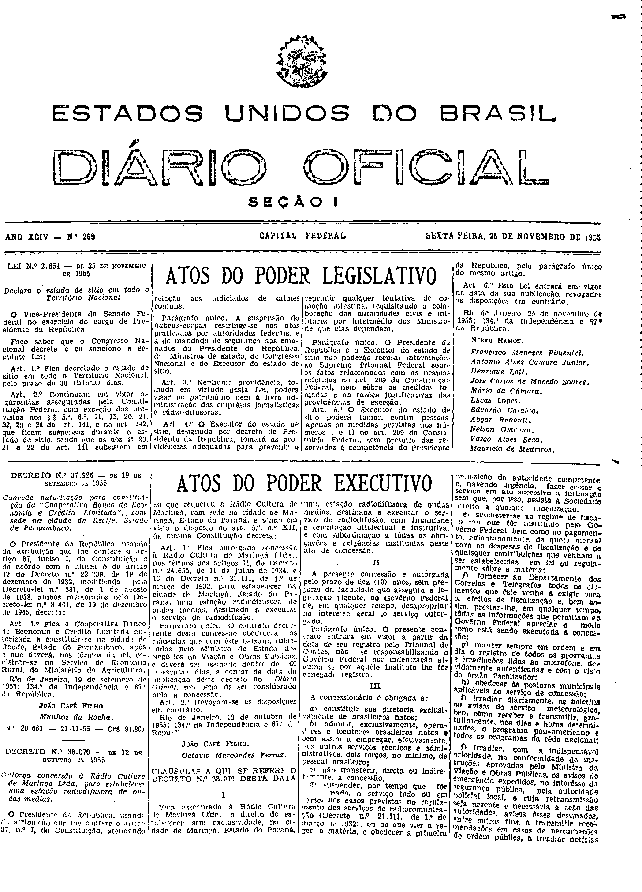
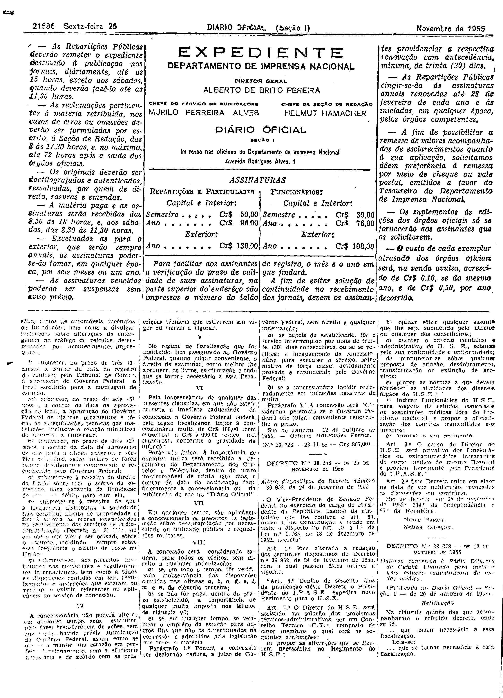

###DEC-038070-0-000-12-10-1955@@@

<strong>DECRETO Nº 38.070, DE 12 DE OUTUBRO DE 1955.</strong>

<!-- fac-simile-oficial:inicio -->

## Fac-símile oficial: decreto e cláusulas

O decreto e as cláusulas são reproduzidos integralmente nas páginas abaixo da edição indicada do Diário Oficial da União. A primeira publicação não foi verificada. As páginas inteiras também contêm matérias vizinhas, que não são atribuídas a este ato. Não há transcrição por OCR.

SHA-256 da imagem: `b2f49ad5c2bc936106bae64238c66292d66e57b8469f799a2dffe23bbdf178b1`.

Fonte: [DO_1_19551125_269.PDF](https://biblioteca.in.gov.br/documents/271518/581356/DO_1_19551125_269.PDF/19d939fe-4cc4-175f-2b87-61a59a683ae5?t=1574964251493&download=true), edição 1955-11-25; SHA-256 do PDF: `33a936629672da3c421948fbcabd413daea8bc56de531970a8d512d46667f17e`.

SHA-256 da imagem: `fe48628aba1c0506b328123da93c9640d8042151c513e8e5b35a4f9ba06ca960`.

Fonte: [DO_1_19551125_269.PDF](https://biblioteca.in.gov.br/documents/271518/581356/DO_1_19551125_269.PDF/19d939fe-4cc4-175f-2b87-61a59a683ae5?t=1574964251493&download=true), edição 1955-11-25; SHA-256 do PDF: `33a936629672da3c421948fbcabd413daea8bc56de531970a8d512d46667f17e`.

<!-- fac-simile-oficial:fim -->
