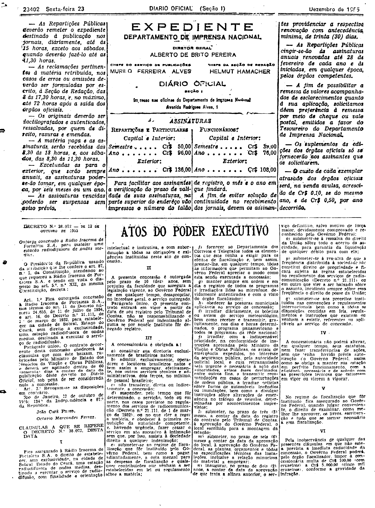
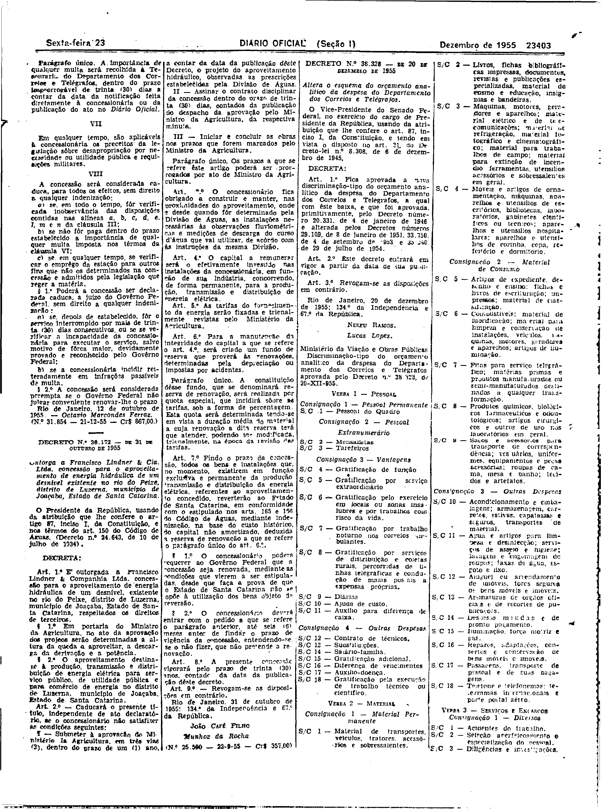

###DEC-038072-0-000-12-10-1955@@@

<strong>DECRETO Nº 38.072, DE 12 DE OUTUBRO DE 1955.</strong>

<em><strong>Outorga concessão à Rádio Iracema de Fortaleza S.A. para estabelecer uma estação radiodifusora de ondas médias.</strong></em>

<strong>O PRESIDENTE DA REPÚBLICA</strong>, usando da atribuição que lhe confere o art. 87, n° I, da Constituição, atendendo ao que requereu a Rádio Iracema de Fortaleza S.A., e tendo em vista o disposto no art. 5º n.° XII, da mesma Constituição,

<strong>DECRETA:</strong>

<strong>Art</strong>. 1º Fica outorgada a concessão à Rádio Iracema de Fortaleza S.A., nos têrmos dos arts. 11 do Decreto n° 24.655, de 11 de julho de 1934, e o art. 16 do Decreto número 21.111, de 1º de março de 1932, para estabelecer na cidade de Sobral, Estado do Ceará, sem direto a exclusividade, uma estação radiodifusora de ondas médias, destinada a executar o serviço de radiodifusão.

Parágrafo único. O contrato decorrente desta concessão obedecerá às cláusulas que com êste baixam, rubricadas pelo Ministro de Estado dos Negócios da Viação e Obras Públicas, e deverá ser assinado dentro de 60 (sessenta) dias, a contar da data da publicação dêste decreto no <em>Diário Oficial</em>, sob pena de ser considerada nula a concessão.

<strong>Art</strong>. 2º Revogam-se as disposições em contrário.

Rio de Janeiro, 12 de outubro de 1955; 134º da Independência e 67º da República.

<strong>JOÃO CAFÉ FILHO</strong>

Octávio Marcondes Ferraz

<!-- fac-simile-oficial:inicio -->

## Fac-símile oficial: cláusulas

O texto acima não inclui as cláusulas a que se refere este decreto. A publicação oficial do anexo está em imagem, nas páginas do _Diário Oficial da União_ (Seção I) de 23 de dezembro de 1955: página 2 do PDF (a partir de «CLÁUSULAS A QUE SE REFERE O DECRETO N.º 38.072, DESTA DATA»); página 3 do PDF (até «N.º 31.854 — 21-12-55 — Cr$ 867,00»).

As imagens são as páginas inteiras, tal como digitalizadas pela Imprensa Nacional, sem recorte, sem redesenho e sem transcrição. Cada página traz também outros atos do mesmo dia; a peça deste decreto está apenas no trecho indicado, e o texto do anexo só existe na imagem. Não há OCR validado.

Fonte: Imprensa Nacional, Biblioteca Machado de Assis, arquivo `DO_1_19551223_292.PDF` (SHA-256 `db10b3823d81cce62eb57c631e02d54c9e0b747342081b94a71b6037b8e79519`), páginas 2, 3 do PDF. SHA-256 das imagens, na ordem: `6ab580b1b18bed5a5ff81300eabb5d84126ebf2f5050263afe09dea7edca8819`, `ed8019421d9d3613eca5e24dbd56d1d9d3bee3174f2221cb77305b9dc1f48d10`.

<!-- fac-simile-oficial:fim -->
