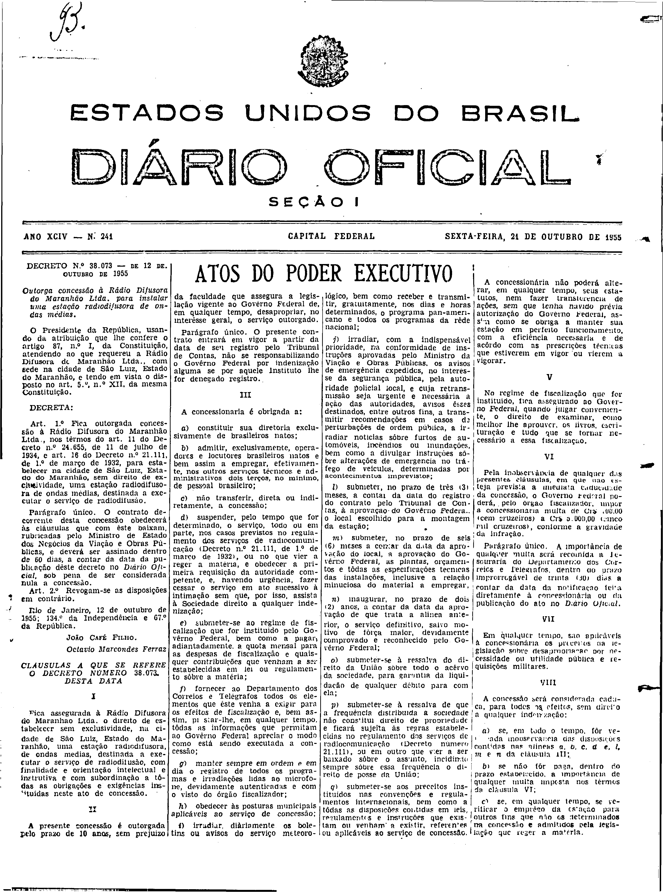
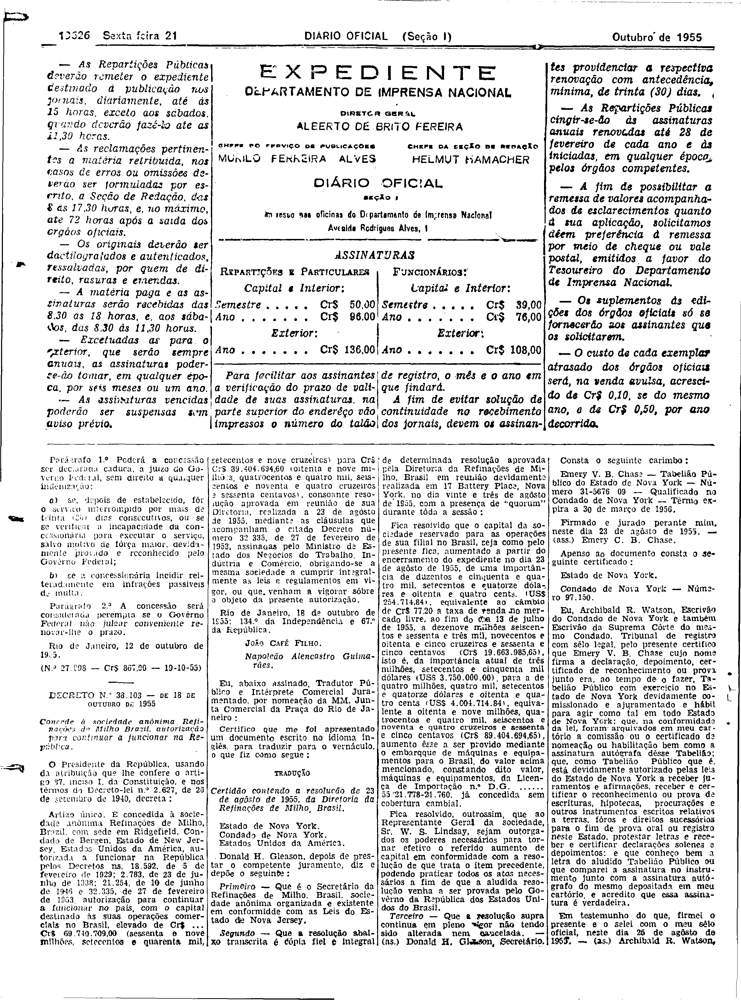

###DEC-038073-0-000-12-10-1955@@@

<strong>DECRETO N. 38.073 – DE 12 DE OUTUBRO DE 1955</strong>

<em><strong>Outorga concessão à Rádio Difusora do Maranhão Ltda. para instalar uma estação radiodifusora de ondas médias.</strong></em>

O Presidente da República, usando da atribuição que lhe confere o artigo 87, nº I, da Constituição, atendendo ao que requereu a Rádio Difusora do Maranhão Ltda., com sede na cidade de São Luiz, Estado do Maranhão, e tendo em vista o disposto no art. 5º, n. XII, da mesma constituição.

<strong>DECRETA:</strong>

<strong>Art.</strong> 1º Fica outorgada concessão à Rádio Difusora do Maranhão Ltda., nos termos do art. 11 do Decreto n. 24.655, de 11 de julho de 1934, e art. 16 do Decreto n. 21.111, de 1 de março de 1932, para estabelecer na cidade de São Luiz, Estado do Maranhão, sem direito de exclusividade, uma estação radiodifusora de ondas médias, destinada a executar o serviço de radiodifusão.

Parágrafo único. O contrato decorrente desta concessão obedecerá às cláusulas que com êste baixam, rubricadas pelo Ministro de Estado dos Negócios da Viação e Obras Públicas, e deverá ser assinado dentro de 60 dias, a contar da data da publicação dêste decreto no Diário Oficial, sob pena de ser considerada nula a concessão.

<strong>Art.</strong> 2º Revogam-se as disposições em contrário.

Rio de janeiro 12 de outubro de 1955; 134º da Independência e 67º da República.

<strong>JOÃO CAFÉ FILHO.</strong>

Octavio Marcondes Ferraz

<!-- fac-simile-oficial:inicio -->

## Fac-símile oficial: cláusulas

O texto acima não inclui as cláusulas a que se refere este decreto. A publicação oficial do anexo está em imagem, nas páginas do _Diário Oficial da União_ (Seção I) de 21 de outubro de 1955: capa (1ª página do caderno, sem numeração impressa; página 1 do PDF) (a partir de «CLÁUSULAS A QUE SE REFERE O DECRETO NÚMERO 38.073, DESTA DATA»); página 2 do PDF (numeração impressa ilegível na imagem) (até «N.º 27.098 — Cr$ 867,00 — 19-10-55»).

As imagens são as páginas inteiras, tal como digitalizadas pela Imprensa Nacional, sem recorte, sem redesenho e sem transcrição. Cada página traz também outros atos do mesmo dia; a peça deste decreto está apenas nas colunas indicadas, e o texto do anexo só existe na imagem. Não há OCR validado.

Fonte: Imprensa Nacional, Biblioteca Machado de Assis, arquivo `DO_1_19551021_241.PDF` (SHA-256 `2751fe2c926981190b699ed6829f7ba8e610149f626fbf82e9e58134991b7b20`), páginas 1, 2 do PDF. SHA-256 das imagens, na ordem: `952aa3888c4eedecda7ac83b8bf27eb346b171909b3c8fbd4f16eb7d84f12602`, `ac7aba2361362bc7d33f7fb713f08c26394d974575ccf21873db71cd83b72ce3`.

<!-- fac-simile-oficial:fim -->
