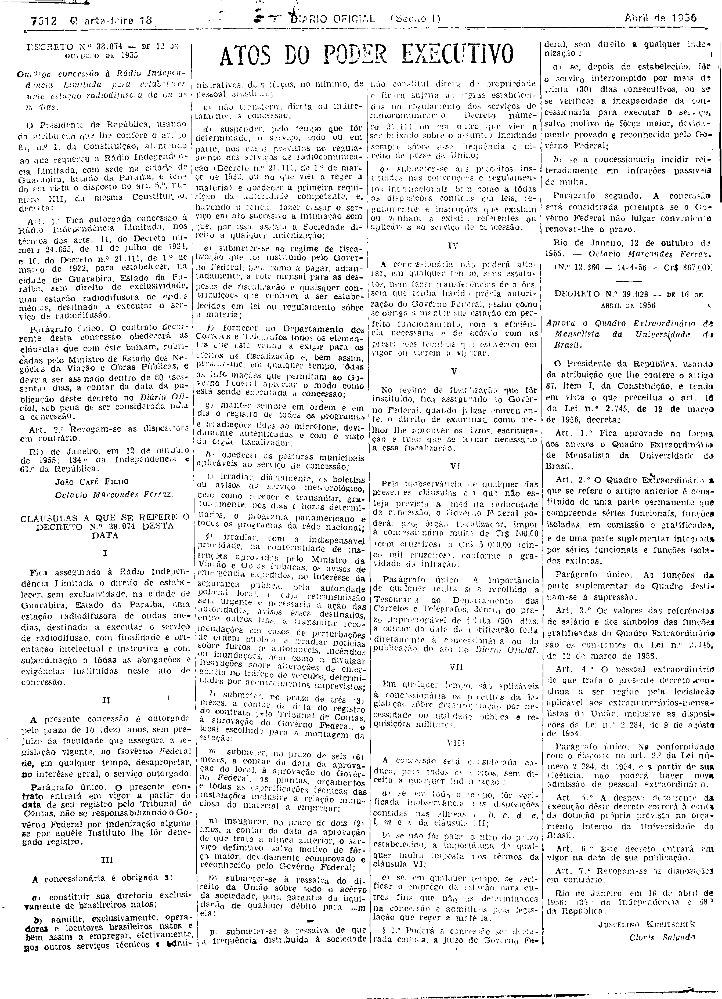

###DEC-038074-0-000-12-10-1955@@@

<strong>DECRETO Nº 38.074, DE 12 DE OUTUBRO DE 1955.</strong>

<em><strong>Outorga concessão à Rádio Independência Limitada para estabelecer uma estação radiodifusora de ondas médias.</strong></em>

<strong>O PRESIDENTE DA REPÚBLICA</strong>, usando da atribuição que lhe confere o artigo 87, nº I, da Constituição, atendendo ao que requereu a Rádio Independência Limitada, com sede na cidade de Guarabira, Estado da Paraíba, e tendo em vista o disposto no art. 5º, número XII, da mesma Constituição,

<strong>DECR</strong><strong>ETA</strong><strong>:</strong>

<strong>Art</strong>. 1º Fica outorgada concessão à Rádio Independência Limitada, nos têrmos dos arts. 11, do Decreto número 24.655, de 11 de julho de 1934, e 16, do Decreto nº 21.111, de 1º de março de 1932, para estabelecer, na cidade de Guarabira, Estado da Paraíba, sem direito de exclusividade, uma estação radiodifusora de ondas médias, destinada a executar o serviço de radiodifusão.

Parágrafo único. O contrato decorrente desta concessão obedecerá às cláusulas que com êste baixam, rubricadas pelo Ministro de Estado dos Negócios da Viação e Obras Públicas, e deverá ser assinado dentro de 60 (sessenta) dias, a contar da data da publicação dêste decreto no <em>Diário Oficial</em>, sob pena de ser considerada nula a concessão.

<strong>Art</strong>. 2º Revogam-se as disposições em contrário.

Rio de Janeiro, em 12 de outubro de 1955; 134º da Independência e 67º da República.

<strong>JOÃO CAFÉ FILHO</strong>

Octavio Marcondes Ferraz

<!-- fac-simile-oficial:inicio -->

## Fac-símile oficial: cláusulas

O texto acima não inclui as cláusulas a que se refere este decreto. A publicação oficial do anexo está em imagem, nas páginas do _Diário Oficial da União_ (Seção I) de 18 de abril de 1956: página 4 do PDF (a partir de «CLÁUSULAS A QUE SE REFERE O DECRETO N.º 38.074 DESTA DATA», até «N.º 12.360 — 14-4-56 — Cr$ 867,00»).

As imagens são as páginas inteiras, tal como digitalizadas pela Imprensa Nacional, sem recorte, sem redesenho e sem transcrição. Cada página traz também outros atos do mesmo dia; a peça deste decreto está apenas no trecho indicado, e o texto do anexo só existe na imagem. Não há OCR validado.

Fonte: Imprensa Nacional, Biblioteca Machado de Assis, arquivo `DO_1_19560418_090.PDF` (SHA-256 `00980fede310d11ddab71efed4aedc29ed72055ec1d3003c6676642e4e3c9b65`), páginas 4 do PDF. SHA-256 das imagens, na ordem: `a9b789f4df0e3acc049f66f8f4755850b1af7e5472c30a64d160cdb79b2b40db`.

<!-- fac-simile-oficial:fim -->
