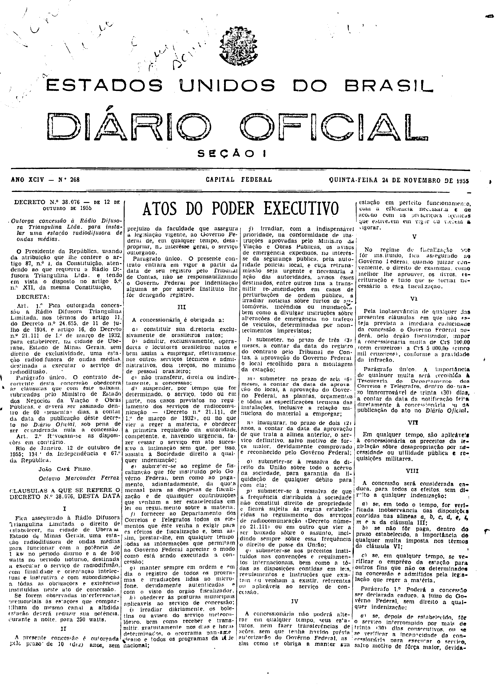
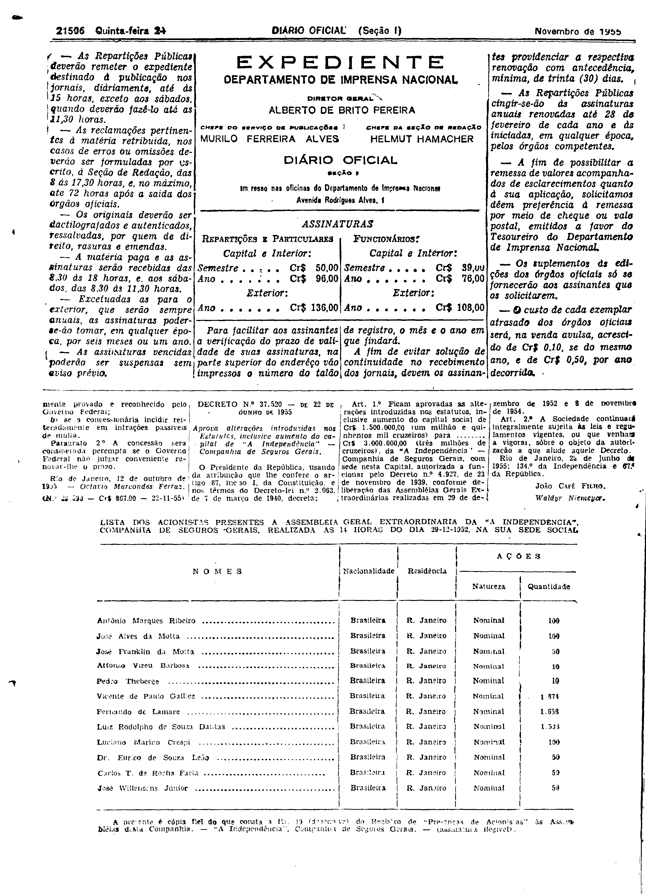

###DEC-038076-0-000-12-10-1955@@@

<strong>DECRETO Nº 38.076, DE 12 DE OUTUBRO DE 1955.</strong>

<em><strong>Outorga concessão à Rádio Difusora Triangulina Ltda. para instalar uma estação radiodifusora de ondas médias.</strong></em>

<strong>O PRESIDENTE DA REPÚBLICA</strong>, usando da atribuição que lhe confere o artigo 87, n° I, da Constituição, atendendo ao que requereu a Rádio Difusora Triangulina Ltda., e tendo em vista o disposto no art. 5º n° XII, da mesma Constituição,

<strong>DECRETA:</strong>

<strong>Art</strong>. 1º Fica outorgada a concessão à Rádio Difusora Triangulina Limitada, nos têrmos dos arts. 11 do Decreto n° 24.655, de 11 de julho de 1934, e artigo 16 do Decreto número 21.111, de 1º de março de 1932, para estabelecer, na cidade de Uberaba, Estado de Minas Gerais, sem direito de exclusividade, uma estação radiodifusora de ondas médias, destinada a executar o serviço de radiodifusão.

Parágrafo único. O contrato decorrente desta concessão obedecerá às cláusulas que com êste baixam, rubricadas pelo Ministro de Estado dos Negócios da Viação e Obras Públicas, e deverá ser assinado dentro de 60 (sessenta) dias, a contar da data da publicação dêste decreto no Diário Oficial, sob pena de ser considerada nula a concessão.

<strong>Art</strong>. 2º Revogam-se as disposições em contrário.

Rio de Janeiro, 12 de outubro de 1955; 134º da Independência e 67º da República.

<strong>JOÃO CAFÉ FILHO</strong>

Octávio Marcondes Ferraz

<!-- fac-simile-oficial:inicio -->

## Fac-símile oficial: cláusulas

O texto acima não inclui as cláusulas a que se refere este decreto. A publicação oficial do anexo está em imagem, nas páginas do _Diário Oficial da União_ (Seção I) de 24 de novembro de 1955: capa (1ª página do caderno, sem numeração impressa; página 1 do PDF) (a partir de «CLÁUSULAS A QUE SE REFERE O DECRETO N.º 38.076, DESTA DATA»); p. 21506 (até «N.º 28.590 — Cr$ 867,00 — 22-11-55»).

As imagens são as páginas inteiras, tal como digitalizadas pela Imprensa Nacional, sem recorte, sem redesenho e sem transcrição. Cada página traz também outros atos do mesmo dia; a peça deste decreto está apenas nas colunas indicadas, e o texto do anexo só existe na imagem. Não há OCR validado.

Fonte: Imprensa Nacional, Biblioteca Machado de Assis, arquivo `DO_1_19551124_268.PDF` (SHA-256 `97b4be7b0a56e13cd8676ec49b7cc8201854b9f7076804993be8e5a5c2910a4e`), páginas 1, 2 do PDF. SHA-256 das imagens, na ordem: `3a74e34a818fe3ca16c80e5cbaf5e933e6e21ce35dc4e5aed030b60e549ceb1e`, `678e94b7cb31d94c0fbcb49522d3805fb31e80b981e6c3ce28a44ccfcbe053ce`.

<!-- fac-simile-oficial:fim -->
