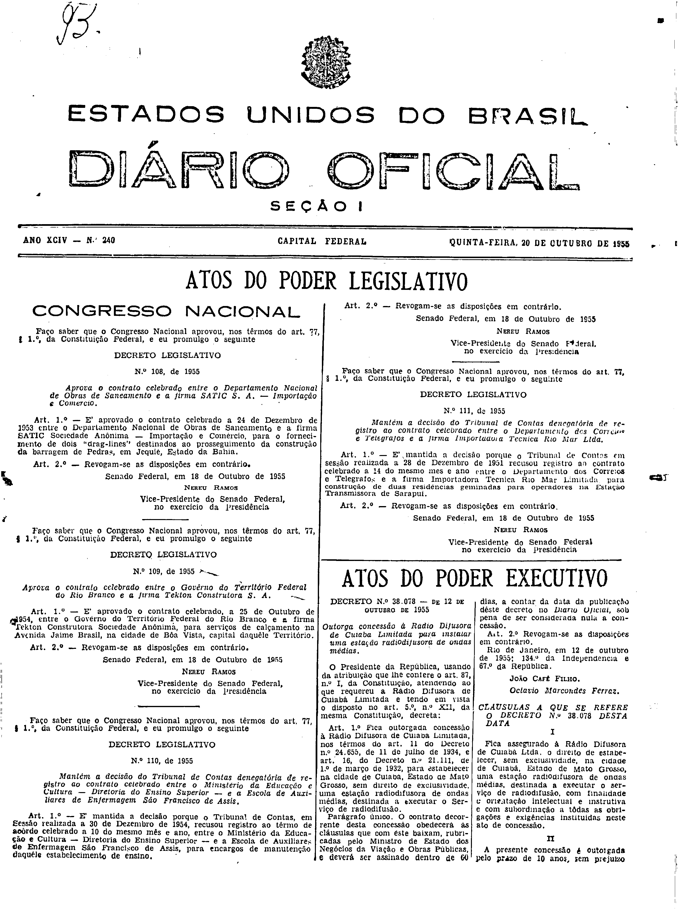
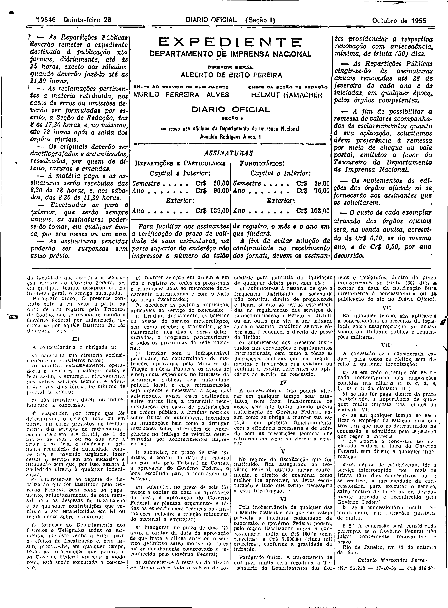

###DEC-038078-0-000-12-10-1955@@@

<strong>DECRETO Nº 38.078, DE 12 DE OUTUBRO DE 1955.</strong>

<em><strong>Outorga concessão à Rádio Difusora de Cuiabá Limitada para instalar uma estação radiodifusora de ondas médias.</strong></em>

<strong>O PRESIDENTE DA REPÚBLICA</strong>, usando da atribuição que lhe confere o artigo 87, n° I, da Constituição, atendendo ao que requereu a Rádio Difusora de Cuiabá Limitada e tendo em vista o disposto no art. 5º n° XII, da mesma Constituição,

<strong>DECRETA:</strong>

<strong>Art</strong>. 1º Fica outorgada a concessão à Rádio Difusora de Cuiabá Limitada, nos têrmos dos art. 11 do Decreto n° 24.655, de 11 de julho de 1934, e art.16 do Decreto número 21.111, de 1º de março de 1932, para estabelecer, na cidade de Cuiabá, Estado de Mato Grosso, sem direito de exclusividade, uma estação radiodifusora de ondas médias, destinada a executar o serviço de radiodifusão.

Parágrafo único. O contrato decorrente desta concessão obedecerá às cláusulas que com êste baixam, rubricadas pelo Ministro de Estado dos Negócios da Viação e Obras Públicas, e deverá ser assinado dentro de 60 (sessenta) dias, a contar da data da publicação dêste decreto no <em>Diário Oficial</em>, sob pena de ser considerada nula a concessão.

<strong>Art</strong>. 2º Revogam-se as disposições em contrário.

Rio de Janeiro, 12 de outubro de 1955; 134º da Independência e 67º da República.

<strong>JOÃO CAFÉ FILHO</strong>

Octávio Marcondes Ferraz

<!-- fac-simile-oficial:inicio -->

## Fac-símile oficial: cláusulas

O texto acima não inclui as cláusulas a que se refere este decreto. A publicação oficial do anexo está em imagem, nas páginas do _Diário Oficial da União_ (Seção I) de 20 de outubro de 1955: capa (1ª página do caderno, sem numeração impressa; página 1 do PDF) (a partir de «CLÁUSULAS A QUE SE REFERE O DECRETO N.º 38.078 DESTA DATA»); p. 19546 (até «N.º 26.983 — 17-10-55 — Cr$ 816,00»).

As imagens são as páginas inteiras, tal como digitalizadas pela Imprensa Nacional, sem recorte, sem redesenho e sem transcrição. Cada página traz também outros atos do mesmo dia; a peça deste decreto está apenas nas colunas indicadas, e o texto do anexo só existe na imagem. Não há OCR validado.

Fonte: Imprensa Nacional, Biblioteca Machado de Assis, arquivo `DO_1_19551020_240.PDF` (SHA-256 `5d42c096b54ba5de83327e2e07c77941316eda80d65b6097a7cb96ed0ceffea4`), páginas 1, 2 do PDF. SHA-256 das imagens, na ordem: `e1fcd7f19ba40d5330d12b8187ed7316a247b3ad550c4ae9fd8f9128bad05bb5`, `cd60c9675cee83654d4e4d27579fc5726024bc99406d849867d886d3e18ff0d7`.

<!-- fac-simile-oficial:fim -->
