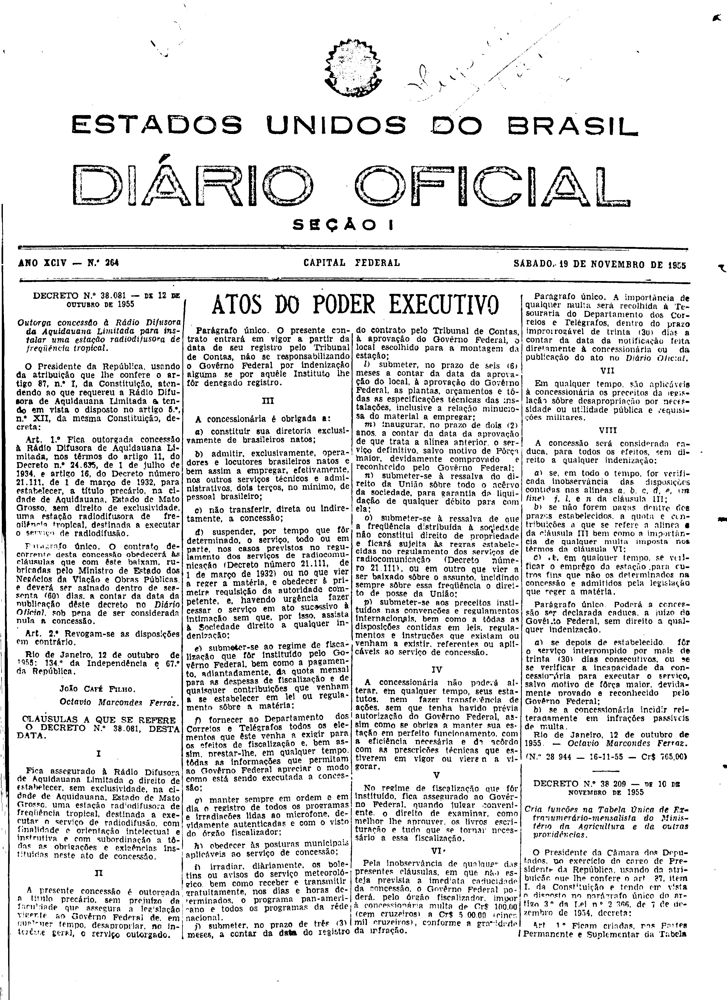

###DEC-038081-0-000-12-10-1955@@@

<strong>DECRETO Nº 38.081, DE 12 DE OUTRUBRO DE 1955.</strong>

<em><strong>Outorga concessão à Rádio Difusora da Aquidauana Limitada para instalar uma estação radiodifusora freqüência tropical.</strong></em>

<strong>O PRESIDENTE DA REPÚBLICA</strong>, usando da atribuição que lhe confere o artigo 87, nº I, da Constituição, atendendo ao que requereu a Rádio Difusora de Aquidauana Limitada e tendo em vista o disposto no artigo 5º, nº XII, da mesma Constituição,

<strong>DECRETA:</strong>

<strong>Art</strong>. 1º Fica outorgada concessão à Rádio Difusora de Aquidauana Limitada, nos têrmos do artigo 11, do Decreto nº 24.635, de 1 de julho de 1934, e artigo 16, do Decreto número 21.111, de 1 de março de 1932, para estabelecer na cidade de Aquidauana, Estado de Mato Grosso, sem direito de exclusividade, uma estação radiodifusora de frequência tropical, destinada a executar o serviço de radiodifusão.

Parágrafo único. O contrato decorrente desta concessão obedecerá às cláusulas que com êste baixam, rubricadas pelo Ministro de Estado dos Negócios da Viação e Obras Públicas, e deverá ser assinado dentro de 60 (sessenta) dias, a contar da data da publicação dêste decreto no <em>Diário Oficial</em>, sob pena de ser considerada nula a concessão.

<strong>Art</strong>. 2º Revogam-se as disposições em contrário.

Rio de Janeiro, 12 de outubro de 1955; 134º da Independência e 67º da República.

<strong>JOÃO CAFÉ FILHO</strong>

Octávio Marcondes Ferraz

<!-- fac-simile-oficial:inicio -->

## Fac-símile oficial: cláusulas

O texto acima não inclui as cláusulas a que se refere este decreto. A publicação oficial do anexo está em imagem, nas páginas do _Diário Oficial da União_ (Seção I) de 19 de novembro de 1955: página 1 do PDF (capa do caderno) (a partir de «CLÁUSULAS A QUE SE REFERE O DECRETO N.º 38.081, DESTA DATA», até «N.º 28.944 — 16-11-55 — Cr$ 765,00»).

As imagens são as páginas inteiras, tal como digitalizadas pela Imprensa Nacional, sem recorte, sem redesenho e sem transcrição. Cada página traz também outros atos do mesmo dia; a peça deste decreto está apenas no trecho indicado, e o texto do anexo só existe na imagem. Não há OCR validado.

Fonte: Imprensa Nacional, Biblioteca Machado de Assis, arquivo `DO_1_19551119_264.PDF` (SHA-256 `0e29e331ec7b9e3aba1658c4bec659958ca9535cc2350607039de274382d9c06`), páginas 1 do PDF. SHA-256 das imagens, na ordem: `31046e4881924d749c8e957c6a043908c98d348a74133dca2e5337fadc94d4c3`.

<!-- fac-simile-oficial:fim -->
