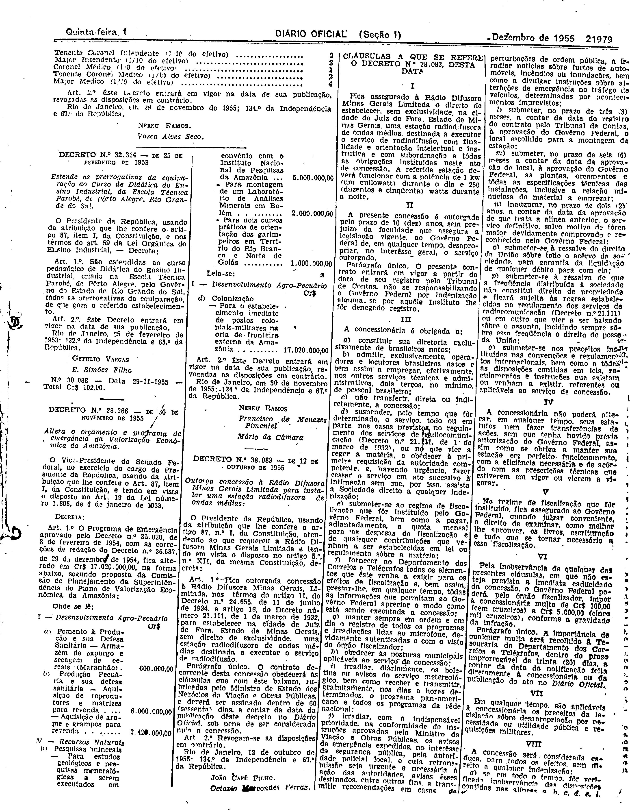
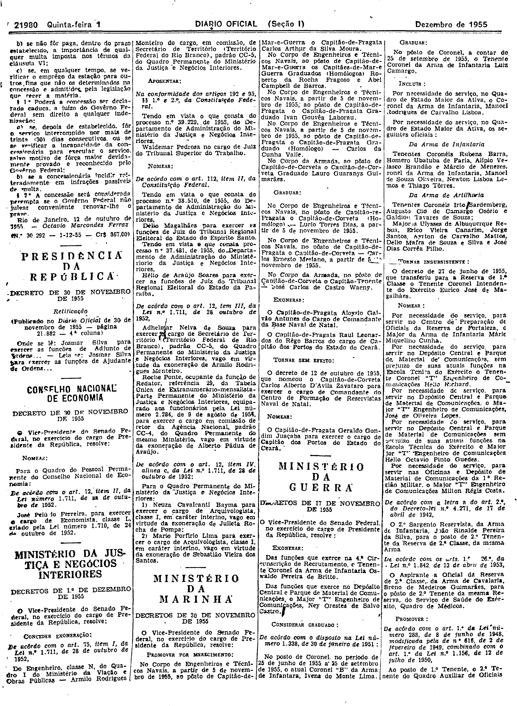

###DEC-038083-0-000-12-10-1955@@@

<strong>DECRETO Nº 38.083, DE 12 DE OUTUBRO DE 1955.</strong>

<em><strong>Outorga concessão à Rádio Difusora Minas Gerais Limitada para instalar uma estação radiodifusora de ondas médias.</strong></em>

<strong>O PRESIDENTE DA REPÚBLICA</strong>, usando da atribuição que lhe confere o artigo 87, nº I, da Constituição, atendendo ao que requereu a Rádio Difusora Minas Gerais Limitada e tendo em vista o disposto no artigo 5º, nº XII, da mesma Constituição,

<strong>DECRETA:</strong>

<strong>Art</strong>. 1º Fica outorgada concessão à Rádio Difusora Minas Gerais, Limitada, nos têrmos do artigo 11, do Decreto nº 24.655, de 11 de julho de 1934, e artigo 16, do Decreto número 21.111, de 1 de março de 1932, para estabelecer na cidade de Juiz de Fora, Estado de Minas Gerais, sem direito de exclusividade, uma estação radiodifusora de ondas médias destinada a executar o serviço de radiodifusão.

Parágrafo único. O contrato decorrente desta concessão obedecerá às cláusulas que com êste baixam, rubricadas pelo Ministro de Estado dos Negócios da Viação e Obras Públicas, e deverá ser assinado dentro de 60 (sessenta) dias, a contar da data da publicação dêste decreto no <em>Diário</em> <em>Oficial</em>, sob pena de ser considerada nula a concessão.

<strong>Art</strong>. 2º Revogam-se as disposições em contrário.

Rio de Janeiro, 12 de outubro de 1955; 134º da Independência e 67º da República.

<strong>JOÃO CAFÉ FILHO</strong>

Octávio Marcondes Ferraz

<!-- fac-simile-oficial:inicio -->

## Fac-símile oficial: cláusulas

O texto acima não inclui as cláusulas a que se refere este decreto. A publicação oficial do anexo está em imagem, nas páginas do _Diário Oficial da União_ (Seção I) de 1 de dezembro de 1955: p. 21979 (a partir de «CLÁUSULAS A QUE SE REFERE O DECRETO N.º 38.083, DESTA DATA»); p. 21980 (até «N.º 30.292 — 1-12-55 — Cr$ 867,00»).

As imagens são as páginas inteiras, tal como digitalizadas pela Imprensa Nacional, sem recorte, sem redesenho e sem transcrição. Cada página traz também outros atos do mesmo dia; a peça deste decreto está apenas nas colunas indicadas, e o texto do anexo só existe na imagem. Não há OCR validado.

Fonte: Imprensa Nacional, Biblioteca Machado de Assis, arquivo `DO_1_19551201_274.PDF` (SHA-256 `2e036f9e0a398f52cccb3a76ee5bb8b6ba445adab20125c96ef8374617d76ec0`), páginas 3, 4 do PDF. SHA-256 das imagens, na ordem: `49006a9d5e1084efc1072f5f5d65a86a3af73831f8d4815174178dae43c2cb45`, `439119ed3812eeb1d2fe6a3d51aa30a06a7e577b8dea8f20278a6a82c67e2c47`.

<!-- fac-simile-oficial:fim -->
