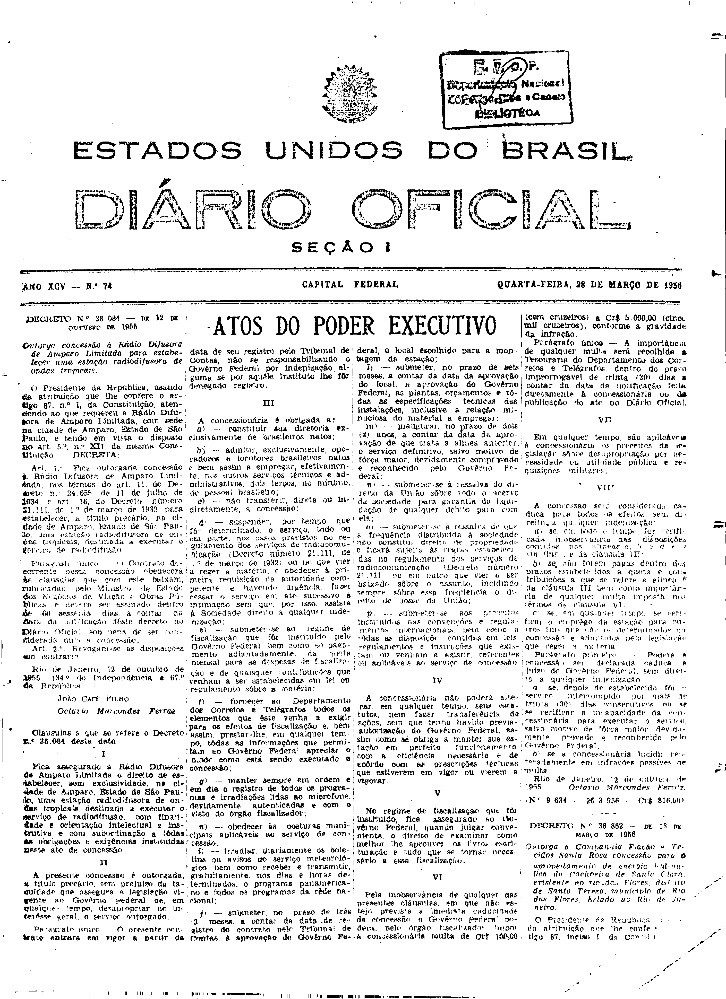

###DEC-038084-0-000-12-10-1955@@@

<strong>DECRETO Nº 38.084, DE 12 DE OUTUBRO DE 1955.</strong>

<em><strong>Outorga concessão à Radio Difusora de Amparo Limitada para estabelecer uma estação radiodifusora de ondas tropicais.</strong></em>

<strong>O</strong> <strong>PRESIDENTE DA REPÚBLICA</strong>, usando da atribuição que lhe confere o artigo 87, nº I, da Constituição atendendo ao que requereu a Rádio Difusora de Amparo limitada, com sede na cidade de Amparo, Estado de São Paulo, e tendo em vista o disposto no art. 5º, nº XII, da mesma Constituição,

<strong>DECRETA:</strong>

<strong>Art</strong>. 1º Fica outorgada concessão à Rádio Difusora de Amparo Limitada, nos têrmos do art. 11, do Decreto nº 24.655, de 11 julho de 1934, e art. 16, do Decreto número 21.111, de 1º de março de 1932 para estabelecer, a título precário, na cidade de Amparo, Estado de São Paulo, uma estação radiodifusora de ondas tropicais, destinada a executar o serviço de radiodifusão.

Parágrafo único - O Contrato decorrente desta concessão obedecerá às cláusulas que com êste baixam, rubricadas pelo Ministro de Estado dos Negócios da Viação e Obras Públicas, e deverá ser assinado dentro de (60 sessenta dias, a contar da data da publicação dêste decreto no <em>Diário</em> <em>Oficial</em>, sob pena de ser considerada nula a concessão.

<strong>Art</strong>. 2º Revogam-se as disposições em contrário.

Rio de Janeiro, 12 de outubro de 1955; 134º da Independência e 67º da República.

<strong>JOÃO CAFÉ FILHO</strong>

Octavio Marcondes Ferraz

###DEC-038084-0-000-12-10-1955@@@RET01+++

<strong>DECRETO Nº 38.084, DE 12 DE OUTUBRO DE 1955.</strong>

<em><strong>Outorga concessão à Rádio Difusora de Ampara Limitada para estabelecer uma estação radiodifusora de ondas tropicais</strong></em>

(Publicado no <em>Diário Oficial</em> - Seção I - de 28 de março de 1956).

<strong>RETIFICAÇÃO:</strong>

Na cláusula III,

<u><strong>ONDE SE LÊ</strong></u>:

n) - obedecer às posturas municipais ...

<u><strong>LEIA-SE</strong></u>:

h) - obedecer às posturas municipais ...

Na cláusula VIII,

<u><strong>ONDE SE LÊ</strong></u>:

a) se, em todo o tempo, for verificada inobservância das disposições contidas nas alíneas <em>a</em>, <em>b</em>, <em>c</em>, <em>d</em>, <em>e</em>, <em>f</em> (<em>in fine</em>), e da clausula III;

<u><strong>LEIA-SE</strong></u>:

a) se, em todo o tempo, fôr verificada inobservância das disposições contidas nas alíneas <em>a</em>, <em>b</em>, <em>c</em>, <em>d</em>, <em>e</em>, <em>(in fine</em>), j, <em>l</em> e <em>m</em> da clausula III.

<!-- fac-simile-oficial:inicio -->

## Fac-símile oficial: cláusulas

O texto acima não inclui as cláusulas a que se refere este decreto. A publicação oficial do anexo está em imagem, nas páginas do _Diário Oficial da União_ (Seção I) de 28 de março de 1956: página 1 do PDF (a partir de «Cláusulas a que se refere o Decreto n.º 38.084 desta data», até «N.º 9.634 — 26-3-956 — Cr$ 816,00»).

As imagens são as páginas inteiras, tal como digitalizadas pela Imprensa Nacional, sem recorte, sem redesenho e sem transcrição. Cada página traz também outros atos do mesmo dia; a peça deste decreto está apenas no trecho indicado, e o texto do anexo só existe na imagem. Não há OCR validado.

Fonte: Imprensa Nacional, Biblioteca Machado de Assis, arquivo `DO_1_19560328_074.PDF` (SHA-256 `62b8611cc4ad944d6a0bfea92a36bbfde935ba50ecdf7bacf06b262ee3450cfd`), páginas 1 do PDF. SHA-256 das imagens, na ordem: `be7fe956d38ff8fad2d45fe348e85535163ab387c9902c4d8f7892fa561ec11b`.

<!-- fac-simile-oficial:fim -->
