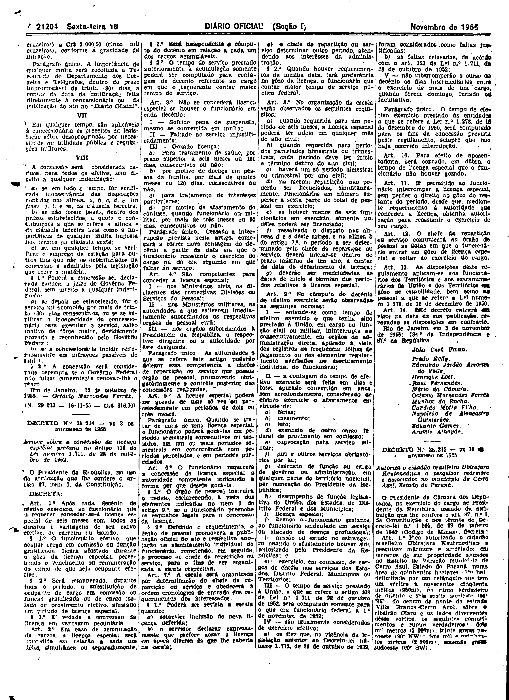

###DEC-038085-0-000-12-10-1955@@@

<strong>DECRETO Nº 38.085, DE 12 DE OUTRUBRO DE 1955.</strong>

<em><strong>Outorga concessão à Rádio Educadora de Parnaíba S.A. para estabelecer uma estação radiodifusora de ondas médias.</strong></em>

<strong>O PRESIDENTE DA REPÚBLICA</strong>, usando da atribuição que lhe confere o artigo 87, nº I, da Constituição, atendendo ao que requereu a Rádio Educadora Parnaíba S. A. e tendo em vista o disposto no art. 5º, nº XII, da mesma Constituição,

<strong>DECRETA:</strong>

<strong>Art</strong>. 1º Fica outorgada concessão à Rádio Educadora de Parnaíba S.A., nos têrmos do art. 11, do Decreto nº 24.655, de 11 de julho de 1934, e art. 16, do Decreto nº 21.111, de 1º de março de 1932, para estabelecer, sem direito de exclusividade, na cidade de Parnaíba, Estado do Piauí, uma estação radiodifusora de ondas médias destinada a executar o serviço de radiodifusão.

Parágrafo único. O contrato decorrente desta concessão obedecerá às cláusulas que com êste baixam, rubricadas pelo Ministro de Estado dos Negócios da Viação e Obras Públicas, e deverá ser assinado dentro de 60 (sessenta) dias, a contar da data da publicação dêste decreto no <em>Diário</em> <em>Oficial</em>, sob pena de ser considerada nula a concessão.

<strong>Art</strong>. 2º Revogam-se as disposições em contrário.

Rio de Janeiro, 12 de outubro de 1955; 134º da Independência e 67º da República.

<strong>JOÃO CAFÉ FILHO</strong>

Octávio Marcondes Ferraz

<!-- fac-simile-oficial:inicio -->

## Fac-símile oficial: cláusulas

O texto acima não inclui as cláusulas a que se refere este decreto. A publicação oficial do anexo está em imagem, nas páginas do _Diário Oficial da União_ (Seção I) de 18 de novembro de 1955: p. 21203 (a partir de «CLÁUSULAS A QUE SE REFERE O DECRETO N.º 38.085, DESTA DATA»); p. 21204 (até «N. 29.033 — 16-11-55 — Cr$ 816,00»).

As imagens são as páginas inteiras, tal como digitalizadas pela Imprensa Nacional, sem recorte, sem redesenho e sem transcrição. Cada página traz também outros atos do mesmo dia; a peça deste decreto está apenas nas colunas indicadas, e o texto do anexo só existe na imagem. Não há OCR validado.

Fonte: Imprensa Nacional, Biblioteca Machado de Assis, arquivo `DO_1_19551118_263.PDF` (SHA-256 `a3954497d17242d61175d6cb89833d23ce5a4f2368efe6fd6510cbb2ce8ee5af`), páginas 3, 4 do PDF. SHA-256 das imagens, na ordem: `d8998941b6f58153a669c355b38123d9ea63b2076fce8da68ea4aaac5dc66507`, `b81cb6c7b22435fa78a5b85ecf2121c426c8ea448a1db9ccfc09da29b6fdf3a2`.

<!-- fac-simile-oficial:fim -->
