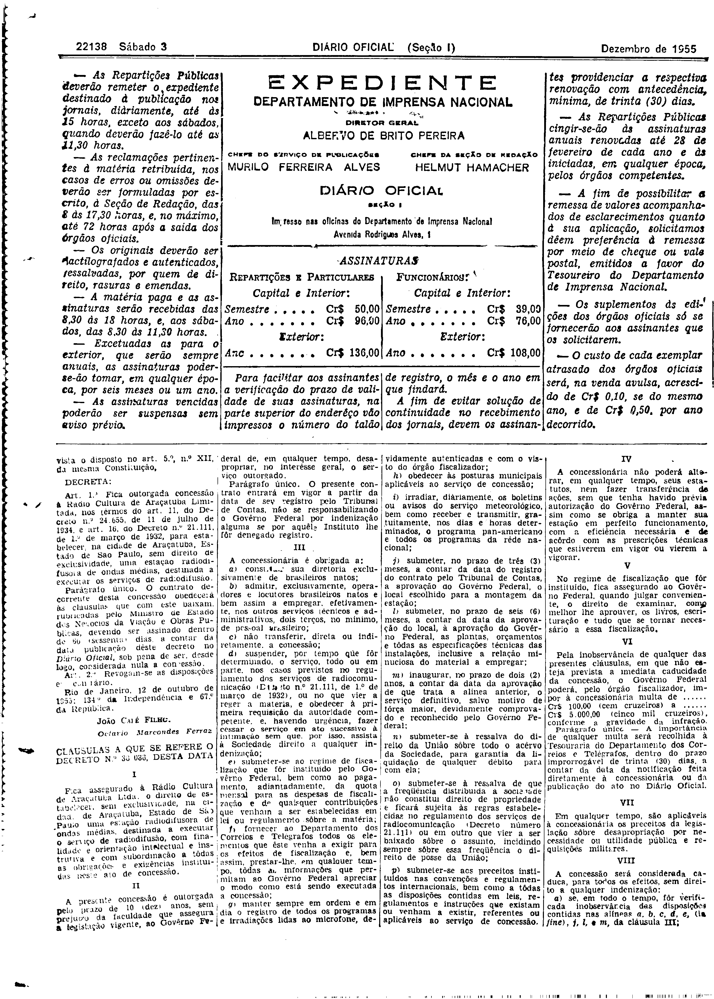

###DEC-038086-0-000-12-10-1955@@@

<strong>DECRETO Nº 38.086, DE 12 DE OUTRUBRO DE 1955.</strong>

<em><strong>Outorga concessão à Rádio Cultura de Araçatuba Ltda. para estabelecer uma estação radiodifusora de ondas médias na cidade de Araçatuba, Estado de São Paulo.</strong></em>

<strong>O PRESIDENTE DA REPÚBLICA</strong>, usando da atribuição que lhe confere o artigo 87, nº I, da Constituição, atendendo ao que requereu a Rádio Cultura de Araçatuba Ltda. e tendo em vista o disposto no art. 5º, nº XII, da mesma Constituição,

<strong>DECRETA:</strong>

<strong>Art</strong>. 1º Fica outorgada concessão à Rádio Cultura de Araçatuba Limitada, nos têrmos do art. 11, do Decreto nº 24.655, de 11 de julho de 1934, e art. 16, do Decreto número 21.111, de 1 de março de 1932, para estabelecer na cidade de Araçatuba, Estado de São Paulo, sem direito de exclusividade, uma estação radiodifusora de ondas médias, destinada a executar os serviços de radiodifusão.

Parágrafo único. O contrato decorrente desta concessão obedecerá às cláusulas que com êste baixam, rubricadas pelo Ministro de Estado dos Negócios da Viação e Obras Públicas, e deverá ser assinado dentro de 60 (sessenta) dias, a contar da data da publicação dêste decreto no <em>Diário</em> <em>Oficial</em>, sob pena de ser considerada nula a concessão.

<strong>Art</strong>. 2º Revogam-se as disposições em contrário.

Rio de Janeiro, 12 de outubro de 1955; 134º da Independência e 67º da República.

<strong>JOÃO CAFÉ FILHO</strong>

Octávio Marcondes Ferraz

<!-- fac-simile-oficial:inicio -->

## Fac-símile oficial: cláusulas

O texto acima não inclui as cláusulas a que se refere este decreto. A publicação oficial do anexo está em imagem, nas páginas do _Diário Oficial da União_ (Seção I) de 3 de dezembro de 1955: página 2 do PDF (a partir de «CLÁUSULAS A QUE SE REFERE O DECRETO N.º 38.086, DESTA DATA»); página 3 do PDF (até «N.º 29.983 — 28-11-55 — Cr$ 816,00»).

As imagens são as páginas inteiras, tal como digitalizadas pela Imprensa Nacional, sem recorte, sem redesenho e sem transcrição. Cada página traz também outros atos do mesmo dia; a peça deste decreto está apenas no trecho indicado, e o texto do anexo só existe na imagem. Não há OCR validado.

Fonte: Imprensa Nacional, Biblioteca Machado de Assis, arquivo `DO_1_19551203_276.PDF` (SHA-256 `6da98ba9b337f94c8072335cab4687f1e300e12ec175c910c7d24f132495c032`), páginas 2, 3 do PDF. SHA-256 das imagens, na ordem: `ecea7be18766930af83632d92a69fd78d0e983a1d95f1e4277698939eebe3781`, `bfd91d57504e4053ea9a6f549c5f844150be491a216ba7ba76a31e75f7d990cf`.

<!-- fac-simile-oficial:fim -->
