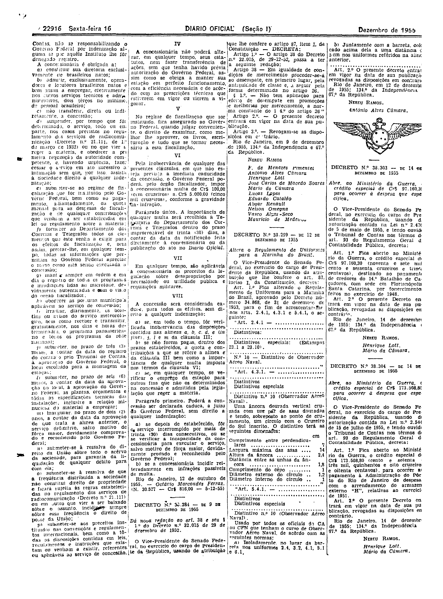

###DEC-038088-0-000-12-10-1955@@@

<strong>DECRETO Nº 38.088, DE 12 DE OUTUBRO DE 1955.</strong>

<!-- fac-simile-oficial:inicio -->

## Fac-símile oficial: decreto e cláusulas

O decreto e as cláusulas são reproduzidos integralmente nas páginas abaixo da edição indicada do Diário Oficial da União. A primeira publicação não foi verificada. As páginas inteiras também contêm matérias vizinhas, que não são atribuídas a este ato. Não há transcrição por OCR.

SHA-256 da imagem: `5487c993749c7ce418174b475a4db2ae9e7fd2e8ec9dedaa2a64d68897d5c1f9`.

Fonte: [DO_1_19551216_286.PDF](https://biblioteca.in.gov.br/documents/271518/581356/DO_1_19551216_286.PDF/24769303-3233-b1aa-4c07-da5ea3f446e8?t=1574964393827&download=true), edição 1955-12-16; SHA-256 do PDF: `dc0f4a9cccce4d2e98caa07cd842e16cd5a26cc6ca8b29da5587261ebdc344e1`.

SHA-256 da imagem: `b091ee33081f5ee5f5b4d3b5f02afc7677f9f70372fb086f74ad0e629162bbae`.

Fonte: [DO_1_19551216_286.PDF](https://biblioteca.in.gov.br/documents/271518/581356/DO_1_19551216_286.PDF/24769303-3233-b1aa-4c07-da5ea3f446e8?t=1574964393827&download=true), edição 1955-12-16; SHA-256 do PDF: `dc0f4a9cccce4d2e98caa07cd842e16cd5a26cc6ca8b29da5587261ebdc344e1`.

<!-- fac-simile-oficial:fim -->
